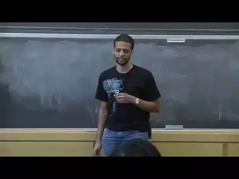
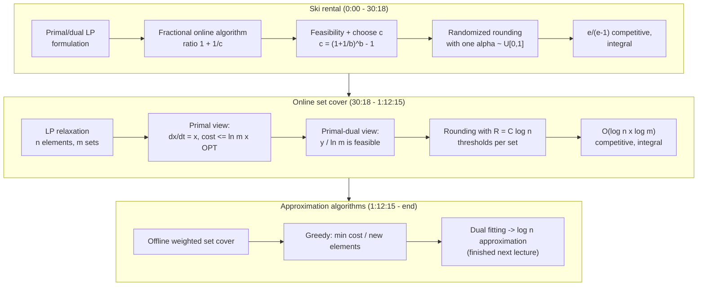

# Advanced Algorithms (COMPSCI 224), Lecture 10

*Harvard University · 1:24:33 · [Watch on YouTube](https://www.youtube.com/watch?v=Jsg9TwLRTbM)*

## Summary

This lecture closes out the **primal-dual method for online algorithms** with two full worked examples and then opens the course's next topic, approximation algorithms. The first half re-derives the classic `e/(e−1)` randomized bound for **ski rental** by building feasible primal and dual LP solutions online and then rounding the fractional solution with a single uniform random threshold. The second half tackles **online set cover**, where a continuous-time multiplicative-growth process on the LP variables gives an `O(log m)`-competitive fractional solution, randomized rounding with `O(log n)` independent thresholds makes it integral, and the same technique — dual fitting — is set up to prove that greedy is a `log n` approximation for offline weighted set cover.

## Topics

1. [Ski rental: goal and LP formulation](./01-ski-rental-and-the-lp-formulation.md) — the model, the target `e/(e−1)` bound, and the primal/dual LPs ([`0:00`](https://www.youtube.com/watch?v=Jsg9TwLRTbM&t=0))
2. [The fractional online algorithm](./02-the-fractional-online-algorithm.md) — the multiplicative update rule and the `1 + 1/c` ratio ([`7:59`](https://www.youtube.com/watch?v=Jsg9TwLRTbM&t=479))
3. [Feasibility and the competitive ratio](./03-feasibility-and-competitive-ratio.md) — geometric increments, choosing `c`, weak duality ([`13:24`](https://www.youtube.com/watch?v=Jsg9TwLRTbM&t=804))
4. [Randomized rounding for ski rental](./04-randomized-rounding-for-ski-rental.md) — one uniform `α`, and why the expected cost equals the primal objective ([`20:01`](https://www.youtube.com/watch?v=Jsg9TwLRTbM&t=1201))
5. [Online set cover: problem, hardness, LPs](./05-online-set-cover-setup.md) — the online model, NP-hardness, and the LP relaxation ([`30:18`](https://www.youtube.com/watch?v=Jsg9TwLRTbM&t=1818))
6. [The purely primal analysis](./06-primal-view-of-set-cover.md) — the `dx/dt = x` evolution and the `ln m · OPT` bound ([`40:29`](https://www.youtube.com/watch?v=Jsg9TwLRTbM&t=2429))
7. [The primal-dual view and dual fitting](./07-primal-dual-view-and-dual-fitting.md) — same algorithm, dual-based proof, scaling `y` by `ln m` ([`53:36`](https://www.youtube.com/watch?v=Jsg9TwLRTbM&t=3216))
8. [Getting an integral online set cover](./08-integral-set-cover-via-randomized-rounding.md) — why one threshold fails and `C·log n` thresholds work ([`1:01:52`](https://www.youtube.com/watch?v=Jsg9TwLRTbM&t=3712))
9. [Approximation algorithms (preview)](./09-approximation-algorithms-preview.md) — offline weighted set cover, greedy, and dual fitting ([`1:12:17`](https://www.youtube.com/watch?v=Jsg9TwLRTbM&t=4337))

## Key takeaways

- A primal-dual online algorithm for ski rental that updates `x ← (1 + 1/b)x + 1/(cb)` achieves competitive ratio `1 + 1/c` with `c = (1 + 1/b)^b − 1`, which equals **2 at `b = 1`** and converges down to **`e/(e−1) ≈ 1.58`** as `b` grows — matching Karlin et al. ('94) by a completely different route ([`1:00`](https://www.youtube.com/watch?v=Jsg9TwLRTbM&t=60), [`2:18`](https://www.youtube.com/watch?v=Jsg9TwLRTbM&t=138), [`18:03`](https://www.youtube.com/watch?v=Jsg9TwLRTbM&t=1083)).
- Rounding that fractional solution with a **single** uniform `α ∈ [0,1]` — buy on the day whose increment `α` lands in — gives an integral randomized algorithm whose expected cost is **exactly** the fractional primal objective `b·x + Σ z_i`, so nothing is lost in the rounding ([`23:29`](https://www.youtube.com/watch?v=Jsg9TwLRTbM&t=1409), [`27:45`](https://www.youtube.com/watch?v=Jsg9TwLRTbM&t=1665)).
- For online set cover, starting every `x_S` at `1/m` and evolving violated constraints by `dx_S/dt = x_S` caps any set's growth at **`ln m` seconds** and the primal objective's growth at **1 per second**, yielding a fractional solution of cost **≤ `ln m · OPT`** ([`48:28`](https://www.youtube.com/watch?v=Jsg9TwLRTbM&t=2908), [`51:17`](https://www.youtube.com/watch?v=Jsg9TwLRTbM&t=3077), [`1:00:40`](https://www.youtube.com/watch?v=Jsg9TwLRTbM&t=3640)).
- Making that solution integral requires **`R = C·log n` independent thresholds per set** rather than one — a single threshold gives expected coverage 1 and genuinely fails on adversarial sequences, while `R` thresholds drive the failure probability to `1/poly(n)` after a union bound, at the cost of an extra `R` factor. The final bound is **`O(log n · log m)`-competitive**, which Alon et al. (SICOMP '09) show is optimal up to `log log` factors ([`1:04:30`](https://www.youtube.com/watch?v=Jsg9TwLRTbM&t=3870), [`1:07:48`](https://www.youtube.com/watch?v=Jsg9TwLRTbM&t=4068), [`1:09:53`](https://www.youtube.com/watch?v=Jsg9TwLRTbM&t=4193), [`52:18`](https://www.youtube.com/watch?v=Jsg9TwLRTbM&t=3138)).
- The recurring technique is named: constructing a deliberately **infeasible** dual whose constraints are violated by a bounded multiplicative factor, then scaling it down to feasibility, is **dual fitting** — and it is what will show offline greedy weighted set cover is a `log n` approximation, matching the `log n` inapproximability barrier ([`1:23:24`](https://www.youtube.com/watch?v=Jsg9TwLRTbM&t=5004), [`1:24:04`](https://www.youtube.com/watch?v=Jsg9TwLRTbM&t=5044), [`1:11:48`](https://www.youtube.com/watch?v=Jsg9TwLRTbM&t=4308)).
