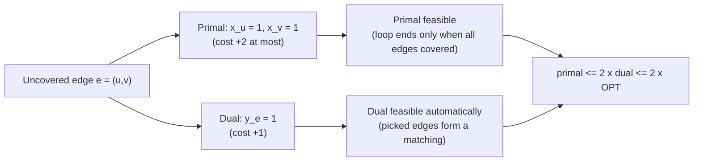

# 3. Vertex Cover: Greedy, LP Rounding, and a Primal-Dual 2-Approximation

## Problem

- Input: undirected graph `G = (V, E)` with `|V| = n`, `|E| = m` ([`15:16`](https://www.youtube.com/watch?v=vnS9_NKoEKI&t=916)).
- Goal: pick a smallest subset `S` of vertices so every edge is incident on at least one vertex of `S` ([`16:20`](https://www.youtube.com/watch?v=vnS9_NKoEKI&t=980)).

## Vertex cover is a special case of set cover

- **Universe = the edges**; **sets = the vertices** (each vertex is the set of edges incident on it) ([`17:09`](https://www.youtube.com/watch?v=vnS9_NKoEKI&t=1029), [`17:52`](https://www.youtube.com/watch?v=vnS9_NKoEKI&t=1072)).
- A student catches a subtlety: the `H_K` set-cover bound is keyed to *set size*, and vertices can have high degree, so it does **not** immediately give 2 here ([`19:35`](https://www.youtube.com/watch?v=vnS9_NKoEKI&t=1175)).
- The right dual statement: if every **element** lies in at most `K` sets, you get a **`K`-approximation** — and every edge lies in exactly 2 vertex-sets ([`20:02`](https://www.youtube.com/watch?v=vnS9_NKoEKI&t=1202)).

## The greedy (combinatorial) algorithm

```
while there exists an uncovered edge e = (u, v):
    add both u and v to the cover
```
([`17:52`](https://www.youtube.com/watch?v=vnS9_NKoEKI&t=1072))

**Claim**: greedy is a **2-approximation** ([`18:33`](https://www.youtube.com/watch?v=vnS9_NKoEKI&t=1113)).

**Classic matching proof** (sketched): the edges picked across the loop's iterations form a **matching**; the returned set has exactly twice that matching's size; and any vertex cover is lower-bounded by the size of any matching ([`18:33`](https://www.youtube.com/watch?v=vnS9_NKoEKI&t=1113), [`19:14`](https://www.youtube.com/watch?v=vnS9_NKoEKI&t=1154)).

## LP formulation

**Primal** ([`20:40`](https://www.youtube.com/watch?v=vnS9_NKoEKI&t=1240), [`21:15`](https://www.youtube.com/watch?v=vnS9_NKoEKI&t=1275)):

- minimize `sum_{v=1..n} x_v`
- subject to `x_u + x_v >= 1` for every edge `e = (u,v)`, and `x >= 0`
- This is essentially the set cover LP ([`21:43`](https://www.youtube.com/watch?v=vnS9_NKoEKI&t=1303)).

**Dual** ([`21:43`](https://www.youtube.com/watch?v=vnS9_NKoEKI&t=1303)):

- maximize `sum_{e in E} y_e`
- subject to `sum_{e containing v} y_e <= 1` for every vertex `v`, and `y >= 0`

## Alternative: LP rounding

1. Solve the primal LP, getting fractional `x` ([`22:32`](https://www.youtube.com/watch?v=vnS9_NKoEKI&t=1352)).
2. For each edge constraint `x_u + x_v >= 1`, at least one of `x_u`, `x_v` is `>= 1/2`; take that vertex ([`22:49`](https://www.youtube.com/watch?v=vnS9_NKoEKI&t=1369), [`23:10`](https://www.youtube.com/watch?v=vnS9_NKoEKI&t=1390)).
3. Rounding at most **doubles** each value, so the cost at most doubles: another 2-approximation ([`23:10`](https://www.youtube.com/watch?v=vnS9_NKoEKI&t=1390), [`23:30`](https://www.youtube.com/watch?v=vnS9_NKoEKI&t=1410)).

**Generalization**: the same threshold rounding gives a **`K`-approximation for set cover** when each element is in at most `K` sets — the constraint has `K` variables summing to `>= 1`, so one of them is `>= 1/K` ([`23:30`](https://www.youtube.com/watch?v=vnS9_NKoEKI&t=1410), [`23:45`](https://www.youtube.com/watch?v=vnS9_NKoEKI&t=1425)).

**Trade-off**: greedy is fast because it never solves an LP; LP rounding is slower. This is why the combinatorial algorithm deserves its own primal-dual analysis ([`22:32`](https://www.youtube.com/watch?v=vnS9_NKoEKI&t=1352), [`23:59`](https://www.youtube.com/watch?v=vnS9_NKoEKI&t=1439)).

## Primal-dual analysis of greedy

When greedy covers edge `e = (u,v)` ([`24:28`](https://www.youtube.com/watch?v=vnS9_NKoEKI&t=1468)):

- set `x_u = 1` and `x_v = 1`;
- set `y_e = 1`.

Key points:

- This is **pure primal-dual, not dual fitting** — dual feasibility comes out automatically, with no rescaling ([`24:28`](https://www.youtube.com/watch?v=vnS9_NKoEKI&t=1468)).
- Both solutions are feasible; each unit of dual increase raises the primal by **at most 2** (only 1 if a vertex was already taken) ([`25:09`](https://www.youtube.com/watch?v=vnS9_NKoEKI&t=1509)).
- Therefore `primal cost <= 2 * dual cost <= 2 * OPT` — a 2-approximation ([`25:44`](https://www.youtube.com/watch?v=vnS9_NKoEKI&t=1544)).



## Homework preview: weighted vertex cover

- On the problem set the vertices carry weights: minimize `sum_v c_v * x_v` ([`25:44`](https://www.youtube.com/watch?v=vnS9_NKoEKI&t=1544)).
- Open question posed to students: should you still take **both** endpoints? Probably not when one is far cheaper — reasoning about primal *and* dual together suggests the right modification ([`26:15`](https://www.youtube.com/watch?v=vnS9_NKoEKI&t=1575)).
