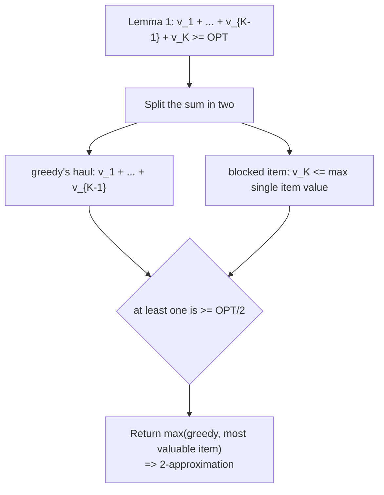

# 7. A Modified Greedy 2-Approximation for Knapsack

## The naive greedy, and why it fails

**Attempt**: sort items by `v_i / w_i` and keep taking them until nothing else fits ([`1:06:17`](https://www.youtube.com/watch?v=vnS9_NKoEKI&t=3977)).

**Failure mode** (raised by a student): a tiny item with a marginally better ratio can block a heavy, very valuable item ([`1:07:17`](https://www.youtube.com/watch?v=vnS9_NKoEKI&t=4037)).

**Concrete bad instance** ([`1:07:53`](https://www.youtube.com/watch?v=vnS9_NKoEKI&t=4073)):

| Item | Value | Weight | Ratio |
| --- | --- | --- | --- |
| 1 | `2` | `1` | `2` |
| 2 | `W` | `W` | `1` |

- Greedy takes item 1 first (better ratio), then item 2 no longer fits → value `2`.
- OPT takes item 2 alone → value `W`.
- The gap is essentially **unbounded**: no better than a `W`-approximation, and the `2` could be shrunk to `1 + epsilon` ([`1:07:53`](https://www.youtube.com/watch?v=vnS9_NKoEKI&t=4073), [`1:08:35`](https://www.youtube.com/watch?v=vnS9_NKoEKI&t=4115)).

## The fix

Return the **better of two candidates** ([`1:09:29`](https://www.youtube.com/watch?v=vnS9_NKoEKI&t=4169)):

1. the output of greedy, or
2. the single **most valuable item**.

Assumption: items with weight greater than `W` are pre-filtered — there is no reason to acknowledge their existence ([`1:09:29`](https://www.youtube.com/watch?v=vnS9_NKoEKI&t=4169)).

**Claim**: this modified greedy is a **2-approximation** ([`1:09:58`](https://www.youtube.com/watch?v=vnS9_NKoEKI&t=4198)).

## Lemma 1 — the workhorse

Suppose greedy takes items in ratio order `v_1/w_1 >= v_2/w_2 >= ... >= v_{K-1}/w_{K-1}`, and then there is **no room for the K-th item**. Then

`sum_{i=1..K} v_i >= OPT`

([`1:09:58`](https://www.youtube.com/watch?v=vnS9_NKoEKI&t=4198), [`1:11:03`](https://www.youtube.com/watch?v=vnS9_NKoEKI&t=4263)).

**Proof** ([`1:13:16`](https://www.youtube.com/watch?v=vnS9_NKoEKI&t=4396), [`1:14:05`](https://www.youtube.com/watch?v=vnS9_NKoEKI&t=4445), [`1:14:25`](https://www.youtube.com/watch?v=vnS9_NKoEKI&t=4465)):

1. The **fractional** optimum takes items `1..K-1` whole and some fraction (`< 1`) of item `K`.
2. `sum_{i=1..K} v_i` exceeds that, because it counts item `K` in full rather than fractionally.
3. Integral OPT `<=` fractional OPT `<= sum_{i=1..K} v_i` ([`1:15:07`](https://www.youtube.com/watch?v=vnS9_NKoEKI&t=4507)).

## From the lemma to the 2-approximation

The 2-approximation follows immediately ([`1:11:50`](https://www.youtube.com/watch?v=vnS9_NKoEKI&t=4310)):

- Write `sum_{i=1..K} v_i = (v_1 + ... + v_{K-1}) + v_K >= OPT`.
- So **one of the two terms is at least `OPT/2`** ([`1:12:38`](https://www.youtube.com/watch?v=vnS9_NKoEKI&t=4358), [`1:13:16`](https://www.youtube.com/watch?v=vnS9_NKoEKI&t=4396)).
- The first term is what greedy collects; the second is bounded by the most valuable single item. Taking the better of the two candidates therefore gets at least `OPT/2`.

