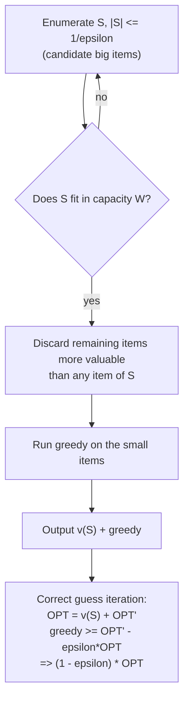

# 8. A PTAS for Knapsack

The `1 + epsilon` scheme is built from Lemma 1 plus two observations ([`1:15:07`](https://www.youtube.com/watch?v=vnS9_NKoEKI&t=4507)).

## Observation 1 — greedy is near-optimal when no item is big

> If **no item has value greater than `epsilon * OPT`**, then greedy alone achieves at least `(1 - epsilon) * OPT` ([`1:15:07`](https://www.youtube.com/watch?v=vnS9_NKoEKI&t=4507)).

Why: by Lemma 1, greedy collects the first `K-1` items and misses only the `K`-th; if that item is worth at most `epsilon * OPT`, then the first `K-1` are worth at least `(1 - epsilon) * OPT` ([`1:16:51`](https://www.youtube.com/watch?v=vnS9_NKoEKI&t=4611), [`1:17:12`](https://www.youtube.com/watch?v=vnS9_NKoEKI&t=4632)).

## Observation 2 — there are few big items

At most `1/epsilon` items **in the optimal solution** can have value greater than `epsilon * OPT` — otherwise their total would already exceed `OPT` ([`1:17:12`](https://www.youtube.com/watch?v=vnS9_NKoEKI&t=4632), [`1:17:50`](https://www.youtube.com/watch?v=vnS9_NKoEKI&t=4670)).

## The algorithm — guess the big items, greed the rest

Since `epsilon` is a constant, the exponent may depend on it however it likes ([`1:18:18`](https://www.youtube.com/watch?v=vnS9_NKoEKI&t=4698)):

1. **Guess** (i.e. enumerate) a set `S` of at most `1/epsilon` items — the intended set of optimal-solution items with value `> epsilon * OPT` ([`1:18:18`](https://www.youtube.com/watch?v=vnS9_NKoEKI&t=4698), [`1:19:13`](https://www.youtube.com/watch?v=vnS9_NKoEKI&t=4753)).
2. Check `S` fits in the knapsack; if not, continue to the next guess. Otherwise put `S` in the output ([`1:19:13`](https://www.youtube.com/watch?v=vnS9_NKoEKI&t=4753), [`1:19:47`](https://www.youtube.com/watch?v=vnS9_NKoEKI&t=4787)).
3. **Remove** every remaining item whose value exceeds that of any item in `S` — consistent with `S` being the set of big items ([`1:19:47`](https://www.youtube.com/watch?v=vnS9_NKoEKI&t=4787), [`1:20:20`](https://www.youtube.com/watch?v=vnS9_NKoEKI&t=4820)).
4. **Run greedy** on what remains ([`1:20:20`](https://www.youtube.com/watch?v=vnS9_NKoEKI&t=4820)).

**Running time**: about `n^{1/epsilon + 1}`, stated loosely as `O(m^{1/epsilon} * poly(n, m))` — polynomial for fixed `epsilon`, so this is a PTAS (not an FPTAS) ([`1:20:44`](https://www.youtube.com/watch?v=vnS9_NKoEKI&t=4844)).

## Correctness: profit `>= (1 - epsilon) * OPT`

Consider the iteration where `S` is guessed **correctly** ([`1:21:28`](https://www.youtube.com/watch?v=vnS9_NKoEKI&t=4888)):

- Decompose `OPT = v(S) + OPT'`, where `OPT'` is the best packing of the *small* items (those no more valuable than any item of `S`) ([`1:22:08`](https://www.youtube.com/watch?v=vnS9_NKoEKI&t=4928)).
- The algorithm achieves `v(S) + greedy`, so it suffices to show `greedy >= OPT' - epsilon * OPT` ([`1:22:38`](https://www.youtube.com/watch?v=vnS9_NKoEKI&t=4958)).
- Let `v_K` be the first item greedy could not fit. Because the big items were filtered out, `v_K <= epsilon * OPT` ([`1:23:04`](https://www.youtube.com/watch?v=vnS9_NKoEKI&t=4984), [`1:23:34`](https://www.youtube.com/watch?v=vnS9_NKoEKI&t=5014)).
- Lemma 1 on the filtered instance gives `greedy + v_K >= OPT'` ([`1:23:34`](https://www.youtube.com/watch?v=vnS9_NKoEKI&t=5014)).
- Combining: `greedy >= OPT' - epsilon * OPT`, so the total is at least `(1 - epsilon) * OPT` ([`1:24:20`](https://www.youtube.com/watch?v=vnS9_NKoEKI&t=5060)).

## Course logistics announced at the end

- Next lecture: an **FPTAS for knapsack** and an FPTAS for another problem ([`1:24:20`](https://www.youtube.com/watch?v=vnS9_NKoEKI&t=5060)).
- The lecturer will be away the following week: **two guest lectures**, Tuesday and Thursday; no in-person office hours, but Google Hangout by email request ([`1:24:20`](https://www.youtube.com/watch?v=vnS9_NKoEKI&t=5060), [`1:25:04`](https://www.youtube.com/watch?v=vnS9_NKoEKI&t=5104), [`1:25:21`](https://www.youtube.com/watch?v=vnS9_NKoEKI&t=5121)).
- **Problem set 4** is out that night ([`1:25:21`](https://www.youtube.com/watch?v=vnS9_NKoEKI&t=5121)).
