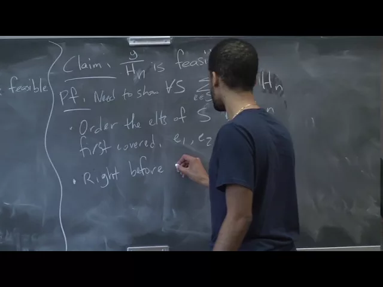
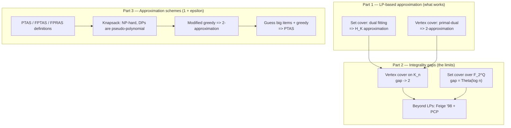

# Advanced Algorithms (COMPSCI 224), Lecture 11

*Harvard University · 1:25:41 · https://www.youtube.com/watch?v=vnS9_NKoEKI*

## Summary

A Harvard graduate lecture on LP-based approximation algorithms, in three movements. It first completes the **dual fitting** analysis of greedy set cover (proving an `H_K` bound) and gives a clean **primal-dual** 2-approximation for vertex cover. It then turns to the **limits** of the LP framework, defining the *integrality gap* and exhibiting two concrete gap instances — the complete graph for vertex cover (gap → 2) and an `F_2^Q` construction for set cover (gap `Θ(log n)`) — plus Feige's NP-hardness barrier. Finally it defines **PTAS / FPTAS / FPRAS** and builds a full PTAS for knapsack, starting from a modified greedy 2-approximation.

**Classification**: educational video (university lecture, proof-driven, with live Q&A that corrects and refines several statements).

## Topics

1. [Lecture Overview and Set Cover Recap](./01-lecture-overview-and-set-cover-recap.md) — agenda, the weighted set cover problem, the greedy price-ratio rule, and history ([`0:00`](https://www.youtube.com/watch?v=vnS9_NKoEKI&t=0))
2. [Dual Fitting Analysis of Greedy Set Cover](./02-dual-fitting-analysis-of-greedy-set-cover.md) — the primal/dual LPs, the price vector, and the `H_K` proof ([`4:23`](https://www.youtube.com/watch?v=vnS9_NKoEKI&t=263))
3. [Vertex Cover: Greedy, LP Rounding, and a Primal-Dual 2-Approximation](./03-vertex-cover-primal-dual-2-approximation.md) — three routes to the factor of 2 ([`15:16`](https://www.youtube.com/watch?v=vnS9_NKoEKI&t=916))
4. [Integrality Gaps: The Limit of an LP Relaxation](./04-integrality-gaps.md) — definition, two gap instances, and the hardness barrier beyond LPs ([`26:37`](https://www.youtube.com/watch?v=vnS9_NKoEKI&t=1597))
5. [Approximation Schemes: PTAS, FPTAS, FPRAS](./05-approximation-schemes-ptas-fptas-fpras.md) — the three definitions and the `1/3` failure-probability digression ([`45:32`](https://www.youtube.com/watch?v=vnS9_NKoEKI&t=2732))
6. [The Knapsack Problem and Its Exact Algorithms](./06-knapsack-problem-and-exact-algorithms.md) — fractional greedy, two DPs, and pseudo-polynomial time ([`56:21`](https://www.youtube.com/watch?v=vnS9_NKoEKI&t=3381))
7. [A Modified Greedy 2-Approximation for Knapsack](./07-modified-greedy-2-approximation-for-knapsack.md) — why naive greedy fails, and Lemma 1 ([`1:06:17`](https://www.youtube.com/watch?v=vnS9_NKoEKI&t=3977))
8. [A PTAS for Knapsack](./08-ptas-for-knapsack.md) — guess the big items, greed the rest ([`1:15:07`](https://www.youtube.com/watch?v=vnS9_NKoEKI&t=4507))

## Key takeaways

- **Dual fitting proves greedy set cover is an `H_K` approximation, not merely `H_n`**: charging each newly covered element a price `c_S / (new elements covered)` gives a dual `y` with `cost(x) = cost(y)`, and `y / H_n` is dual-feasible. The proof actually bounds `sum_{e in S} y_e <= c_S * H_K` where `K = |S|`, so if all sets have size at most `K`, greedy is a `log K` approximation ([`14:28`](https://www.youtube.com/watch?v=vnS9_NKoEKI&t=868), [`14:56`](https://www.youtube.com/watch?v=vnS9_NKoEKI&t=896)).
- **Vertex cover admits a 2-approximation three ways**, and the primal-dual route needs no rescaling at all: setting `x_u = x_v = 1` and `y_e = 1` per covered edge keeps *both* solutions feasible automatically, with the primal rising by at most 2 per unit of dual — pure primal-dual, not dual fitting ([`24:28`](https://www.youtube.com/watch?v=vnS9_NKoEKI&t=1468), [`25:44`](https://www.youtube.com/watch?v=vnS9_NKoEKI&t=1544)). LP rounding at threshold `1/2` gives the same factor and generalizes to a `K`-approximation for set cover when each element lies in at most `K` sets ([`23:30`](https://www.youtube.com/watch?v=vnS9_NKoEKI&t=1410)).
- **Those factors are not artifacts of weak analysis — the LP relaxations themselves are that lossy.** On `K_n`, the LP puts `1/2` on every vertex for cost `n/2` while the integer optimum is `n - 1`, a ratio tending to 2 ([`31:34`](https://www.youtube.com/watch?v=vnS9_NKoEKI&t=1894), [`32:47`](https://www.youtube.com/watch?v=vnS9_NKoEKI&t=1967)). For set cover over the nonzero vectors of `F_2^Q` with `n = 2^Q - 1`, every element lies in exactly half the sets, so `x_S = 2/m` costs only `2` fractionally, while a linear-algebra argument forces at least `Q ≈ log n` sets integrally ([`41:21`](https://www.youtube.com/watch?v=vnS9_NKoEKI&t=2481), [`44:55`](https://www.youtube.com/watch?v=vnS9_NKoEKI&t=2695)).
- **Beyond LP barriers, set cover is hard to approximate outright**: Feige (1998) showed that beating `ln n` would let you solve SAT in `n^{log log n}` time, far below the exponential time of the best known SAT algorithms — a PCP-theorem result outside this course's machinery ([`47:37`](https://www.youtube.com/watch?v=vnS9_NKoEKI&t=2857), [`47:55`](https://www.youtube.com/watch?v=vnS9_NKoEKI&t=2875)).
- **Knapsack's DPs run in `O(nW)` and `O(nV)`, which is pseudo-polynomial, not polynomial** — the input encodes `W` in `log W` bits, so genuine polynomial time means `poly(n, log W)`, which is why NP-hardness is not contradicted ([`1:01:48`](https://www.youtube.com/watch?v=vnS9_NKoEKI&t=3708), [`1:03:44`](https://www.youtube.com/watch?v=vnS9_NKoEKI&t=3824), [`1:04:12`](https://www.youtube.com/watch?v=vnS9_NKoEKI&t=3852)).
- **Naive ratio-greedy on knapsack can be off by a factor of `W`** (items `(v=2, w=1)` and `(v=W, w=W)`: greedy gets `2`, OPT gets `W`), but returning the better of greedy and the single most valuable item is a **2-approximation**, and the same Lemma 1 upgrades to a full **PTAS** in time `~n^{1/epsilon + 1}` by enumerating the `<= 1/epsilon` big items and greeding the rest ([`1:07:53`](https://www.youtube.com/watch?v=vnS9_NKoEKI&t=4073), [`1:09:29`](https://www.youtube.com/watch?v=vnS9_NKoEKI&t=4169), [`1:20:44`](https://www.youtube.com/watch?v=vnS9_NKoEKI&t=4844), [`1:24:20`](https://www.youtube.com/watch?v=vnS9_NKoEKI&t=5060)).
