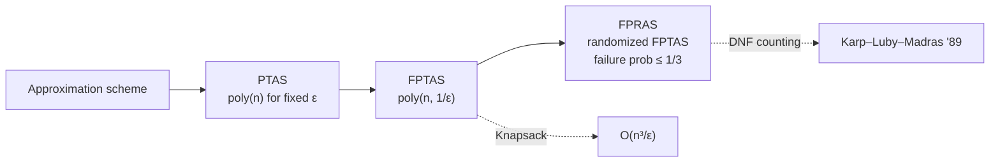

# 1. Lecture roadmap and course logistics

## Logistics

- Two guest lectures next week (Tuesday and Thursday); the **Thursday lecture will not be recorded**, so attendance in person is required to see it [`0:02`](https://www.youtube.com/watch?v=2Gl-yNso0_0&t=2).
- This session wraps up the approximation-algorithms block of the course [`0:02`](https://www.youtube.com/watch?v=2Gl-yNso0_0&t=2).

## Three-part agenda

1. **Finish FPTAS** — apply it to Knapsack [`0:28`](https://www.youtube.com/watch?v=2Gl-yNso0_0&t=28).
2. **FPRAS** — apply it to DNF counting [`0:28`](https://www.youtube.com/watch?v=2Gl-yNso0_0&t=28).
3. **Semidefinite programming** — with Max-Cut as the application [`0:28`](https://www.youtube.com/watch?v=2Gl-yNso0_0&t=28), [`1:08`](https://www.youtube.com/watch?v=2Gl-yNso0_0&t=68).

## PTAS vs. FPTAS (the distinction driving part 1)

- **PTAS**: for any *fixed* ε you get a `1 ± ε` approximation in time polynomial in `n` — but only when ε is treated as a constant [`1:08`](https://www.youtube.com/watch?v=2Gl-yNso0_0&t=68).
- **FPTAS**: the running time must additionally be polynomial in `1/ε` [`1:41`](https://www.youtube.com/watch?v=2Gl-yNso0_0&t=101).
- Last lecture established a PTAS for Knapsack; today upgrades it to an FPTAS running in `O(n³/ε)` for a `(1 − ε)`-approximation [`1:41`](https://www.youtube.com/watch?v=2Gl-yNso0_0&t=101).

## Approximation-scheme hierarchy

