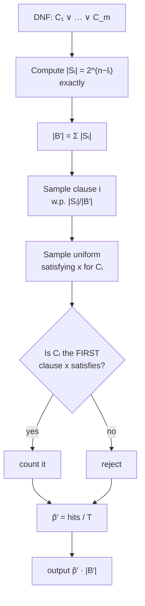

# 5. The Karp–Luby–Madras FPRAS for DNF counting

## The naive algorithm and why it fails

- Setup: `n` variables, `m` clauses; let a `p` fraction of the `2ⁿ` assignments satisfy the formula. The goal is to estimate `p` [`33:36`](https://www.youtube.com/watch?v=2Gl-yNso0_0&t=2016), [`34:20`](https://www.youtube.com/watch?v=2Gl-yNso0_0&t=2060).
- Naive: sample uniformly random assignments, check satisfaction, take the empirical fraction [`34:20`](https://www.youtube.com/watch?v=2Gl-yNso0_0&t=2060).
- **Failure mode**: if `p` is tiny — e.g. the formula `x₁ ∧ x₂ ∧ … ∧ xₙ` has exactly one satisfying assignment, so `p = 1/2ⁿ` — you need exponentially many samples before seeing a hit, and you conclude the answer is zero [`35:02`](https://www.youtube.com/watch?v=2Gl-yNso0_0&t=2102), [`35:24`](https://www.youtube.com/watch?v=2Gl-yNso0_0&t=2124), [`35:46`](https://www.youtube.com/watch?v=2Gl-yNso0_0&t=2146).
- **The trick**: rig the sample space so that the success probability is not too small [`36:10`](https://www.youtube.com/watch?v=2Gl-yNso0_0&t=2170).

## The enlarged universe

- `Sᵢ` = set of assignments satisfying clause `Cᵢ` [`36:10`](https://www.youtube.com/watch?v=2Gl-yNso0_0&t=2170).
- `B = ⋃ᵢ Sᵢ` — the target; we want `|B|` up to `1 ± ε` [`36:54`](https://www.youtube.com/watch?v=2Gl-yNso0_0&t=2214).
- `B′ = { (i, x) : x satisfies Cᵢ }` — the **disjoint union** of the `Sᵢ`. Each satisfying assignment appears once per clause it satisfies [`37:33`](https://www.youtube.com/watch?v=2Gl-yNso0_0&t=2253), [`38:25`](https://www.youtube.com/watch?v=2Gl-yNso0_0&t=2305).

**`|B′|` is computable exactly and fast** [`39:50`](https://www.youtube.com/watch?v=2Gl-yNso0_0&t=2390), [`40:57`](https://www.youtube.com/watch?v=2Gl-yNso0_0&t=2457):

```
|B′| = Σᵢ |Sᵢ|,   where  |Sᵢ| = 2^(n − #literals in Cᵢ)
```

because the clause's own literals are forced and every other variable is free [`40:22`](https://www.youtube.com/watch?v=2Gl-yNso0_0&t=2422).

## Estimating the ratio instead

- Estimate `p′ = |B| / |B′|`, then output `p̃′ · |B′|` [`40:57`](https://www.youtube.com/watch?v=2Gl-yNso0_0&t=2457).
- **Key bound: `p′ ≥ 1/m`.** Every assignment in `B` appears at least once and at most `m` times in `B′`, so `|B′| ≤ m·|B|` [`41:27`](https://www.youtube.com/watch?v=2Gl-yNso0_0&t=2487), [`41:57`](https://www.youtube.com/watch?v=2Gl-yNso0_0&t=2517).
- This is exactly what the naive approach lacked [`42:19`](https://www.youtube.com/watch?v=2Gl-yNso0_0&t=2539).

## Making "is it in `B`?" well-typed — the canonical-representative bijection

- Type mismatch: an element of `B` is an `n`-bit string; an element of `B′` is a bit string plus an index in `[m]`. Also, *every* element of `B′` trivially satisfies the DNF, so a naive membership test would always say yes [`44:27`](https://www.youtube.com/watch?v=2Gl-yNso0_0&t=2667), [`44:52`](https://www.youtube.com/watch?v=2Gl-yNso0_0&t=2692).
- **Fix**: bijectively map `B` into the subset `{ (i, x) ∈ B′ : Cᵢ is the *first* clause that x satisfies }` [`45:19`](https://www.youtube.com/watch?v=2Gl-yNso0_0&t=2719), [`45:45`](https://www.youtube.com/watch?v=2Gl-yNso0_0&t=2745), [`46:14`](https://www.youtube.com/watch?v=2Gl-yNso0_0&t=2774).
- Each satisfying assignment is now counted exactly once, and the test is cheap: run `x` through every clause and confirm `i` is the first hit [`46:14`](https://www.youtube.com/watch?v=2Gl-yNso0_0&t=2774).

## Sampling uniformly from `B′`

Two steps [`48:25`](https://www.youtube.com/watch?v=2Gl-yNso0_0&t=2905), [`48:47`](https://www.youtube.com/watch?v=2Gl-yNso0_0&t=2927), [`49:14`](https://www.youtube.com/watch?v=2Gl-yNso0_0&t=2954):

1. Pick clause `i` **not uniformly** but with probability `|Sᵢ| / Σⱼ |Sⱼ|` [`48:47`](https://www.youtube.com/watch?v=2Gl-yNso0_0&t=2927).
2. Pick a uniformly random satisfying assignment for `Cᵢ`: force the clause's literals, choose every other variable uniformly at random [`49:14`](https://www.youtube.com/watch?v=2Gl-yNso0_0&t=2954), [`50:35`](https://www.youtube.com/watch?v=2Gl-yNso0_0&t=3035).

This yields a uniformly random element of `B′`, and all the `|Sᵢ|` values needed are computable in closed form [`49:14`](https://www.youtube.com/watch?v=2Gl-yNso0_0&t=2954), [`50:13`](https://www.youtube.com/watch?v=2Gl-yNso0_0&t=3013).

- Housekeeping: any clause containing both `x` and `¬x` can be discarded, since it is never satisfiable [`50:13`](https://www.youtube.com/watch?v=2Gl-yNso0_0&t=3013).

## Final algorithm

1. Sample `T` elements from `B′` [`51:20`](https://www.youtube.com/watch?v=2Gl-yNso0_0&t=3080).
2. Let `p̃′` = fraction of those `T` samples that are canonical (i.e. "in `B`") [`51:20`](https://www.youtube.com/watch?v=2Gl-yNso0_0&t=3080).
3. Output `p̃′ · |B′|` [`51:20`](https://www.youtube.com/watch?v=2Gl-yNso0_0&t=3080).



## Analysis via Chernoff

- Let `Xⱼ = 1` if the `j`-th sample lies in `B`, and `X = Σⱼ Xⱼ`; by linearity `E[X] = p′·T` [`52:46`](https://www.youtube.com/watch?v=2Gl-yNso0_0&t=3166), [`53:24`](https://www.youtube.com/watch?v=2Gl-yNso0_0&t=3204).
- Failure means `|X − E[X]| > ε·E[X]`; Chernoff bounds this by `2·e^(−ε²μ/c)` for a small constant `c` (3 or 4), with `μ = p′T` [`53:24`](https://www.youtube.com/watch?v=2Gl-yNso0_0&t=3204), [`54:00`](https://www.youtube.com/watch?v=2Gl-yNso0_0&t=3240).
- This drops below `δ` once

```
T ≳ log(1/δ) / (p′ · ε²)
```

  [`54:36`](https://www.youtube.com/watch?v=2Gl-yNso0_0&t=3276).
- Substituting `p′ ≥ 1/m` gives the **polynomial sample count**

```
T = O( m · log(1/δ) / ε² )
```

  [`54:36`](https://www.youtube.com/watch?v=2Gl-yNso0_0&t=3276), [`55:42`](https://www.youtube.com/watch?v=2Gl-yNso0_0&t=3342).
- Contrast: the identical Chernoff argument on the naive sampler would need `~2ⁿ` samples because `p` can be that small [`55:18`](https://www.youtube.com/watch?v=2Gl-yNso0_0&t=3318).
- Sampling and membership-checking are both polynomial per sample, so the whole thing is polynomial time — an FPRAS for DNF counting [`55:42`](https://www.youtube.com/watch?v=2Gl-yNso0_0&t=3342), [`56:03`](https://www.youtube.com/watch?v=2Gl-yNso0_0&t=3363).
