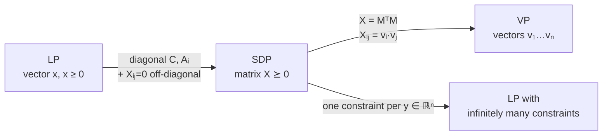

# 6. Semidefinite programming (SDP) and vector programming

## Framing

- Algorithms for actually *solving* LPs have not been covered yet; they come after next week's guest lectures. For now, solvability is taken as a black box — and the same black-box assumption is extended to SDPs [`56:53`](https://www.youtube.com/watch?v=2Gl-yNso0_0&t=3413).

## The SDP form

LP solves for a vector `x`; SDP solves for an `n × n` matrix `X` [`57:22`](https://www.youtube.com/watch?v=2Gl-yNso0_0&t=3442), [`58:01`](https://www.youtube.com/watch?v=2Gl-yNso0_0&t=3481):

```
minimize    tr(Cᵀ X)
subject to  tr(Aᵢᵀ X) = bᵢ    for i = 1…m
            X ⪰ 0             (positive semidefinite)
```

[`58:01`](https://www.youtube.com/watch?v=2Gl-yNso0_0&t=3481), [`58:22`](https://www.youtube.com/watch?v=2Gl-yNso0_0&t=3502), [`58:47`](https://www.youtube.com/watch?v=2Gl-yNso0_0&t=3527), [`59:07`](https://www.youtube.com/watch?v=2Gl-yNso0_0&t=3547).

- The PSD constraint is what replaces LP's coordinatewise non-negativity constraints [`58:47`](https://www.youtube.com/watch?v=2Gl-yNso0_0&t=3527).
- **Solvability**: SDPs can be solved to `L` bits of precision in time poly(`n`, `m`, `L`) — reference given: *Semidefinite Programming* by Vandenberghe and Boyd [`59:48`](https://www.youtube.com/watch?v=2Gl-yNso0_0&t=3588), [`1:00:58`](https://www.youtube.com/watch?v=2Gl-yNso0_0&t=3658).

## Reading the trace as an inner product

- Fact (a direct computation): `tr(AᵀB) = Σ_{i,j} Aᵢⱼ Bᵢⱼ` [`1:00:58`](https://www.youtube.com/watch?v=2Gl-yNso0_0&t=3658), [`1:01:34`](https://www.youtube.com/watch?v=2Gl-yNso0_0&t=3694).
- So an SDP *is* an LP over `n²`-dimensional vectors — objective `cᵀx`, constraints `aᵢ·x = bᵢ` — plus the one genuinely matrix-specific constraint that the reshaped `n × n` matrix be PSD [`1:01:34`](https://www.youtube.com/watch?v=2Gl-yNso0_0&t=3694), [`1:02:10`](https://www.youtube.com/watch?v=2Gl-yNso0_0&t=3730).

## PSD: definition and equivalent characterizations

**Definition**: symmetric `X` is PSD if `yᵀXy ≥ 0` for all `y ∈ ℝⁿ` [`1:02:10`](https://www.youtube.com/watch?v=2Gl-yNso0_0&t=3730), [`1:02:48`](https://www.youtube.com/watch?v=2Gl-yNso0_0&t=3768).

For symmetric `n × n` matrices, the following are equivalent [`1:03:53`](https://www.youtube.com/watch?v=2Gl-yNso0_0&t=3833), [`1:04:42`](https://www.youtube.com/watch?v=2Gl-yNso0_0&t=3882):

- **(a)** `X` is PSD.
- **(b)** All eigenvalues of `X` are non-negative (a real symmetric matrix is diagonalizable with a full set of real eigenvalues — the **spectral theorem**).
- **(c)** `X = MᵀM` for some real matrix `M`.

These are standard linear-algebra facts; look up the spectral theorem [`1:04:42`](https://www.youtube.com/watch?v=2Gl-yNso0_0&t=3882).

## LP ⊂ SDP, and SDP as an infinite LP

**LP is a special case of SDP** [`1:06:26`](https://www.youtube.com/watch?v=2Gl-yNso0_0&t=3986), [`1:06:58`](https://www.youtube.com/watch?v=2Gl-yNso0_0&t=4018), [`1:07:25`](https://www.youtube.com/watch?v=2Gl-yNso0_0&t=4045):

- Make `C` diagonal with `c₁…cₙ`, and each `Aᵢ` diagonal with `aᵢ₁…aᵢₙ` [`1:06:58`](https://www.youtube.com/watch?v=2Gl-yNso0_0&t=4018), [`1:07:25`](https://www.youtube.com/watch?v=2Gl-yNso0_0&t=4045).
- Add constraints forcing `Xᵢⱼ = 0` for `i ≠ j` [`1:07:25`](https://www.youtube.com/watch?v=2Gl-yNso0_0&t=4045).
- For a diagonal matrix, PSD ⇔ all eigenvalues ≥ 0 ⇔ all diagonal entries ≥ 0 — exactly LP's non-negativity [`1:07:25`](https://www.youtube.com/watch?v=2Gl-yNso0_0&t=4045).

**Conversely**, an SDP is an LP with *infinitely many* constraints: one constraint `tr((yyᵀ)ᵀX) ≥ 0` per vector `y`. Correct, but a very big LP [`1:08:07`](https://www.youtube.com/watch?v=2Gl-yNso0_0&t=4087), [`1:08:26`](https://www.youtube.com/watch?v=2Gl-yNso0_0&t=4106).

## SDP ≡ vector programming (VP)

- Since `X ⪰ 0` ⇔ `X = MᵀM`, `X` is a **Gram matrix** of the columns `v₁…vₙ` of `M`, i.e. `Xᵢⱼ = vᵢ · vⱼ` [`1:09:08`](https://www.youtube.com/watch?v=2Gl-yNso0_0&t=4148), [`1:09:35`](https://www.youtube.com/watch?v=2Gl-yNso0_0&t=4175), [`1:09:59`](https://www.youtube.com/watch?v=2Gl-yNso0_0&t=4199).
- Substituting: `tr(CᵀX) = Σ_{i,j} Cᵢⱼ (vᵢ·vⱼ)`, and likewise for the constraints [`1:09:59`](https://www.youtube.com/watch?v=2Gl-yNso0_0&t=4199), [`1:10:24`](https://www.youtube.com/watch?v=2Gl-yNso0_0&t=4224).
- **Vector programming**: linear programming where the variables are dot products [`1:10:24`](https://www.youtube.com/watch?v=2Gl-yNso0_0&t=4224):

```
minimize    Σ_{i,j} cᵢⱼ (vᵢ · vⱼ)
subject to  Σ_{i,j} a^k_{ij} (vᵢ · vⱼ) = b_k   for k = 1…m
```

  [`1:10:24`](https://www.youtube.com/watch?v=2Gl-yNso0_0&t=4224), [`1:11:13`](https://www.youtube.com/watch?v=2Gl-yNso0_0&t=4273).
- No PSD constraint is needed in VP — using vector dot products already encodes it. Since SDP is solvable efficiently, so is VP [`1:10:24`](https://www.youtube.com/watch?v=2Gl-yNso0_0&t=4224).


