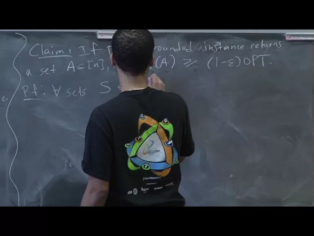
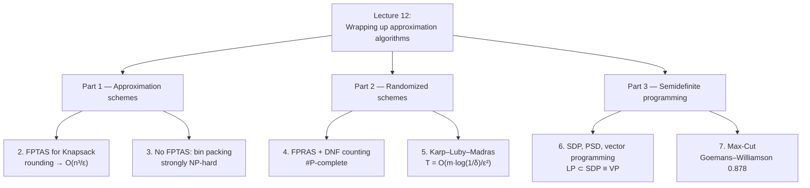

# Advanced Algorithms (COMPSCI 224), Lecture 12

*Harvard University · 1:25:04 · [Watch on YouTube](https://www.youtube.com/watch?v=2Gl-yNso0_0)*

## Summary

The final lecture of the approximation-algorithms block, covering three topics. First it completes the story on approximation schemes: a rounding-based **FPTAS for Knapsack** running in `O(n³/ε)`, followed by bin packing as an example of a **strongly NP-hard** problem where no FPTAS can exist. Second it introduces **FPRAS** (randomized approximation schemes) through the Karp–Luby–Madras algorithm for **DNF counting**, a #P-complete problem made approximable by sampling from an enlarged universe where the success probability is at least `1/m`. Third it defines **semidefinite programming**, shows LP ⊂ SDP ≡ vector programming, and derives the **Goemans–Williamson 0.878-approximation for Max-Cut** via SDP relaxation plus random hyperplane rounding.

## Structure

## Topics

1. [Lecture roadmap and course logistics](./01-lecture-roadmap.md) — agenda, and the PTAS vs. FPTAS distinction.
2. [An FPTAS for Knapsack by rounding](./02-fptas-for-knapsack.md) — value rounding, the `O(n³/ε)` bound, and the correctness proof.
3. [When no FPTAS exists](./03-when-no-fptas-exists.md) — bin packing, strong NP-hardness, and why the same argument spares Knapsack.
4. [FPRAS and DNF counting](./04-fpras-and-dnf-counting.md) — DNF-SAT is easy, DNF counting is #P-complete, but approximable.
5. [The Karp–Luby–Madras FPRAS](./05-karp-luby-madras-fpras.md) — the disjoint-union universe, first-clause bijection, and Chernoff analysis.
6. [Semidefinite programming and vector programming](./06-semidefinite-programming.md) — the SDP form, PSD characterizations, LP ⊂ SDP ≡ VP.
7. [Max-Cut and Goemans–Williamson](./07-max-cut-goemans-williamson.md) — quadratic program, SDP relaxation, random hyperplane rounding.

## Key takeaways

- Rounding values by `vᵢ′ = ⌊(n/ε)·vᵢ/v_max⌋` turns Knapsack's pseudo-polynomial `O(nV)` DP into a genuine **FPTAS running in `O(n³/ε)`** for a `(1−ε)`-approximation, because the rounded value total is bounded by `n²/ε` [`1:41`](https://www.youtube.com/watch?v=2Gl-yNso0_0&t=101), [`6:41`](https://www.youtube.com/watch?v=2Gl-yNso0_0&t=401). The best known bound for Knapsack remains **Lawler 1979** at `O(n·log(1/ε) + 1/ε⁴)`, with no improvement found since [`2:18`](https://www.youtube.com/watch?v=2Gl-yNso0_0&t=138), [`2:48`](https://www.youtube.com/watch?v=2Gl-yNso0_0&t=168).
- **Bin packing has no FPTAS unless P = NP**: run it with `ε ≪ 1/n`, and since bin counts are integers, an answer of "2.2 bins" resolves the NP-complete 2-bin decision problem exactly. Such problems are called **strongly NP-hard** [`18:32`](https://www.youtube.com/watch?v=2Gl-yNso0_0&t=1112), [`19:22`](https://www.youtube.com/watch?v=2Gl-yNso0_0&t=1162). The reason Knapsack escapes this trap is that `v_max` takes only `log v_max` bits, so the required `1/ε` would be exponential in the input size [`32:03`](https://www.youtube.com/watch?v=2Gl-yNso0_0&t=1923).
- **DNF satisfiability is in P but DNF counting is #P-complete**, provable by negating a CNF into a DNF and recovering the CNF's count as `2ⁿ − T` — yet approximate counting survives, because the hardness proof needs to distinguish zero from nonzero, which `(1±ε)` multiplicative error cannot do [`23:15`](https://www.youtube.com/watch?v=2Gl-yNso0_0&t=1395), [`26:31`](https://www.youtube.com/watch?v=2Gl-yNso0_0&t=1591), [`27:20`](https://www.youtube.com/watch?v=2Gl-yNso0_0&t=1640), [`29:28`](https://www.youtube.com/watch?v=2Gl-yNso0_0&t=1768).
- **Karp–Luby–Madras (1989) gives an FPRAS for DNF counting** by sampling from the disjoint union `B′ = ⨆ Sᵢ` instead of all `2ⁿ` assignments. Since `|Sᵢ| = 2^(n−lᵢ)` is computable exactly and each satisfying assignment appears at most `m` times, the success probability is `≥ 1/m`, so Chernoff needs only `T = O(m·log(1/δ)/ε²)` samples — versus the `~2ⁿ` samples naive uniform sampling would require [`41:57`](https://www.youtube.com/watch?v=2Gl-yNso0_0&t=2517), [`54:36`](https://www.youtube.com/watch?v=2Gl-yNso0_0&t=3276), [`55:18`](https://www.youtube.com/watch?v=2Gl-yNso0_0&t=3318), [`55:42`](https://www.youtube.com/watch?v=2Gl-yNso0_0&t=3342).
- **LP is a strict special case of SDP** (diagonal `C` and `Aᵢ`, off-diagonal `X` forced to zero, where PSD collapses to entrywise non-negativity), and **SDP is equivalent to vector programming** via `X = MᵀM` ⇒ `Xᵢⱼ = vᵢ·vⱼ`; SDPs solve to `L` bits in poly(`n`,`m`,`L`) time [`59:48`](https://www.youtube.com/watch?v=2Gl-yNso0_0&t=3588), [`1:07:25`](https://www.youtube.com/watch?v=2Gl-yNso0_0&t=4045), [`1:09:35`](https://www.youtube.com/watch?v=2Gl-yNso0_0&t=4175).
- **Goemans–Williamson (1995) broke the 20-year 0.5 barrier for Max-Cut with a 0.878-approximation** — random partition and local search both only guarantee `m/2 ≥ OPT/2`. Relaxing `xᵢxⱼ` to `vᵢ·vⱼ` and rounding with a random hyperplane gives per-edge separation probability `θ/π` against relaxation value `(1−cos θ)/2`, and the ratio's infimum `min_θ (2/π)·θ/(1−cos θ) = 0.878` is the approximation factor. Its lasting impact was popularizing SDPs as a tool for approximation algorithms [`1:13:45`](https://www.youtube.com/watch?v=2Gl-yNso0_0&t=4425), [`1:15:07`](https://www.youtube.com/watch?v=2Gl-yNso0_0&t=4507), [`1:15:35`](https://www.youtube.com/watch?v=2Gl-yNso0_0&t=4535), [`1:16:10`](https://www.youtube.com/watch?v=2Gl-yNso0_0&t=4570), [`1:22:54`](https://www.youtube.com/watch?v=2Gl-yNso0_0&t=4974).
