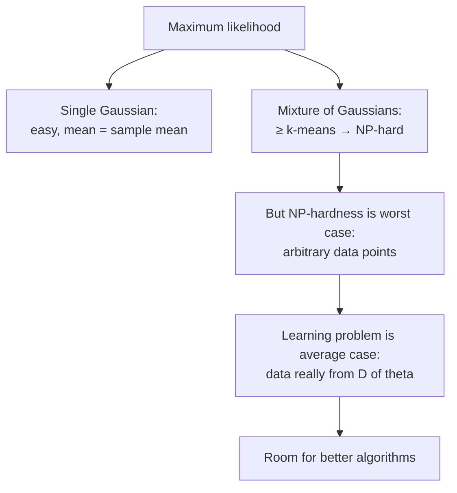

# 03 — Maximum likelihood and its limits

## The approach

- The practitioner's standard method for learning a probabilistic model is **maximum likelihood**: pick the parameter within the family whose model has the best probability of generating the observed data [`17:01`](https://www.youtube.com/watch?v=VuM1WnwEMRQ&t=1021), [`17:35`](https://www.youtube.com/watch?v=VuM1WnwEMRQ&t=1055), [`18:04`](https://www.youtube.com/watch?v=VuM1WnwEMRQ&t=1084).
- Assuming i.i.d. samples `v₁ … vₙ`, the optimization is

  `max over θ of  Σᵢ₌₁ⁿ log p_θ(vᵢ)`

  where `p_θ` is the density of `D(θ)` [`18:04`](https://www.youtube.com/watch?v=VuM1WnwEMRQ&t=1084), [`21:46`](https://www.youtube.com/watch?v=VuM1WnwEMRQ&t=1306), [`22:21`](https://www.youtube.com/watch?v=VuM1WnwEMRQ&t=1341).
- Sum-of-logs is used purely for convenience — it is equivalent to maximizing the product of probabilities, and a sum is conceptually easier to reason about [`19:16`](https://www.youtube.com/watch?v=VuM1WnwEMRQ&t=1156).

## Where it works

- Effective for very simple distributions. For a **single Gaussian** the optimization is easy and yields the intuitive answer: the estimated mean is the sample mean [`20:00`](https://www.youtube.com/watch?v=VuM1WnwEMRQ&t=1200).

## Where it breaks

- For a **mixture of Gaussians**, maximum likelihood is at least as hard as **k-means clustering, which is itself NP-hard** [`20:34`](https://www.youtube.com/watch?v=VuM1WnwEMRQ&t=1234).
- Important caveat about what the hardness means: NP-hardness refers to the **worst case**, where the `vᵢ` are arbitrary points not drawn from `D(θ)` [`21:03`](https://www.youtube.com/watch?v=VuM1WnwEMRQ&t=1263).
- The actual learning problem — data really generated by `D(θ)` — is **not a worst-case problem**, so it cannot straightforwardly be called NP-hard [`21:46`](https://www.youtube.com/watch?v=VuM1WnwEMRQ&t=1306). This gap is the opening the rest of the lecture exploits.

