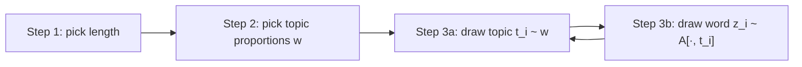

# 06 — The topic matrix A and the document-generation recipe

## The topic matrix A

The most important parameter of a topic model; it recurs through the whole rest of the lecture [`38:41`](https://www.youtube.com/watch?v=VuM1WnwEMRQ&t=2321), [`39:28`](https://www.youtube.com/watch?v=VuM1WnwEMRQ&t=2368).

- Shape: **n × k** [`39:28`](https://www.youtube.com/watch?v=VuM1WnwEMRQ&t=2368).
  - `n` = **vocabulary size** — thousands, tens of thousands, or more [`39:57`](https://www.youtube.com/watch?v=VuM1WnwEMRQ&t=2397).
  - `k` = **number of topics** — much smaller, think 100 or 200 [`39:57`](https://www.youtube.com/watch?v=VuM1WnwEMRQ&t=2397), [`40:21`](https://www.youtube.com/watch?v=VuM1WnwEMRQ&t=2421).
- **Each column is a topic**; entry `A[banana, food] = 1%` means a word drawn from topic *food* is *banana* with 1% probability [`40:21`](https://www.youtube.com/watch?v=VuM1WnwEMRQ&t=2421), [`40:57`](https://www.youtube.com/watch?v=VuM1WnwEMRQ&t=2457).
- Topic **names cannot be generated automatically** — the algorithm produces distributions, not labels [`40:21`](https://www.youtube.com/watch?v=VuM1WnwEMRQ&t=2421).
- Constraints: all entries **non-negative**, and **each column sums to 1** so it is a valid distribution over words [`41:28`](https://www.youtube.com/watch?v=VuM1WnwEMRQ&t=2488).

## General recipe for generating a document

Shared by essentially all topic models [`42:46`](https://www.youtube.com/watch?v=VuM1WnwEMRQ&t=2566):

1. **Pick the document length** [`42:46`](https://www.youtube.com/watch?v=VuM1WnwEMRQ&t=2566).
2. **Pick the topic proportions** `w = (w₁ … w_k)`, with `wᵢ ≥ 0` and `Σ wᵢ = 1` [`42:46`](https://www.youtube.com/watch?v=VuM1WnwEMRQ&t=2566), [`43:41`](https://www.youtube.com/watch?v=VuM1WnwEMRQ&t=2621).
3. **For each word position i:** draw a topic `tᵢ ∈ [k]` according to `w`, then draw the word `zᵢ ∈ [n]` from column `A[·, tᵢ]` [`44:13`](https://www.youtube.com/watch?v=VuM1WnwEMRQ&t=2653), [`45:29`](https://www.youtube.com/watch?v=VuM1WnwEMRQ&t=2729).
   - Example: `w = (0.7, 0.3, 0, …)` gives `tᵢ = 1` with 70% probability and `tᵢ = 2` otherwise [`44:56`](https://www.youtube.com/watch?v=VuM1WnwEMRQ&t=2696).

## Step 1 and Step 2 are where models differ

- **Length** is not really a modelling target: an article is ~300 words, you simply observe it from data, so most topic models ignore it. Here it is assumed **fixed and known** [`46:34`](https://www.youtube.com/watch?v=VuM1WnwEMRQ&t=2794), [`47:02`](https://www.youtube.com/watch?v=VuM1WnwEMRQ&t=2822).
- **Step 2 is the real dividing line** between topic models — the recipe above isn't yet a model because the distribution over `w` is unspecified [`46:05`](https://www.youtube.com/watch?v=VuM1WnwEMRQ&t=2765), [`47:02`](https://www.youtube.com/watch?v=VuM1WnwEMRQ&t=2822).

| Model | How `w` is chosen | Reference |
|---|---|---|
| **pLSI** | `w` is a **basis vector** (one entry 1, rest 0) — chosen with probability `πᵢ`; the whole document is about a single topic | [`47:02`](https://www.youtube.com/watch?v=VuM1WnwEMRQ&t=2822), [`47:50`](https://www.youtube.com/watch?v=VuM1WnwEMRQ&t=2870), [`48:14`](https://www.youtube.com/watch?v=VuM1WnwEMRQ&t=2894) |
| **LDA** | `w ~ Dirichlet(α)` | [`48:14`](https://www.youtube.com/watch?v=VuM1WnwEMRQ&t=2894) |
| Many later models | Various other distributions | [`49:09`](https://www.youtube.com/watch?v=VuM1WnwEMRQ&t=2949) |

Why the Dirichlet: partly to simplify their algorithm, but the real intuition is that it produces vectors that are **not just basis vectors** (documents can mix topics) while still tending to be **sparse** — matching the intuition that no document covers all 100+ topics [`48:14`](https://www.youtube.com/watch?v=VuM1WnwEMRQ&t=2894), [`48:46`](https://www.youtube.com/watch?v=VuM1WnwEMRQ&t=2926), [`49:09`](https://www.youtube.com/watch?v=VuM1WnwEMRQ&t=2949).

## This lecture's stance

**Ignore all these differences.** Treat the `w`'s as part of the parameters — arbitrary, subject only to a few reasonable assumptions made later [`49:36`](https://www.youtube.com/watch?v=VuM1WnwEMRQ&t=2976).
