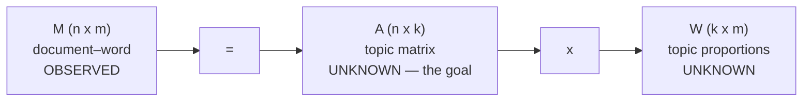

# 07 — The long-document case and the identity M = A·W

## The simplifying regime: n → ∞

- The lecture does **not** attempt the fully general learning algorithm; it restricts to the **easy case where document length goes to infinity** [`49:36`](https://www.youtube.com/watch?v=VuM1WnwEMRQ&t=2976), [`50:08`](https://www.youtube.com/watch?v=VuM1WnwEMRQ&t=3008).
- Openly acknowledged as unrealistic in practice; papers exist for finite or small document length [`50:08`](https://www.youtube.com/watch?v=VuM1WnwEMRQ&t=3008), [`50:44`](https://www.youtube.com/watch?v=VuM1WnwEMRQ&t=3044).
- **What it buys you:** every word appears more than once, so within-document word probabilities can be estimated by simple counting — occurrences of the word ÷ document length [`50:44`](https://www.youtube.com/watch?v=VuM1WnwEMRQ&t=3044), [`51:10`](https://www.youtube.com/watch?v=VuM1WnwEMRQ&t=3070).
- Accuracy caveat: the length must be **comparable to the vocabulary size** for this estimate to be good [`51:43`](https://www.youtube.com/watch?v=VuM1WnwEMRQ&t=3103).

## The document–word matrix M

- Collect those estimated probabilities into a matrix `M` of shape **n × m**: `n` vocabulary words, `m` documents [`52:09`](https://www.youtube.com/watch?v=VuM1WnwEMRQ&t=3129), [`52:39`](https://www.youtube.com/watch?v=VuM1WnwEMRQ&t=3159).
- Each **column is a document**, holding P(word | document) [`52:39`](https://www.youtube.com/watch?v=VuM1WnwEMRQ&t=3159).
- Under bag-of-words, **this is essentially all the information available**, since ordering doesn't matter [`53:09`](https://www.youtube.com/watch?v=VuM1WnwEMRQ&t=3189).

## Deriving the factorization

By the two-step generative process, for word `v` in document `d`:

`P(zᵢ = v) = Σⱼ₌₁ᵏ P(tᵢ = j | doc) · P(zᵢ = v | tᵢ = j)` [`53:40`](https://www.youtube.com/watch?v=VuM1WnwEMRQ&t=3220), [`54:09`](https://www.youtube.com/watch?v=VuM1WnwEMRQ&t=3249), [`54:44`](https://www.youtube.com/watch?v=VuM1WnwEMRQ&t=3284).

- The first factor is exactly the document's topic proportions `w` [`54:44`](https://www.youtube.com/watch?v=VuM1WnwEMRQ&t=3284).
- The second factor is exactly an entry `A[v, j]` of the topic matrix [`54:44`](https://www.youtube.com/watch?v=VuM1WnwEMRQ&t=3284), [`55:22`](https://www.youtube.com/watch?v=VuM1WnwEMRQ&t=3322).

That sum-of-products **is** the matrix-product rule, so:

> **M = A · W**, with `A` the n × k topic matrix and `W` the k × m matrix whose columns are each document's topic proportions [`55:22`](https://www.youtube.com/watch?v=VuM1WnwEMRQ&t=3322), [`55:50`](https://www.youtube.com/watch?v=VuM1WnwEMRQ&t=3350), [`56:23`](https://www.youtube.com/watch?v=VuM1WnwEMRQ&t=3383).

## Why this matters

The identity **links the observable `M` to the unknown parameter `A`**. The learning problem becomes: given `M`, find a decomposition `A · W` where both factors are much smaller than `M` [`56:48`](https://www.youtube.com/watch?v=VuM1WnwEMRQ&t=3408).
