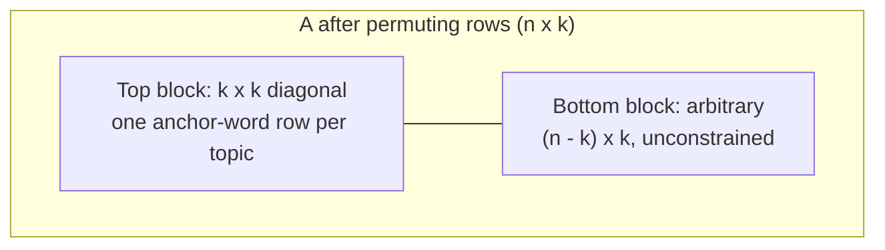

# 09 — Separability and anchor words

The natural assumption that rescues NMF. Since `A` is a matrix of topics and words, we can expect it to have special properties; the relevant one is **separability**, defined by **Donoho and Stodden** [`1:01:49`](https://www.youtube.com/watch?v=VuM1WnwEMRQ&t=3709).

## Formal definition

`A ∈ R^{n×k}` is **separable** if for every column `i ∈ [k]` there exists a row `aᵢ` such that:

1. `A[aᵢ, i] > 0` — the entry where that row meets column `i` is strictly positive [`1:02:27`](https://www.youtube.com/watch?v=VuM1WnwEMRQ&t=3747), [`1:04:18`](https://www.youtube.com/watch?v=VuM1WnwEMRQ&t=3858);
2. `A[aᵢ, j] = 0` for all `j ≠ i` — every other entry in that row is zero [`1:03:39`](https://www.youtube.com/watch?v=VuM1WnwEMRQ&t=3819), [`1:04:18`](https://www.youtube.com/watch?v=VuM1WnwEMRQ&t=3858).

**Geometric picture:** permuting those `k` special rows to the top makes `A` look like a **diagonal matrix stacked on top of an arbitrary block** — the bottom part can be anything [`1:04:48`](https://www.youtube.com/watch?v=VuM1WnwEMRQ&t=3888), [`1:05:18`](https://www.youtube.com/watch?v=VuM1WnwEMRQ&t=3918).

## Translation into topic-model language

- Column = topic, row = word [`1:05:18`](https://www.youtube.com/watch?v=VuM1WnwEMRQ&t=3918), [`1:05:50`](https://www.youtube.com/watch?v=VuM1WnwEMRQ&t=3950).
- So: **for every topic there exists a word — an "anchor word" — that has non-zero probability in that topic and zero probability in every other topic** [`1:05:50`](https://www.youtube.com/watch?v=VuM1WnwEMRQ&t=3950), [`1:06:33`](https://www.youtube.com/watch?v=VuM1WnwEMRQ&t=3993).
- Examples: *snow* is likely in a *weather* topic and unlikely elsewhere; if that seems insufficiently specific, *polar vortex* is more clearly weather-only [`1:06:33`](https://www.youtube.com/watch?v=VuM1WnwEMRQ&t=3993), [`1:07:12`](https://www.youtube.com/watch?v=VuM1WnwEMRQ&t=4032).
- The assumption is: **anchor words exist for all topics** [`1:07:12`](https://www.youtube.com/watch?v=VuM1WnwEMRQ&t=4032).

## What the assumption does and does not give you

- ✗ It does **not** say the anchor word must appear whenever a document covers the topic — a short document may simply never mention it [`1:07:45`](https://www.youtube.com/watch?v=VuM1WnwEMRQ&t=4065).
- ✓ It says the **converse**: if the anchor word **is** seen in a document, then at least some fraction of that document must be about that topic [`1:08:10`](https://www.youtube.com/watch?v=VuM1WnwEMRQ&t=4090).
