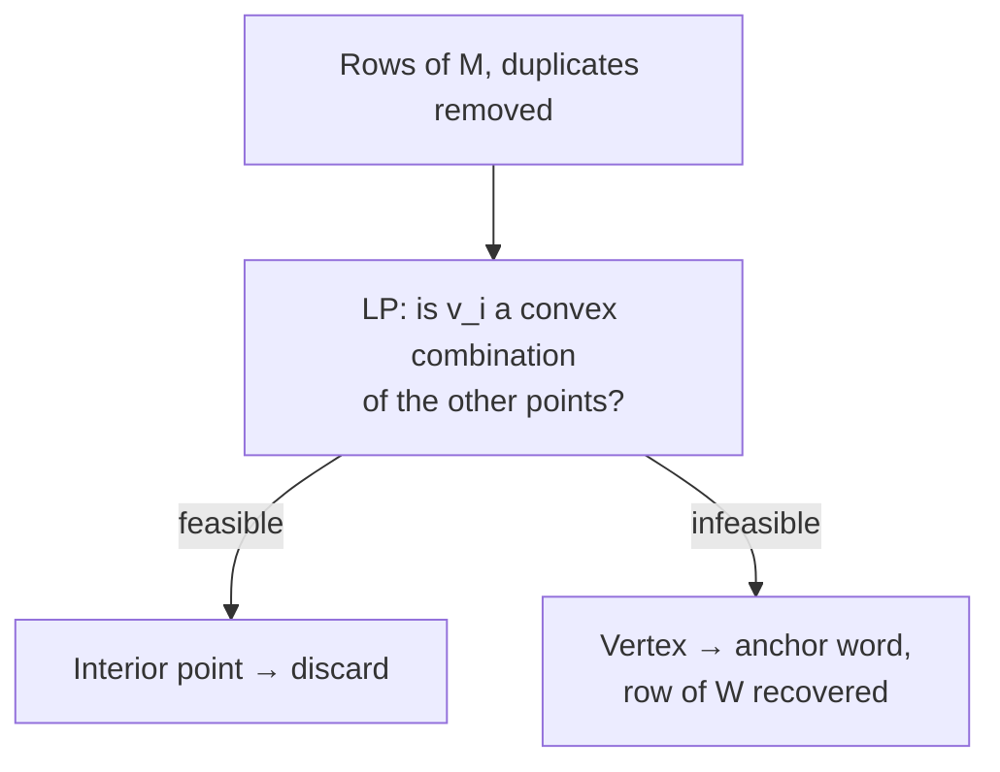

# 10 — Reduction to a convex-hull problem, and the algorithm

## Two observations about the rows of M

Assume `M = A·W` with `A` separable [`1:08:35`](https://www.youtube.com/watch?v=VuM1WnwEMRQ&t=4115).

1. **Anchor rows expose W directly.** For an anchor row `aᵢ` (only the i-th entry non-zero), the product with `W` gives
   `M[aᵢ, ·] = A[aᵢ, i] · W[i, ·]`.
   In words: **the rows of W appear as rows of M, up to scaling** — `W` is hiding inside the observable `M` [`1:09:01`](https://www.youtube.com/watch?v=VuM1WnwEMRQ&t=4141), [`1:09:38`](https://www.youtube.com/watch?v=VuM1WnwEMRQ&t=4178), [`1:10:26`](https://www.youtube.com/watch?v=VuM1WnwEMRQ&t=4226).
2. **Every other row is a non-negative combination.** For an arbitrary row `j`: `M[j, ·] = Σᵢ₌₁ᵏ A[j,i] · W[i, ·]` [`1:10:26`](https://www.youtube.com/watch?v=VuM1WnwEMRQ&t=4226), [`1:10:53`](https://www.youtube.com/watch?v=VuM1WnwEMRQ&t=4253).

## Normalization turns combinations into convex combinations

- W.l.o.g. rescale so the **rows of M, A and W all sum to 1** [`1:10:53`](https://www.youtube.com/watch?v=VuM1WnwEMRQ&t=4253), [`1:12:03`](https://www.youtube.com/watch?v=VuM1WnwEMRQ&t=4323).
- Then for an anchor row the scaling factor becomes exactly 1, so **M[aᵢ, ·] = W[i, ·]** [`1:12:03`](https://www.youtube.com/watch?v=VuM1WnwEMRQ&t=4323), [`1:12:19`](https://www.youtube.com/watch?v=VuM1WnwEMRQ&t=4339).
- And every other row becomes a **convex** combination rather than merely non-negative [`1:12:19`](https://www.youtube.com/watch?v=VuM1WnwEMRQ&t=4339).

> **Conclusion:** every row of `M` is either a row of `W` or lies in the **convex hull** of the rows of `W` [`1:12:19`](https://www.youtube.com/watch?v=VuM1WnwEMRQ&t=4339).

## The resulting geometric problem

- **Given:** `n` points `v₁ … vₙ` lying in the convex hull of `k` unknown ones `v_{a₁} … v_{a_k}` (which are the rows of `W`) [`1:13:06`](https://www.youtube.com/watch?v=VuM1WnwEMRQ&t=4386).
- **Find:** the indices `a₁ … a_k`, or equivalently the corresponding rows [`1:13:54`](https://www.youtube.com/watch?v=VuM1WnwEMRQ&t=4434).
- Picture: points scattered inside a triangle, with the **triangle's vertices included among the given points** — recover the vertices [`1:13:54`](https://www.youtube.com/watch?v=VuM1WnwEMRQ&t=4434), [`1:14:37`](https://www.youtube.com/watch?v=VuM1WnwEMRQ&t=4477).
- This is **equivalent to NMF under the separability assumption** [`1:14:37`](https://www.youtube.com/watch?v=VuM1WnwEMRQ&t=4477).

## One more (degeneracy) assumption

- A row of `W` could in principle sit **inside** the hull — but then that row can be dropped, yielding a smaller factorization. It's the analogue of factoring a rank-R matrix with R+1 columns, which is not what we want [`1:15:06`](https://www.youtube.com/watch?v=VuM1WnwEMRQ&t=4506), [`1:15:34`](https://www.youtube.com/watch?v=VuM1WnwEMRQ&t=4534).
- So assume the **rows of W are all vertices of the convex hull** [`1:16:00`](https://www.youtube.com/watch?v=VuM1WnwEMRQ&t=4560).

## The algorithm

After removing duplicate points, for each point `vᵢ` test whether it lies in the convex hull of all the other points [`1:16:13`](https://www.youtube.com/watch?v=VuM1WnwEMRQ&t=4573).

- **Claim:** `vᵢ` is a vertex ⟺ `vᵢ` is **not** in the convex hull of the rest [`1:16:13`](https://www.youtube.com/watch?v=VuM1WnwEMRQ&t=4573), [`1:17:19`](https://www.youtube.com/watch?v=VuM1WnwEMRQ&t=4639).
- Proof sketch: an interior point stays inside after removing duplicates; a vertex, once removed from the set, is outside the shrunken hull [`1:17:19`](https://www.youtube.com/watch?v=VuM1WnwEMRQ&t=4639), [`1:17:52`](https://www.youtube.com/watch?v=VuM1WnwEMRQ&t=4672).
- The membership test is a **linear program**: find `αⱼ ≥ 0` with `Σ_{j≠i} αⱼ = 1` and `vᵢ = Σ_{j≠i} αⱼ vⱼ` [`1:17:52`](https://www.youtube.com/watch?v=VuM1WnwEMRQ&t=4672), [`1:18:15`](https://www.youtube.com/watch?v=VuM1WnwEMRQ&t=4695).
- **Feasible ⇒ interior point. Infeasible ⇒ vertex** (an anchor word / row of W) [`1:18:43`](https://www.youtube.com/watch?v=VuM1WnwEMRQ&t=4723), [`1:19:12`](https://www.youtube.com/watch?v=VuM1WnwEMRQ&t=4752).

## What breaks in practice, and the fixes

1. **Probabilities cannot be estimated accurately** — in fact estimates are far from accurate [`1:19:12`](https://www.youtube.com/watch?v=VuM1WnwEMRQ&t=4752).
2. Even a small perturbation moves points, possibly **out of the low-dimensional subspace**, so exact hull membership stops holding. Fix: test whether a point is **close to** the convex hull of the others — still an LP, but harder [`1:19:38`](https://www.youtube.com/watch?v=VuM1WnwEMRQ&t=4778), [`1:19:59`](https://www.youtube.com/watch?v=VuM1WnwEMRQ&t=4799).
3. `M` itself cannot be estimated well enough. Fix: estimate instead **the probability that two words co-occur in the same document** — a quantity estimable to arbitrary accuracy given enough documents [`1:19:59`](https://www.youtube.com/watch?v=VuM1WnwEMRQ&t=4799), [`1:20:26`](https://www.youtube.com/watch?v=VuM1WnwEMRQ&t=4826).

## Empirical outcome

The improved version of this algorithm **can actually be implemented, is pretty fast, runs on a New York Times article corpus, produces results comparable to previous heuristic algorithms, and is even faster than them** [`1:20:53`](https://www.youtube.com/watch?v=VuM1WnwEMRQ&t=4853), [`1:21:24`](https://www.youtube.com/watch?v=VuM1WnwEMRQ&t=4884).
