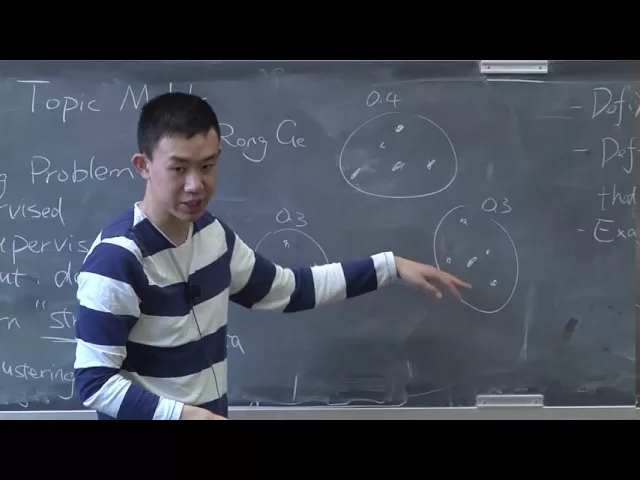
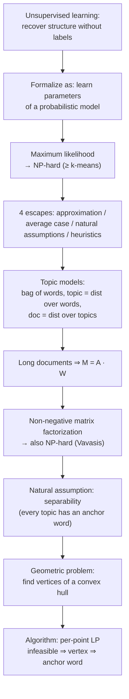

# Advanced Algorithms (COMPSCI 224), Lecture 13

*Harvard University · 1:21:46 · [Watch on YouTube](https://www.youtube.com/watch?v=VuM1WnwEMRQ)*

A guest lecture by **Rong Ge** (postdoc, Microsoft Research), standing in for Jelani Nelson, on **learning topic models** — a case study in applying theoretical-CS algorithm design to machine learning [`0:00`](https://www.youtube.com/watch?v=VuM1WnwEMRQ&t=0), [`0:36`](https://www.youtube.com/watch?v=VuM1WnwEMRQ&t=36).

The lecture builds one continuous chain: unsupervised learning is formalized as recovering the parameters of a probabilistic model; the standard tool (maximum likelihood) is NP-hard; four escape routes from NP-hardness are surveyed; topic models are defined via three simplifying assumptions; long documents reduce learning to the factorization `M = A·W`; that is non-negative matrix factorization, also NP-hard; and the **separability / anchor-word** assumption finally turns it into a convex-hull vertex-finding problem solvable with linear programs.

## Topics

1. [Supervised vs. unsupervised learning](./01-supervised-vs-unsupervised-learning.md)
2. [Probabilistic models and the learning problem](./02-probabilistic-models-and-the-learning-problem.md)
3. [Maximum likelihood and its limits](./03-maximum-likelihood-and-its-limits.md)
4. [Four ways around NP-hardness](./04-getting-around-np-hardness.md)
5. [Topic models: the goal and the three simplifying assumptions](./05-topic-models-goal-and-assumptions.md)
6. [The topic matrix A and the document-generation recipe](./06-topic-matrix-and-document-generation.md)
7. [The long-document case and the identity M = A·W](./07-long-documents-and-the-m-equals-aw-structure.md)
8. [Non-negative matrix factorization (NMF)](./08-non-negative-matrix-factorization.md)
9. [Separability and anchor words](./09-separability-and-anchor-words.md)
10. [Reduction to a convex-hull problem, and the algorithm](./10-geometric-reduction-and-the-algorithm.md)

Full source: [`transcript.md`](./transcript.md)

## Key takeaways

- **Maximum likelihood for a mixture of Gaussians is at least as hard as k-means clustering, hence NP-hard**, whereas for a single Gaussian it is easy and returns the sample mean [`20:00`](https://www.youtube.com/watch?v=VuM1WnwEMRQ&t=1200), [`20:34`](https://www.youtube.com/watch?v=VuM1WnwEMRQ&t=1234).
- **Approximation algorithms are the wrong tool for maximum likelihood**: a constant factor in log-probability space does not correspond to a constant factor in probability space, so an approximately-optimal `θ` can assign vastly lower probability than the optimum [`24:06`](https://www.youtube.com/watch?v=VuM1WnwEMRQ&t=1446), [`24:29`](https://www.youtube.com/watch?v=VuM1WnwEMRQ&t=1469).
- **NP-hardness of maximum likelihood is a worst-case statement** about arbitrary data points; the actual learning problem — data really drawn from `D(θ)` — is average-case and therefore not covered by the hardness result [`21:03`](https://www.youtube.com/watch?v=VuM1WnwEMRQ&t=1263), [`21:46`](https://www.youtube.com/watch?v=VuM1WnwEMRQ&t=1306).
- **Letting a document be a distribution over topics (rather than pLSI's single topic) fits empirical data much better**, which is why the field moved from pLSI to models like LDA [`38:19`](https://www.youtube.com/watch?v=VuM1WnwEMRQ&t=2299), [`38:41`](https://www.youtube.com/watch?v=VuM1WnwEMRQ&t=2321).
- **For very long documents, learning a topic model is exactly non-negative matrix factorization**: the observable document–word matrix satisfies `M = A·W` with `A` the n × k topic matrix and `W` the k × m topic-proportion matrix [`55:50`](https://www.youtube.com/watch?v=VuM1WnwEMRQ&t=3350), [`56:48`](https://www.youtube.com/watch?v=VuM1WnwEMRQ&t=3408).
- **Non-negativity, not normalization, is what makes NMF hard.** Normalization is w.l.o.g.; dropping non-negativity reduces the problem to plain rank decomposition solvable by SVD — but SVD's factors cannot be read as probabilities. NMF itself is NP-hard (Vavasis) [`59:09`](https://www.youtube.com/watch?v=VuM1WnwEMRQ&t=3549), [`59:33`](https://www.youtube.com/watch?v=VuM1WnwEMRQ&t=3573), [`59:57`](https://www.youtube.com/watch?v=VuM1WnwEMRQ&t=3597), [`1:00:19`](https://www.youtube.com/watch?v=VuM1WnwEMRQ&t=3619).
- **Separability (Donoho–Stodden) — every topic has an anchor word appearing in no other topic — reduces NMF to a purely geometric problem**: after rescaling rows to sum to 1, every row of `M` is either a row of `W` or lies in the convex hull of the rows of `W`, so learning becomes finding the hull's vertices [`1:01:49`](https://www.youtube.com/watch?v=VuM1WnwEMRQ&t=3709), [`1:12:19`](https://www.youtube.com/watch?v=VuM1WnwEMRQ&t=4339), [`1:14:37`](https://www.youtube.com/watch?v=VuM1WnwEMRQ&t=4477).
- **Vertex detection is a single linear program per point**: `vᵢ` is a vertex (anchor word) exactly when the LP expressing it as a convex combination of the other points is **infeasible** [`1:16:13`](https://www.youtube.com/watch?v=VuM1WnwEMRQ&t=4573), [`1:18:15`](https://www.youtube.com/watch?v=VuM1WnwEMRQ&t=4695), [`1:18:43`](https://www.youtube.com/watch?v=VuM1WnwEMRQ&t=4723).
- **Making it work on real data required two changes**: test *closeness* to the convex hull instead of exact membership (estimates perturb points out of the low-dimensional subspace), and estimate **pairwise word co-occurrence probabilities** — which converge with enough documents — instead of `M` directly [`1:19:38`](https://www.youtube.com/watch?v=VuM1WnwEMRQ&t=4778), [`1:19:59`](https://www.youtube.com/watch?v=VuM1WnwEMRQ&t=4799), [`1:20:26`](https://www.youtube.com/watch?v=VuM1WnwEMRQ&t=4826).
- **The improved algorithm was implemented and run on a New York Times corpus**, giving results comparable to the previous heuristic algorithms while being faster [`1:20:53`](https://www.youtube.com/watch?v=VuM1WnwEMRQ&t=4853), [`1:21:24`](https://www.youtube.com/watch?v=VuM1WnwEMRQ&t=4884).
