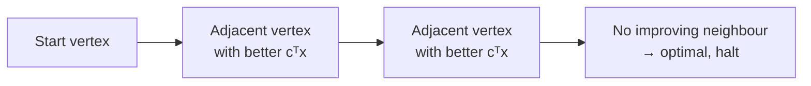

# 03 — The geometric picture and the definition of a vertex

## LPs geometrically

- In 2D, constraints `x ≥ 0`, `y ≥ 0` plus other half-space constraints carve out a **polygon** as the feasible region; `c` is a direction vector in that picture [`10:11`](https://www.youtube.com/watch?v=U7158Q-2rJc&t=611), [`10:54`](https://www.youtube.com/watch?v=U7158Q-2rJc&t=654), [`11:16`](https://www.youtube.com/watch?v=U7158Q-2rJc&t=676), [`11:41`](https://www.youtube.com/watch?v=U7158Q-2rJc&t=701).

## Simplex in one sentence

**Simplex is a greedy algorithm on the vertices of the polytope** [`10:11`](https://www.youtube.com/watch?v=U7158Q-2rJc&t=611):

1. Start at some vertex.
2. Greedily move to an **adjacent** vertex that strictly improves the objective.
3. Stop when at the optimal vertex [`12:40`](https://www.youtube.com/watch?v=U7158Q-2rJc&t=760), [`13:31`](https://www.youtube.com/watch?v=U7158Q-2rJc&t=811).

- Attribution: **Dantzig, 1947** [`12:40`](https://www.youtube.com/watch?v=U7158Q-2rJc&t=760).

## The four questions the rest of the lecture answers

- How do you get an **initial vertex**? [`12:06`](https://www.youtube.com/watch?v=U7158Q-2rJc&t=726) → see `04`
- How do you prove there is **always a better adjacent vertex** when you are not optimal? [`12:06`](https://www.youtube.com/watch?v=U7158Q-2rJc&t=726)
- If **several adjacent vertices** improve, how do you choose — and does the choice matter? [`12:06`](https://www.youtube.com/watch?v=U7158Q-2rJc&t=726) → pivoting rules, see `08`
- How do you even know the **optimum is attained at a vertex**? [`12:06`](https://www.youtube.com/watch?v=U7158Q-2rJc&t=726) → see `05`
- The **stopping condition** is left unspecified until the algorithm is written precisely [`13:31`](https://www.youtube.com/watch?v=U7158Q-2rJc&t=811), [`13:57`](https://www.youtube.com/watch?v=U7158Q-2rJc&t=837).

## Definitions

- **The polytope**: `P = { x : Ax = b, x ≥ 0 }` — the set over which `cᵀx` is minimized [`14:20`](https://www.youtube.com/watch?v=U7158Q-2rJc&t=860).
- **Vertex**: `x ∈ P` is a vertex iff **there does *not* exist** `y ≠ 0` with both `x + y ∈ P` and `x − y ∈ P` [`14:48`](https://www.youtube.com/watch?v=U7158Q-2rJc&t=888), [`15:29`](https://www.youtube.com/watch?v=U7158Q-2rJc&t=929).
  - Equivalently: if such a `y` exists, `x` is **not** a vertex — `x` sits strictly inside a segment contained in `P` [`15:29`](https://www.youtube.com/watch?v=U7158Q-2rJc&t=929).
  - Note this definition is purely about `P`; **it never mentions the objective function** [`48:39`](https://www.youtube.com/watch?v=U7158Q-2rJc&t=2919).
