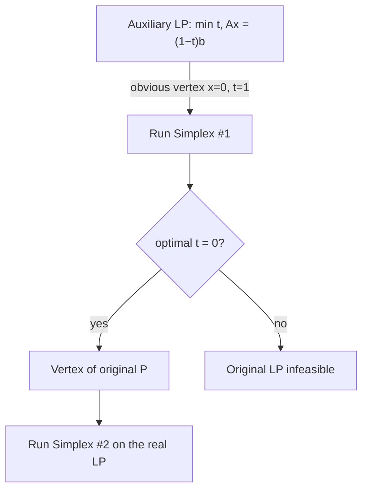

# 04 — Getting an initial vertex (and why it looks circular)

## The apparent paradox: feasibility ≡ optimization

- **Checking feasibility of a general polytope is as hard as solving the LP.** Guess a target value `r`, add the constraint `cᵀx ≤ r`, and ask whether a feasible point exists; **binary search on `r`** then recovers OPT [`16:03`](https://www.youtube.com/watch?v=U7158Q-2rJc&t=963), [`16:41`](https://www.youtube.com/watch?v=U7158Q-2rJc&t=1001), [`16:59`](https://www.youtube.com/watch?v=U7158Q-2rJc&t=1019), [`20:22`](https://www.youtube.com/watch?v=U7158Q-2rJc&t=1222), [`20:45`](https://www.youtube.com/watch?v=U7158Q-2rJc&t=1245).
- So getting a starting vertex "for free" would be suspicious — unless the LP used for it is a **special, easy** one.

## Why the binary search terminates (bit-precision argument)

- A vertex is (as proved later) the intersection of `m` tight constraints, so there are **at most `n choose m` vertices**, and computing one means **solving a linear system** on a submatrix of `A` [`17:40`](https://www.youtube.com/watch?v=U7158Q-2rJc&t=1060), [`17:59`](https://www.youtube.com/watch?v=U7158Q-2rJc&t=1079), [`18:30`](https://www.youtube.com/watch?v=U7158Q-2rJc&t=1110).
- If all entries of `A`, `b`, `c` are integers of at most `B` bits, one can **bound the number of bits needed to write down a vertex**, hence OPT is a rational of bounded precision [`18:30`](https://www.youtube.com/watch?v=U7158Q-2rJc&t=1110), [`18:45`](https://www.youtube.com/watch?v=U7158Q-2rJc&t=1125).
- Therefore the binary search only needs **that many iterations** — it never has to refine beyond the known precision bound [`19:12`](https://www.youtube.com/watch?v=U7158Q-2rJc&t=1152), [`19:48`](https://www.youtube.com/watch?v=U7158Q-2rJc&t=1188), [`20:09`](https://www.youtube.com/watch?v=U7158Q-2rJc&t=1209).
- Caveat stated explicitly: this argument **assumes** vertices are optimal and that vertices come from linear systems on submatrices of `A` — both proved later in the lecture [`19:48`](https://www.youtube.com/watch?v=U7158Q-2rJc&t=1188).

## The trick: run Simplex twice

**Reduce "find a starting vertex" to a *different* LP that has an obvious starting vertex** [`20:45`](https://www.youtube.com/watch?v=U7158Q-2rJc&t=1245):

```
min  t
s.t. Ax = (1 − t)·b
     x ≥ 0
     0 ≤ t ≤ 1
```
[`21:16`](https://www.youtube.com/watch?v=U7158Q-2rJc&t=1276)

- Not yet standard form because of `t ≤ 1`; fix it with a slack: **`s_t + t = 1`, `s_t ≥ 0`** [`22:04`](https://www.youtube.com/watch?v=U7158Q-2rJc&t=1324), [`22:23`](https://www.youtube.com/watch?v=U7158Q-2rJc&t=1343).

### The obvious starting vertex

- **`x = 0`, `t = 1`, `s_t = 0`** is feasible [`22:23`](https://www.youtube.com/watch?v=U7158Q-2rJc&t=1343), [`23:06`](https://www.youtube.com/watch?v=U7158Q-2rJc&t=1386).
- It is a **vertex**, not merely feasible — checked against the definition: any candidate `y` can put no mass on the `x` coordinates (one of `x ± y` would go negative), none on the slack (same reason), and none on `t` (increasing `t` violates `t ≤ 1`), so `y = 0` [`23:40`](https://www.youtube.com/watch?v=U7158Q-2rJc&t=1420), [`24:31`](https://www.youtube.com/watch?v=U7158Q-2rJc&t=1471), [`24:53`](https://www.youtube.com/watch?v=U7158Q-2rJc&t=1493).

### What minimizing `t` buys you

- If the optimum reaches **`t = 0`**, the constraint becomes `Ax = b`, so you have a feasible point of the original LP — and the point returned is in fact a **vertex of the original polytope** [`24:53`](https://www.youtube.com/watch?v=U7158Q-2rJc&t=1493), [`25:29`](https://www.youtube.com/watch?v=U7158Q-2rJc&t=1529).


