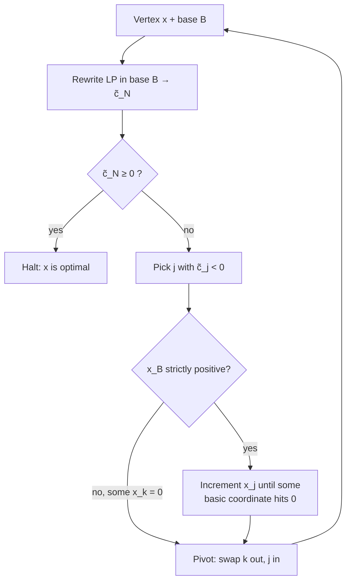

# 08 — The Simplex algorithm and pivoting rules

## The algorithm

Maintain a **current vertex `x` and its base `B`**, and rewrite the LP in that base (see `07`) [`1:14:34`](https://www.youtube.com/watch?v=U7158Q-2rJc&t=4474), [`1:15:22`](https://www.youtube.com/watch?v=U7158Q-2rJc&t=4522):

1. **Halting condition** — if `c̃_N ≥ 0` (non-negative vector), **halt and return `x`** [`1:15:22`](https://www.youtube.com/watch?v=U7158Q-2rJc&t=4522).
2. **Improving step** — if some `j ∈ N` has **`c̃_j < 0`**, increment `x_j` as far as feasibility allows [`1:16:34`](https://www.youtube.com/watch?v=U7158Q-2rJc&t=4594).
3. The **initial vertex** comes from the auxiliary LP of topic `04` [`1:17:32`](https://www.youtube.com/watch?v=U7158Q-2rJc&t=4652).

## What "increment as far as we can" means

- `x_B` **depends on `x_N`**: changing a non-basic `x_j` moves the basic coordinates [`1:17:50`](https://www.youtube.com/watch?v=U7158Q-2rJc&t=4670).
- Push `x_j` until some coordinate of `x_B` **hits zero**; going further would make it negative [`1:18:21`](https://www.youtube.com/watch?v=U7158Q-2rJc&t=4701), [`1:18:45`](https://www.youtube.com/watch?v=U7158Q-2rJc&t=4725).

## The annoying detail: degenerate bases

- If `B` had size exactly `m` **without padding**, all of `x_B` is strictly positive, so a **strictly positive increment of `x_j` is always available** [`1:18:45`](https://www.youtube.com/watch?v=U7158Q-2rJc&t=4725), [`1:19:20`](https://www.youtube.com/watch?v=U7158Q-2rJc&t=4760), [`1:20:26`](https://www.youtube.com/watch?v=U7158Q-2rJc&t=4826).
- If `B` was **padded** from a smaller support, some `k ∈ B` already has `x_k = 0` and **`x_j` may not be incrementable at all** [`1:19:48`](https://www.youtube.com/watch?v=U7158Q-2rJc&t=4788), [`1:20:26`](https://www.youtube.com/watch?v=U7158Q-2rJc&t=4826), [`1:21:09`](https://www.youtube.com/watch?v=U7158Q-2rJc&t=4869).
- The fix is a **pivot**: put `j` into the base and **kick out one of the already-zero coordinates `k`** — which by the base↔vertex correspondence means moving to a new vertex [`1:19:48`](https://www.youtube.com/watch?v=U7158Q-2rJc&t=4788), [`1:21:09`](https://www.youtube.com/watch?v=U7158Q-2rJc&t=4869), [`1:21:58`](https://www.youtube.com/watch?v=U7158Q-2rJc&t=4918).

## Pivoting rules and cycling

- Two open choices at every step: **which `j` with `c̃_j < 0` enters**, and **which `k` leaves** [`1:20:05`](https://www.youtube.com/watch?v=U7158Q-2rJc&t=4805), [`1:24:46`](https://www.youtube.com/watch?v=U7158Q-2rJc&t=5086).
- Choosing carelessly can produce **infinite loops**: you insert someone, kick someone out, and undo it on the next iteration, forever [`1:21:58`](https://www.youtube.com/watch?v=U7158Q-2rJc&t=4918).
- **Bland's Rule** (Bland, *Mathematics of Operations Research*, **1977**) is a greedy pivoting rule **provably free of infinite loops**; the proof is deferred to the next lecture [`1:22:27`](https://www.youtube.com/watch?v=U7158Q-2rJc&t=4947), [`1:22:56`](https://www.youtube.com/watch?v=U7158Q-2rJc&t=4976).
- Other loop-free rules exist post-Bland; before Bland the known rules all had infinite loops. In practice people **sometimes still use rules known to cycle**, on the belief that cycling only arises in contrived cases [`1:23:55`](https://www.youtube.com/watch?v=U7158Q-2rJc&t=5035), [`1:24:25`](https://www.youtube.com/watch?v=U7158Q-2rJc&t=5065).

## Next lecture

- State Bland's Rule, **prove Simplex correct**, and show that a **dual feasible solution matching the primal cost can be read directly off the halting condition** — giving strong duality [`1:22:56`](https://www.youtube.com/watch?v=U7158Q-2rJc&t=4976), [`1:23:26`](https://www.youtube.com/watch?v=U7158Q-2rJc&t=5006).
