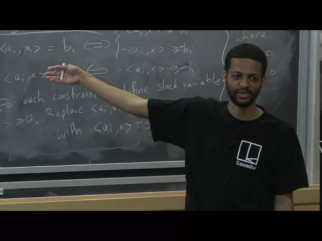
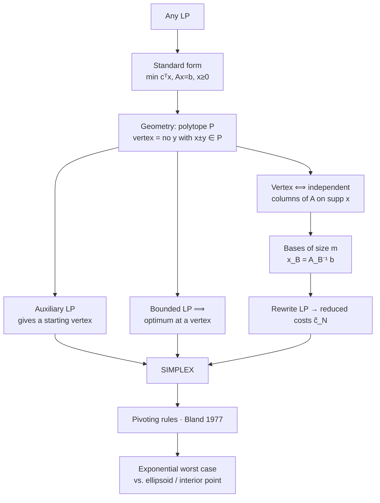

# Advanced Algorithms (COMPSCI 224), Lecture 15

*Harvard University · 1:26:13 · [Watch on YouTube](https://www.youtube.com/watch?v=U7158Q-2rJc)*

## Summary

After many lectures treating linear programming as a black box, this lecture finally opens the box and develops the **Simplex algorithm** from scratch. It builds the machinery in order: reducing any LP to **standard form** (`min cᵀx`, `Ax = b`, `x ≥ 0`), defining a **vertex** of the polytope, showing how to obtain a **starting vertex** by running Simplex on an auxiliary LP, proving that a **bounded LP attains its optimum at a vertex**, and proving that **`x` is a vertex iff the columns of `A` on its support are linearly independent**. That characterization turns vertices into **bases** — sets of `m` independent columns — which lets the LP be rewritten around any base so that the objective becomes a constant plus **reduced costs `c̃_N`** on the non-basic variables. Simplex then reads off as: halt when `c̃_N ≥ 0`, otherwise increase a negative-reduced-cost variable and pivot; the lecture closes on **Bland's Rule** for avoiding cycling and on the gap between Simplex's exponential worst case and its practical speed.

**Content type:** educational video — a university lecture (theorem/proof style, with live Q&A from students).

## Topics

1. [Course logistics and lecture roadmap](01-lecture-roadmap-and-logistics.md) — project proposal deadline, and the three-part plan: Simplex, strong duality, ellipsoid.
2. [Putting any LP into standard form](02-standard-form-for-linear-programs.md) — the four reductions (max→min, `=`→two `≥`, `≤`→`≥`, slack variables) and why `n ≥ m`.
3. [The geometric picture and the definition of a vertex](03-geometry-of-simplex-and-vertices.md) — Simplex as a greedy walk over vertices (Dantzig, 1947) and the formal definition of a vertex.
4. [Getting an initial vertex](04-finding-a-starting-vertex.md) — why feasibility ≡ optimization, the bit-precision bound, and the auxiliary LP `min t` with `Ax = (1−t)b`.
5. [Vertices attain the optimum](05-vertices-attain-the-optimum.md) — the bounded-LP claim, its two-case proof, `t* = min(−x_j/y_j)`, and the two corollaries.
6. [Vertices ⟺ linearly independent columns](06-algebraic-characterization-of-vertices.md) — the support submatrix `A_{B(x)}`, both contrapositives, and `|B(x)| ≤ m`.
7. [Bases and rewriting the LP around a vertex](07-bases-and-rewriting-the-lp.md) — `x_B = A_B⁻¹ b`, base padding, and the reduced-cost form of the objective.
8. [The Simplex algorithm and pivoting rules](08-the-simplex-algorithm-and-pivoting.md) — the halting condition `c̃_N ≥ 0`, degenerate bases, cycling, and Bland's Rule.
9. [Simplex in practice vs. polynomial-time LP](09-simplex-in-practice-and-polynomial-time-lp.md) — exponential worst case, ellipsoid, interior-point methods.

## Key takeaways

- **Every LP can be forced into standard form** `min cᵀx, Ax = b, x ≥ 0` using four mechanical reductions, and the slack-variable step automatically guarantees `n ≥ m` (at least as many variables as constraints) [`9:07`](https://www.youtube.com/watch?v=U7158Q-2rJc&t=547), [`9:26`](https://www.youtube.com/watch?v=U7158Q-2rJc&t=566), [`9:43`](https://www.youtube.com/watch?v=U7158Q-2rJc&t=583).
- **A bounded LP always attains its optimum at a vertex**: for any feasible `x` there is a vertex `x′` with `cᵀx′ ≤ cᵀx`, proved by repeatedly stepping along a kernel direction `y` — a step that creates a new zero coordinate and can therefore recur **at most `n` times**, while the alternative case would force the LP to be unbounded [`27:38`](https://www.youtube.com/watch?v=U7158Q-2rJc&t=1658), [`41:49`](https://www.youtube.com/watch?v=U7158Q-2rJc&t=2509), [`44:11`](https://www.youtube.com/watch?v=U7158Q-2rJc&t=2651).
- **Corollary: a non-empty standard-form polytope always has a vertex** — apply the result with the trivial objective `min 0ᵀx`. This fails outside standard form, where a feasible region can be a vertex-free strip [`48:15`](https://www.youtube.com/watch?v=U7158Q-2rJc&t=2895), [`49:22`](https://www.youtube.com/watch?v=U7158Q-2rJc&t=2962), [`49:55`](https://www.youtube.com/watch?v=U7158Q-2rJc&t=2995).
- **`x` is a vertex iff the columns of `A` on `{ j : x_j > 0 }` are linearly independent**, which caps the support at `|B(x)| ≤ m` and makes a vertex fully recoverable from its base by solving `x_B = A_B⁻¹ b`. Combined with the `n choose m` bound on the number of vertices, this is what bounds the precision needed to write down OPT [`51:04`](https://www.youtube.com/watch?v=U7158Q-2rJc&t=3064), [`52:53`](https://www.youtube.com/watch?v=U7158Q-2rJc&t=3173), [`1:05:33`](https://www.youtube.com/watch?v=U7158Q-2rJc&t=3933), [`17:59`](https://www.youtube.com/watch?v=U7158Q-2rJc&t=1079).
- **Simplex's stopping rule is `c̃_N ≥ 0`**: rewriting the LP in the current base turns the objective into a constant `c_Bᵀ A_B⁻¹ b` plus reduced costs on non-basic variables, so a negative `c̃_j` is exactly a direction of improvement [`1:13:08`](https://www.youtube.com/watch?v=U7158Q-2rJc&t=4388), [`1:15:22`](https://www.youtube.com/watch?v=U7158Q-2rJc&t=4522), [`1:16:34`](https://www.youtube.com/watch?v=U7158Q-2rJc&t=4594).
- **Naive pivoting can cycle forever; Bland's Rule (Bland, *Math. of OR*, 1977) provably cannot.** Practitioners nonetheless still use rules known to cycle, judging cycling to be contrived in practice [`1:21:58`](https://www.youtube.com/watch?v=U7158Q-2rJc&t=4918), [`1:22:27`](https://www.youtube.com/watch?v=U7158Q-2rJc&t=4947), [`1:23:55`](https://www.youtube.com/watch?v=U7158Q-2rJc&t=5035).
- **No known pivoting rule is even sub-exponential, let alone polynomial** — so Simplex is theoretically slow yet practically dominant; **ellipsoid** was the first polynomial-time LP algorithm but is impractical, while **interior-point methods** are both polynomial and fast [`1:24:46`](https://www.youtube.com/watch?v=U7158Q-2rJc&t=5086), [`1:25:25`](https://www.youtube.com/watch?v=U7158Q-2rJc&t=5125), [`1:25:50`](https://www.youtube.com/watch?v=U7158Q-2rJc&t=5150).
- **Strong duality comes free from Simplex**: at the halting condition one can directly read off a dual feasible solution achieving the same cost as the primal (proof deferred to the next lecture) [`2:26`](https://www.youtube.com/watch?v=U7158Q-2rJc&t=146), [`1:23:26`](https://www.youtube.com/watch?v=U7158Q-2rJc&t=5006).
