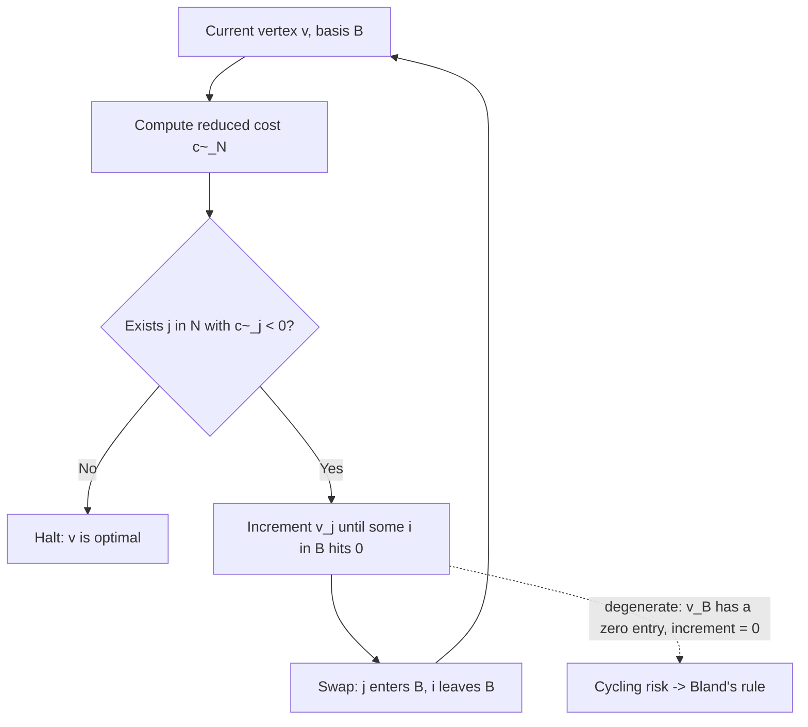

# 2. Simplex — vertices, bases, and reduced costs

## Standard form and the polytope

- The LP under study: minimize `cᵀx` subject to `Ax = b`, `x ≥ 0` coordinate-wise ([`3:25`](https://www.youtube.com/watch?v=4A5LiJpPDRw&t=205)).
- `P = { x : Ax = b, x ≥ 0 }` is the feasible polytope ([`3:57`](https://www.youtube.com/watch?v=4A5LiJpPDRw&t=237)).
- Dimensions: `A` is `m × n`; `c` and `b` are the cost and right-hand-side vectors ([`5:13`](https://www.youtube.com/watch?v=4A5LiJpPDRw&t=313)).

## Vertices and bases

- **Vertex definition used here:** `x ∈ P` is a vertex if the submatrix `A_x` has full column rank (linearly independent columns), where `A_x` is the submatrix of `A` given by the indices `j` with `x_j > 0` ([`4:28`](https://www.youtube.com/watch?v=4A5LiJpPDRw&t=268)).
- Call that index set `B'(x)`, the basis for `x`. Since column rank = row rank ≤ m, `|B'(x)| ≤ m` ([`5:13`](https://www.youtube.com/watch?v=4A5LiJpPDRw&t=313), [`5:47`](https://www.youtube.com/watch?v=4A5LiJpPDRw&t=347)).
- **Extension step:** to each vertex assign a basis `B(x) ⊆ {1..n}` with `|B(x)| = m` exactly, obtained by augmenting `B'(x)` with extra columns until `A_{B(x)}` has rank exactly `m` ([`5:47`](https://www.youtube.com/watch?v=4A5LiJpPDRw&t=347), [`6:24`](https://www.youtube.com/watch?v=4A5LiJpPDRw&t=384), [`6:43`](https://www.youtube.com/watch?v=4A5LiJpPDRw&t=403)).
- Assumption: `A` has full row rank — redundant rows are redundant constraints and are stripped in preprocessing (along with obvious infeasibility) ([`7:07`](https://www.youtube.com/watch?v=4A5LiJpPDRw&t=427)).
- Consequence: `A_B` is a square `m × m` **invertible** matrix ([`7:28`](https://www.youtube.com/watch?v=4A5LiJpPDRw&t=448)).
- `N := {1..n} \ B` is the complement — the coordinates that are (nominally) zero ([`8:00`](https://www.youtube.com/watch?v=4A5LiJpPDRw&t=480)).

## The algorithm shape

- Start at an initial vertex `x₀` — obtainable by running simplex on an auxiliary LP (covered in the previous lecture) — then greedily move to subsequent vertices until a halting condition ([`7:28`](https://www.youtube.com/watch?v=4A5LiJpPDRw&t=448), [`8:00`](https://www.youtube.com/watch?v=4A5LiJpPDRw&t=480)).
- The current vertex is always represented by its basis ([`8:00`](https://www.youtube.com/watch?v=4A5LiJpPDRw&t=480)).

## Deriving the reduced cost

1. Split the LP by basis: minimize `c_Bᵀ x_B + c_Nᵀ x_N` s.t. `A_B x_B + A_N x_N = b`, `x_B, x_N ≥ 0` ([`9:08`](https://www.youtube.com/watch?v=4A5LiJpPDRw&t=548), [`9:31`](https://www.youtube.com/watch?v=4A5LiJpPDRw&t=571)).
2. Multiply the equality by `A_B⁻¹` to write `x_B` in terms of `x_N`: `x_B = A_B⁻¹(b − A_N x_N)` ([`10:00`](https://www.youtube.com/watch?v=4A5LiJpPDRw&t=600), [`13:31`](https://www.youtube.com/watch?v=4A5LiJpPDRw&t=811)).
3. Substitute back: objective becomes the **constant** `c_Bᵀ A_B⁻¹ b` plus `(c_N − A_Nᵀ A_B⁻ᵀ c_B)ᵀ x_N` ([`10:26`](https://www.youtube.com/watch?v=4A5LiJpPDRw&t=626), [`11:13`](https://www.youtube.com/watch?v=4A5LiJpPDRw&t=673)).
4. That bracketed vector is the **reduced cost** `c̃_N` — the only part depending on the variables ([`11:13`](https://www.youtube.com/watch?v=4A5LiJpPDRw&t=673)).

## The pivot step (easy case: `v_B > 0` strictly)

- If some `j ∈ N` has `c̃_j < 0`, start **incrementing** the `j`-th coordinate of the current vertex `v` ([`12:37`](https://www.youtube.com/watch?v=4A5LiJpPDRw&t=757), [`13:09`](https://www.youtube.com/watch?v=4A5LiJpPDRw&t=789)).
- Because `x_B` depends on `x_N`, raising coordinate `j` implicitly moves basic variables, some of them downward ([`13:53`](https://www.youtube.com/watch?v=4A5LiJpPDRw&t=833)).
- You can only increment until some `i ∈ B` hits `x_i = 0`; that gives a **new vertex** — one previously-zero coordinate became positive, one positive coordinate became zero ([`14:09`](https://www.youtube.com/watch?v=4A5LiJpPDRw&t=849), [`14:25`](https://www.youtube.com/watch?v=4A5LiJpPDRw&t=865)).
- When `v_B > 0` strictly, the increment amount is **strictly positive**, so genuine progress is made ([`14:25`](https://www.youtube.com/watch?v=4A5LiJpPDRw&t=865), [`14:49`](https://www.youtube.com/watch?v=4A5LiJpPDRw&t=889)).

## Optimality / halting

- If `c̃_j ≥ 0` for all `j ∈ N`, **halt and declare optimality** ([`15:43`](https://www.youtube.com/watch?v=4A5LiJpPDRw&t=943)).
- Justification: the objective is a constant plus `c̃ᵀ x_N`; `x_N ≥ 0` everywhere in `P`, and `c̃ ≥ 0`, so that term can only go up. It is exactly `0` at the current vertex, so the current vertex beats every other point ([`15:43`](https://www.youtube.com/watch?v=4A5LiJpPDRw&t=943), [`16:21`](https://www.youtube.com/watch?v=4A5LiJpPDRw&t=981), [`16:41`](https://www.youtube.com/watch?v=4A5LiJpPDRw&t=1001)).

## The problem case (degeneracy)

- Because of the augmentation to size exactly `m`, some entry of `v_B` can be **zero** ([`16:41`](https://www.youtube.com/watch?v=4A5LiJpPDRw&t=1001)).
- Then even with a negative `c̃_j`, the `j`-th coordinate may **instantly saturate** a non-negativity constraint and cannot be incremented at all ([`17:10`](https://www.youtube.com/watch?v=4A5LiJpPDRw&t=1030)). This is what Bland's rule fixes.

