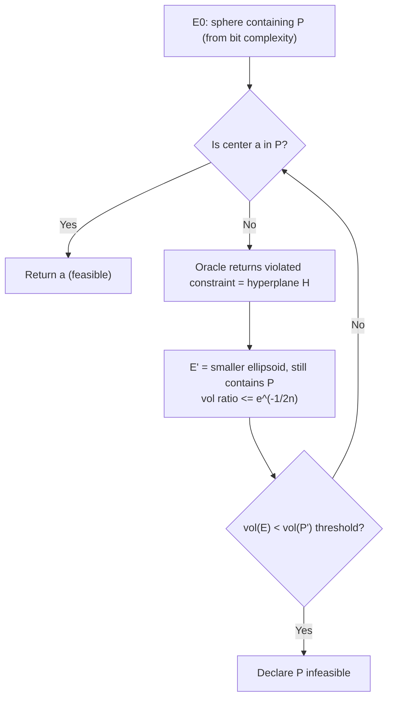

# 8. The ellipsoid algorithm

## Provenance and why it matters

- **First** polynomial-time algorithm for LP, due to **Khachiyan**, published in a Russian journal, in the 1970s ([`52:28`](https://www.youtube.com/watch?v=4A5LiJpPDRw&t=3148), [`52:55`](https://www.youtube.com/watch?v=4A5LiJpPDRw&t=3175)).
- Nothing is proved about it in this lecture — only the mechanism and the properties that make it more useful than interior point in certain situations ([`52:55`](https://www.youtube.com/watch?v=4A5LiJpPDRw&t=3175), [`53:58`](https://www.youtube.com/watch?v=4A5LiJpPDRw&t=3238)).

## Its killer feature: the separation oracle

- It can solve **exponentially sized LPs in polynomial time** in some cases ([`53:58`](https://www.youtube.com/watch?v=4A5LiJpPDRw&t=3238)).
- All it really needs is an **oracle**: given an infeasible point, return a violated constraint ([`54:21`](https://www.youtube.com/watch?v=4A5LiJpPDRw&t=3261)).
- If you can implement that oracle without writing down the LP, you never need the LP explicitly — and ellipsoid makes only a **polynomial number of oracle calls** ([`54:39`](https://www.youtube.com/watch?v=4A5LiJpPDRw&t=3279), [`54:57`](https://www.youtube.com/watch?v=4A5LiJpPDRw&t=3297)).
- Extension to **convex programming**: by the **separating hyperplane theorem** (also called the Hahn–Banach theorem), for any closed convex set and any point outside it there is always a separating hyperplane — so ellipsoid applies when the feasible region is a convex set, not just a polytope, provided you can implement the oracle and name an initial `E₀` ([`1:02:38`](https://www.youtube.com/watch?v=4A5LiJpPDRw&t=3758), [`1:03:02`](https://www.youtube.com/watch?v=4A5LiJpPDRw&t=3782), [`1:03:26`](https://www.youtube.com/watch?v=4A5LiJpPDRw&t=3806)).

## Definition of an ellipsoid

- For `a ∈ ℝⁿ` and a **positive definite** matrix `A`, `E(A, a) = { x : (x − a)ᵀ A⁻¹ (x − a) ≤ 1 }` ([`55:17`](https://www.youtube.com/watch?v=4A5LiJpPDRw&t=3317)).
- A unit sphere is `A = I` with `a` the center; in general ellipsoids are **linear transformations of the sphere** ([`56:15`](https://www.youtube.com/watch?v=4A5LiJpPDRw&t=3375)).

## The algorithm (feasibility)

Goal: test feasibility of `P = { x : Ax ≥ b }` ([`56:34`](https://www.youtube.com/watch?v=4A5LiJpPDRw&t=3394)).

1. **Start** with an ellipsoid `E₀` guaranteed to contain `P` (assuming `P` bounded) ([`57:16`](https://www.youtube.com/watch?v=4A5LiJpPDRw&t=3436), [`58:09`](https://www.youtube.com/watch?v=4A5LiJpPDRw&t=3489)).
   - How you know such a sphere exists: with rational inputs you clear denominators to get integers; a **bit-complexity** analysis of inverting an integer matrix and multiplying by the right-hand side bounds the bits needed to represent any vertex, hence bounds `P` inside a ball of known radius ([`58:09`](https://www.youtube.com/watch?v=4A5LiJpPDRw&t=3489), [`58:43`](https://www.youtube.com/watch?v=4A5LiJpPDRw&t=3523), [`59:07`](https://www.youtube.com/watch?v=4A5LiJpPDRw&t=3547)). Getting `E₀` is therefore easy ([`59:30`](https://www.youtube.com/watch?v=4A5LiJpPDRw&t=3570)).
2. **While** the center `a` of the current ellipsoid is not in `P` ([`59:30`](https://www.youtube.com/watch?v=4A5LiJpPDRw&t=3570)):
   - Infeasibility of `a` means some constraint (a hyperplane `H`) is violated, so all of `P` lies on the **other side** of `H` from `a` ([`1:00:36`](https://www.youtube.com/watch?v=4A5LiJpPDRw&t=3636), [`1:00:55`](https://www.youtube.com/watch?v=4A5LiJpPDRw&t=3655), [`1:01:29`](https://www.youtube.com/watch?v=4A5LiJpPDRw&t=3689)).
   - Build a new ellipsoid `E'` from `H` and the old `E` by a **closed-form formula**: `E'` still contains `P` but has smaller volume ([`1:01:29`](https://www.youtube.com/watch?v=4A5LiJpPDRw&t=3689), [`1:01:58`](https://www.youtube.com/watch?v=4A5LiJpPDRw&t=3718)).
3. If a center `a ∈ P` is found, **return `a`**; else once `vol(E)` becomes too small, **declare `P` empty** (infeasible) ([`1:03:49`](https://www.youtube.com/watch?v=4A5LiJpPDRw&t=3829), [`1:04:53`](https://www.youtube.com/watch?v=4A5LiJpPDRw&t=3893)).

**Shrinkage rate:** `vol(E') / vol(E) ≤ e^(−1/(2n))` ([`1:03:49`](https://www.youtube.com/watch?v=4A5LiJpPDRw&t=3829)). Hence `vol(E_k) ≤ vol(E₀) · e^(−k/(2n))`, and `vol(E₀)` is a computable sphere volume ([`1:13:04`](https://www.youtube.com/watch?v=4A5LiJpPDRw&t=4384)).

## The zero-volume problem and its fix

- **Alarm:** equality constraints (expressible as two inequalities) drop the polytope into a lower-dimensional subspace, giving it **zero volume** in the ambient space — so "volume too small" is meaningless ([`1:05:27`](https://www.youtube.com/watch?v=4A5LiJpPDRw&t=3927), [`1:05:57`](https://www.youtube.com/watch?v=4A5LiJpPDRw&t=3957)).
- **Preprocessing fix.** Let `L` be the bit complexity of `P`, roughly `log` of `max_{ij} |A_ij|` plus the largest entry of `b`, plus `m + n` ([`1:06:17`](https://www.youtube.com/watch?v=4A5LiJpPDRw&t=3977), [`1:06:59`](https://www.youtube.com/watch?v=4A5LiJpPDRw&t=4019)). Define the inflated polytope
  `P' = { x : Ax ≤ b + 2^(−L)·𝟙, and −2^L ≤ x_j ≤ 2^L for all j }` ([`1:06:59`](https://www.youtube.com/watch?v=4A5LiJpPDRw&t=4019), [`1:07:35`](https://www.youtube.com/watch?v=4A5LiJpPDRw&t=4055)).
- `P'` has volume that is exponentially small in `L` but **bounded away from zero** ([`1:07:52`](https://www.youtube.com/watch?v=4A5LiJpPDRw&t=4072)).
- **Theorem (proof deferred to the notes):** `P` is infeasible **iff** `P'` is infeasible ([`1:07:52`](https://www.youtube.com/watch?v=4A5LiJpPDRw&t=4072)). It again reduces to vertices being specified by a bounded number of bits ([`1:08:37`](https://www.youtube.com/watch?v=4A5LiJpPDRw&t=4117)).
- This gives the concrete stopping threshold: once `vol(E)` drops below `vol(P')`, declare infeasible ([`1:08:37`](https://www.youtube.com/watch?v=4A5LiJpPDRw&t=4117), [`1:13:31`](https://www.youtube.com/watch?v=4A5LiJpPDRw&t=4411)).
- Remaining wrinkle: a point found in `P'` may lie outside `P`, but there is a **rounding** procedure to get back into `P` (also not covered) ([`1:08:55`](https://www.youtube.com/watch?v=4A5LiJpPDRw&t=4135)).

## From feasibility to optimization

To solve `min cᵀx` s.t. `Ax = b`, `x ≥ 0` using only a feasibility routine ([`1:09:15`](https://www.youtube.com/watch?v=4A5LiJpPDRw&t=4155)):

1. Check whether `P = { x : Ax = b, x ≥ 0 }` is feasible; if not, output **not feasible** ([`1:09:52`](https://www.youtube.com/watch?v=4A5LiJpPDRw&t=4192)).
2. Check whether the dual region `P_dual = { y : Aᵀy ≤ c }` is feasible; if not, output **unbounded** ([`1:10:34`](https://www.youtube.com/watch?v=4A5LiJpPDRw&t=4234), [`1:11:17`](https://www.youtube.com/watch?v=4A5LiJpPDRw&t=4277)).
3. After steps 1–2 the primal is feasible and bounded, so by **strong duality** the dual is too and both attain the same value. Run feasibility once more on the combined system `Ax = b`, `x ≥ 0`, `Aᵀy ≤ c`, `cᵀx = bᵀy` — any feasible `(x, y)` is an **optimal primal–dual pair** ([`1:11:17`](https://www.youtube.com/watch?v=4A5LiJpPDRw&t=4277), [`1:12:00`](https://www.youtube.com/watch?v=4A5LiJpPDRw&t=4320)).

Not covered: the closed-form ellipsoid update itself ([`1:13:31`](https://www.youtube.com/watch?v=4A5LiJpPDRw&t=4411), [`1:13:58`](https://www.youtube.com/watch?v=4A5LiJpPDRw&t=4438)).
