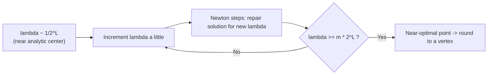

# 9. Interior point methods — preview

Only a flavor is given here; full details come next lecture ([`1:14:25`](https://www.youtube.com/watch?v=4A5LiJpPDRw&t=4465), [`1:24:12`](https://www.youtube.com/watch?v=4A5LiJpPDRw&t=5052)).

## Origins and character

- Introduced by **Karmarkar**, STOC 1984, journal version in *Combinatorica* 1984 ([`1:15:14`](https://www.youtube.com/watch?v=4A5LiJpPDRw&t=4514)).
- Also gives **poly-time LP**, has been very influential, and extends to other convex programs; entire books exist on it ([`1:15:14`](https://www.youtube.com/watch?v=4A5LiJpPDRw&t=4514), [`1:15:55`](https://www.youtube.com/watch?v=4A5LiJpPDRw&t=4555)).
- The material will look unlike typical algorithms-class content: expect **gradient descent, Newton's method, and multivariate calculus** ([`1:14:25`](https://www.youtube.com/watch?v=4A5LiJpPDRw&t=4465), [`1:14:52`](https://www.youtube.com/watch?v=4A5LiJpPDRw&t=4492)).

## Simplex vs. interior point

| Simplex | Interior point |
| --- | --- |
| Lives on the **exterior**, hopping vertex to vertex along edges ([`1:15:55`](https://www.youtube.com/watch?v=4A5LiJpPDRw&t=4555)) | Stays as **far from the exterior as possible**, moving toward an optimal vertex from the inside ([`1:15:55`](https://www.youtube.com/watch?v=4A5LiJpPDRw&t=4555), [`1:16:23`](https://www.youtube.com/watch?v=4A5LiJpPDRw&t=4583)) |

## Getting an initial interior point

- Chicken-and-egg: finding an interior point implies solving feasibility, which (as with ellipsoid) essentially solves the problem ([`1:16:23`](https://www.youtube.com/watch?v=4A5LiJpPDRw&t=4583), [`1:17:08`](https://www.youtube.com/watch?v=4A5LiJpPDRw&t=4628)).
- **Fix:** modify the LP so it has an obvious interior point, arranged so that the optimal vertex of the modified LP corresponds to a vertex of the original ([`1:17:08`](https://www.youtube.com/watch?v=4A5LiJpPDRw&t=4628), [`1:17:32`](https://www.youtube.com/watch?v=4A5LiJpPDRw&t=4652)).
- Mechanism: add **one extra variable** that trivially satisfies the constraints but is **heavily penalized** in the objective — e.g. weight `10^L` when the LP's numbers never exceed `2^L`, so a genuinely feasible instance never uses it ([`1:17:59`](https://www.youtube.com/watch?v=4A5LiJpPDRw&t=4679), [`1:18:11`](https://www.youtube.com/watch?v=4A5LiJpPDRw&t=4691), [`1:18:37`](https://www.youtube.com/watch?v=4A5LiJpPDRw&t=4717)).

## Iteration counts

- At least **`L`** iterations are needed ([`1:18:58`](https://www.youtube.com/watch?v=4A5LiJpPDRw&t=4738), [`1:19:16`](https://www.youtube.com/watch?v=4A5LiJpPDRw&t=4756)).
- Best known before recently: **`L · √m`** iterations, `m` = number of constraints ([`1:19:16`](https://www.youtube.com/watch?v=4A5LiJpPDRw&t=4756)).
- A paper from that year improved `√m` to **√(rank of the constraint matrix)** ([`1:19:16`](https://www.youtube.com/watch?v=4A5LiJpPDRw&t=4756)).
- Ellipsoid's running time also depends on `L`; there are **no known strongly polynomial-time algorithms for LP** ([`1:19:40`](https://www.youtube.com/watch?v=4A5LiJpPDRw&t=4780)).

## The barrier formulation

For `min cᵀx` s.t. `Ax ≥ b`, turn it into an **unconstrained** problem ([`1:19:40`](https://www.youtube.com/watch?v=4A5LiJpPDRw&t=4780), [`1:20:15`](https://www.youtube.com/watch?v=4A5LiJpPDRw&t=4815)):

- Slack vector `s(x) = Ax − b`, non-negative for any feasible `x` ([`1:20:15`](https://www.youtube.com/watch?v=4A5LiJpPDRw&t=4815)).
- Minimize over all `x ∈ ℝⁿ`: `λ·cᵀx + p(s(x))`, where `p` is a **barrier function** with `p(z) → ∞` as any `z_i → 0` ([`1:20:55`](https://www.youtube.com/watch?v=4A5LiJpPDRw&t=4855), [`1:21:40`](https://www.youtube.com/watch?v=4A5LiJpPDRw&t=4900)).
- The choice here is the **log barrier**: `p(z) = −Σ_{i=1}^{m} ln(z_i)` ([`1:21:40`](https://www.youtube.com/watch?v=4A5LiJpPDRw&t=4900)).
- At `λ = 0` you minimize the barrier alone, which pushes you well into the interior with no constraint tight; that minimizer is called the **analytic center** ([`1:22:25`](https://www.youtube.com/watch?v=4A5LiJpPDRw&t=4945), [`1:22:46`](https://www.youtube.com/watch?v=4A5LiJpPDRw&t=4966)).

## The path-following loop

1. Start with `λ` tiny — around `1/2^L`, i.e. inverse-exponential in `L` — with a way to get an initial point for that `λ` ([`1:22:46`](https://www.youtube.com/watch?v=4A5LiJpPDRw&t=4966), [`1:22:59`](https://www.youtube.com/watch?v=4A5LiJpPDRw&t=4979)).
2. Increment `λ` slightly to `λ'` ([`1:23:16`](https://www.youtube.com/watch?v=4A5LiJpPDRw&t=4996)).
3. Warm-start from the old solution and run a few steps of **Newton's method** to make it good for `λ'` ([`1:23:16`](https://www.youtube.com/watch?v=4A5LiJpPDRw&t=4996), [`1:23:33`](https://www.youtube.com/watch?v=4A5LiJpPDRw&t=5013)).
4. Repeat, alternating increment and Newton, until `λ` is big enough ([`1:23:47`](https://www.youtube.com/watch?v=4A5LiJpPDRw&t=5027)).
5. Once `λ ≈ m · 2^L`, a good solution to that subproblem is **almost optimal**, and it can be **rounded to a vertex** ([`1:23:47`](https://www.youtube.com/watch?v=4A5LiJpPDRw&t=5027), [`1:24:12`](https://www.youtube.com/watch?v=4A5LiJpPDRw&t=5052)).

