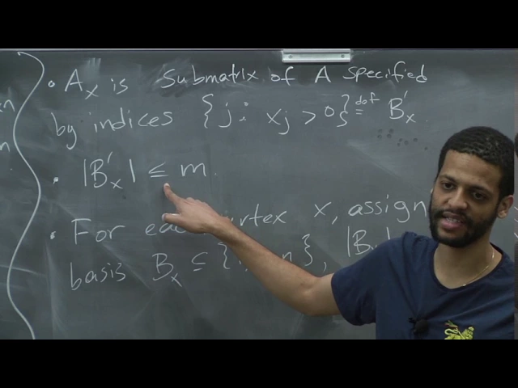
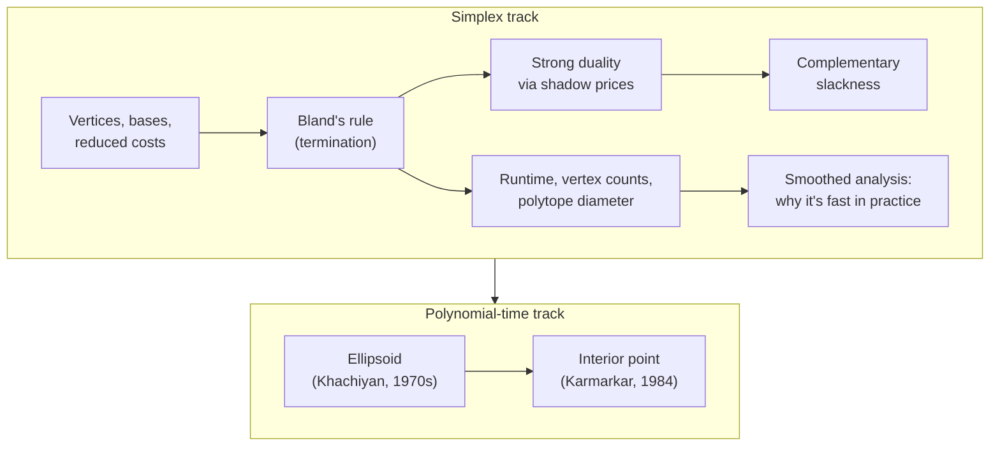

# Advanced Algorithms (COMPSCI 224), Lecture 16

*Harvard University · 1:24:57 · [Watch on YouTube](https://www.youtube.com/watch?v=4A5LiJpPDRw)*

## Summary

This lecture closes out the **simplex algorithm** and then surveys the polynomial-time alternatives for linear programming. It completes the reduced-cost pivot step, patches the degenerate case with **Bland's rule**, and uses the shadow price vector to derive **strong duality** and **complementary slackness** as corollaries of simplex terminating. The second half explains why simplex is exponential in the worst case but fast in practice (vertex counts, the polytope-diameter question and the fall of the Hirsch conjecture, and Spielman–Teng **smoothed analysis**), sketches the **ellipsoid** algorithm and its separation-oracle superpower, and previews **path-following interior point** methods with the log barrier.

## Topics

1. [Introduction — where LP algorithms stand](01-introduction.md)
2. [Simplex — vertices, bases, and reduced costs](02-simplex-vertices-bases-reduced-costs.md)
3. [Bland's rule — a pivoting rule that terminates](03-blands-rule.md)
4. [Strong duality out of simplex (plus a Q&A aside on rank)](04-strong-duality-from-simplex.md)
5. [Complementary slackness](05-complementary-slackness.md)
6. [Simplex running time and the polytope-diameter question](06-simplex-runtime-and-polytope-diameter.md)
7. [Smoothed analysis — why simplex is fast in practice](07-smoothed-analysis.md)
8. [The ellipsoid algorithm](08-ellipsoid-algorithm.md)
9. [Interior point methods — preview](09-interior-point-preview.md)

Full source text: [transcript.md](transcript.md)

## Key takeaways

- **Simplex halts exactly when the reduced cost `c̃_N = c_N − A_Nᵀ A_B⁻ᵀ c_B` is non-negative**, and that condition certifies global optimality because `x_N ≥ 0` throughout the polytope, so the objective can only rise from the current vertex ([`15:43`](https://www.youtube.com/watch?v=4A5LiJpPDRw&t=943), [`16:41`](https://www.youtube.com/watch?v=4A5LiJpPDRw&t=1001)).
- **Bland's rule is the pivoting rule that provably terminates** — enter the smallest-index `j` minimizing a negative `c̃_j`, leave the first `k` minimizing the ratio `min_i { (A_B⁻¹b)_i / (A_B⁻¹A)_{ij} : (A_B⁻¹A)_{ij} > 0 }` — where other rules can cycle forever on degenerate bases ([`19:44`](https://www.youtube.com/watch?v=4A5LiJpPDRw&t=1184), [`21:43`](https://www.youtube.com/watch?v=4A5LiJpPDRw&t=1303), [`22:35`](https://www.youtube.com/watch?v=4A5LiJpPDRw&t=1355)).
- **Strong duality falls out of simplex for free** via the shadow price vector `y = A_B⁻ᵀc_B`: at every iterate `cᵀv_B = bᵀy`, and the halting condition `c̃_N ≥ 0` is precisely dual feasibility of `y`, since the dual slack satisfies `r_B = 0` and `r_N = c̃_N` ([`28:15`](https://www.youtube.com/watch?v=4A5LiJpPDRw&t=1695), [`31:09`](https://www.youtube.com/watch?v=4A5LiJpPDRw&t=1869), [`31:55`](https://www.youtube.com/watch?v=4A5LiJpPDRw&t=1915)).
- **Complementary slackness follows in three lines:** the gap `cᵀx − bᵀy = Σ_i x_i r_i` is zero at optimality and every term is non-negative, so for each `i` either `x_i = 0` or the dual slack `r_i = 0` ([`36:39`](https://www.youtube.com/watch?v=4A5LiJpPDRw&t=2199), [`37:08`](https://www.youtube.com/watch?v=4A5LiJpPDRw&t=2228)).
- **The Hirsch conjecture (1957, diameter ≤ `m − d`) was disproved by Santos in the *Annals of Mathematics*, 2011**, with an explicit polytope at `d = 43`, `m = 86` and diameter ≥ 44 — off by one — plus an infinite family with diameter ≥ `(1 + ε)m`; these near-linear lower bounds still leave a `poly(m, d)` diameter bound, the necessary (not sufficient) condition for poly-time simplex, wide open ([`43:47`](https://www.youtube.com/watch?v=4A5LiJpPDRw&t=2627), [`44:31`](https://www.youtube.com/watch?v=4A5LiJpPDRw&t=2671), [`45:12`](https://www.youtube.com/watch?v=4A5LiJpPDRw&t=2712), [`46:12`](https://www.youtube.com/watch?v=4A5LiJpPDRw&t=2772)).
- **Spielman and Teng's smoothed analysis explains simplex's practical speed:** on a worst-case LP perturbed by independent mean-zero Gaussian noise on every entry of `A`, `b`, and `c`, simplex with a specific pivot rule runs in expected polynomial time (polynomial in the variance too) ([`49:07`](https://www.youtube.com/watch?v=4A5LiJpPDRw&t=2947), [`49:29`](https://www.youtube.com/watch?v=4A5LiJpPDRw&t=2969), [`50:57`](https://www.youtube.com/watch?v=4A5LiJpPDRw&t=3057)).
- **Ellipsoid needs only a separation oracle, not the LP itself** — each step shrinks volume by a factor `e^(−1/(2n))`, it makes polynomially many oracle calls, and it therefore solves exponentially sized LPs and general convex programs (via the separating hyperplane / Hahn–Banach theorem) ([`53:58`](https://www.youtube.com/watch?v=4A5LiJpPDRw&t=3238), [`54:39`](https://www.youtube.com/watch?v=4A5LiJpPDRw&t=3279), [`1:03:02`](https://www.youtube.com/watch?v=4A5LiJpPDRw&t=3782), [`1:03:49`](https://www.youtube.com/watch?v=4A5LiJpPDRw&t=3829)).
- **Zero-volume polytopes are handled by inflating to `P' = { Ax ≤ b + 2^(−L)𝟙, −2^L ≤ x_j ≤ 2^L }`**, which has exponentially small but non-zero volume and satisfies "`P` infeasible iff `P'` infeasible", giving ellipsoid a concrete stopping threshold ([`1:06:59`](https://www.youtube.com/watch?v=4A5LiJpPDRw&t=4019), [`1:07:52`](https://www.youtube.com/watch?v=4A5LiJpPDRw&t=4072)).
- **Interior point (Karmarkar, STOC/Combinatorica 1984) needs at least `L` iterations**; the best known bound was `L·√m`, improved that year to `L·√(rank of the constraint matrix)` — and **no strongly polynomial-time LP algorithm is known** ([`1:15:14`](https://www.youtube.com/watch?v=4A5LiJpPDRw&t=4514), [`1:19:16`](https://www.youtube.com/watch?v=4A5LiJpPDRw&t=4756), [`1:19:40`](https://www.youtube.com/watch?v=4A5LiJpPDRw&t=4780)).
