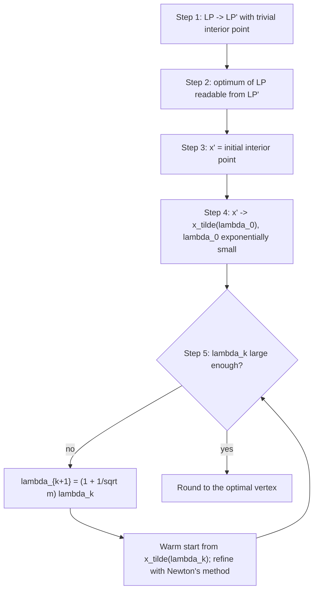

# 2. The five-step algorithm outline

The lecturer gives a deliberately "vague outline" first, then fills in the pieces out of order ([`8:12`](https://www.youtube.com/watch?v=PPCnYiTpbCo&t=492)).

## The steps

1. **Modify** the LP into an `LP'` that trivially has a known interior point ([`8:48`](https://www.youtube.com/watch?v=PPCnYiTpbCo&t=528)).
2. **Show** that if the LP is bounded and feasible, an optimal solution to `LP` can be read off from an optimal solution to `LP'` ([`8:48`](https://www.youtube.com/watch?v=PPCnYiTpbCo&t=528)).
3. Take `x'` = the initial interior point for `LP'` ([`10:01`](https://www.youtube.com/watch?v=PPCnYiTpbCo&t=601)).
4. From `x'`, obtain `x̃_{λ₀}`, an **approximate** minimizer of `f_{λ₀}` ([`10:40`](https://www.youtube.com/watch?v=PPCnYiTpbCo&t=640)).
5. **Main loop**: while `k` is below a threshold fixed by the analysis, use `x̃_{λk}` as the starting approximate solution for `f_{λk+1}` (with `λk+1` slightly larger than `λk`), refine it with an iterative method such as **Newton's method**, increment `k`, repeat ([`11:30`](https://www.youtube.com/watch?v=PPCnYiTpbCo&t=690), [`12:13`](https://www.youtube.com/watch?v=PPCnYiTpbCo&t=733)).

Steps 1–4 are pure initialization; all the real work is in step 5 ([`11:30`](https://www.youtube.com/watch?v=PPCnYiTpbCo&t=690)).

## Why the warm start works

- `λ₀` is chosen exponentially small, so the cost function is effectively ignored and the goal is just to land well inside the feasible region ([`13:08`](https://www.youtube.com/watch?v=PPCnYiTpbCo&t=788)).
- Because `λk+1` is only slightly bigger than `λk`, a **continuity argument** says an approximate minimizer of `f_{λk}` is still an (worse but usable) approximate minimizer of `f_{λk+1}` ([`13:28`](https://www.youtube.com/watch?v=PPCnYiTpbCo&t=808), [`13:47`](https://www.youtube.com/watch?v=PPCnYiTpbCo&t=827)).
- The iterative refinement then upgrades it back to a good approximate minimizer, producing `x̃_{λk+1}` ([`14:09`](https://www.youtube.com/watch?v=PPCnYiTpbCo&t=849)).
- Once `λk` is large enough, `λ·cᵀx` dominates the barrier term and the minimizer can be rounded easily to an optimal LP solution ([`14:22`](https://www.youtube.com/watch?v=PPCnYiTpbCo&t=862)).

## Order of presentation

The lecture assumes step 4 is already done, covers step 5 and the stopping condition first, and defers steps 1–4 to a later lecture ([`15:22`](https://www.youtube.com/watch?v=PPCnYiTpbCo&t=922), [`15:47`](https://www.youtube.com/watch?v=PPCnYiTpbCo&t=947)).

