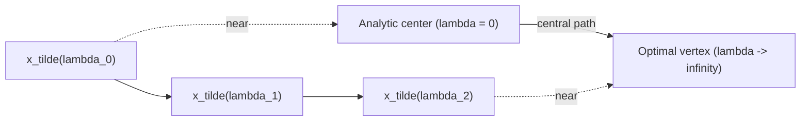

# 5. The central path and path-following IPMs

- The outline above is specifically a **path-following interior point method** ([`39:40`](https://www.youtube.com/watch?v=PPCnYiTpbCo&t=2380)).
- **Central path**: the curve `λ ↦ x_λ` traced as `λ` runs over `[0, ∞)` ([`40:22`](https://www.youtube.com/watch?v=PPCnYiTpbCo&t=2422), [`40:52`](https://www.youtube.com/watch?v=PPCnYiTpbCo&t=2452)).
  - At `λ = 0` the cost is irrelevant and the curve begins at the **analytic center** — as deep inside the region as possible ([`40:22`](https://www.youtube.com/watch?v=PPCnYiTpbCo&t=2422), [`40:52`](https://www.youtube.com/watch?v=PPCnYiTpbCo&t=2452)).
  - As `λ → ∞` the curve ends at an **optimal vertex** ([`40:52`](https://www.youtube.com/watch?v=PPCnYiTpbCo&t=2452)).
- The algorithm starts at the beginning of the curve and follows it ([`41:18`](https://www.youtube.com/watch?v=PPCnYiTpbCo&t=2478)).
- Blackboard cartoon: a feasible polygon with the cost pointing "upward" (minimizing gravity), the optimal vertex at the bottom, the analytic center somewhere inside, and the central path joining them ([`41:40`](https://www.youtube.com/watch?v=PPCnYiTpbCo&t=2500), [`41:58`](https://www.youtube.com/watch?v=PPCnYiTpbCo&t=2518)).
- Crucial point: the iterates `x̃_{λ0}, x̃_{λ1}, …` are **never exactly on the central path** — they stay near it, refine toward it, then get reused as the warm start for the next `λ` ([`41:58`](https://www.youtube.com/watch?v=PPCnYiTpbCo&t=2518), [`42:34`](https://www.youtube.com/watch?v=PPCnYiTpbCo&t=2554), [`43:00`](https://www.youtube.com/watch?v=PPCnYiTpbCo&t=2580)).
- Not every interior point method is described in path-following terms; this course presents the path-following version ([`43:00`](https://www.youtube.com/watch?v=PPCnYiTpbCo&t=2580), [`43:35`](https://www.youtube.com/watch?v=PPCnYiTpbCo&t=2615)).

