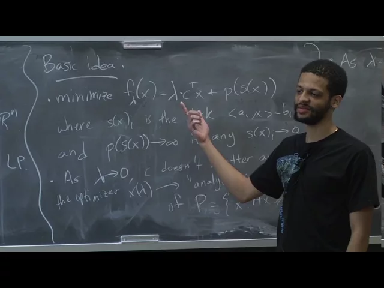
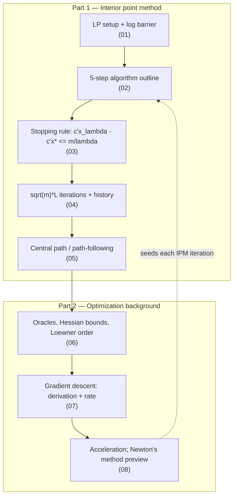

# Advanced Algorithms (COMPSCI 224), Lecture 17

*Harvard University · 1:26:44 · [Watch on YouTube](https://www.youtube.com/watch?v=PPCnYiTpbCo)*

## Summary

A university lecture on the **interior point method (IPM)** for linear programming. The first half sets up the method: replace `min cᵀx s.t. Ax ≥ b` by the penalized objective `f_λ(x) = λ·cᵀx − Σ log s(x)ᵢ`, follow the resulting *central path* from the analytic center of the feasible region toward the optimal vertex as `λ` grows, and prove the suboptimality bound `cᵀx_λ − cᵀx* ≤ m/λ` that says when to stop. Combining that with a `(1 + 1/√m)` step size for `λ` yields the classical `√m·L` iteration count, and the lecture places it against Karmarkar's `O(mL)`, Renegar's `O(√m·L)`, and the then-brand-new Lee–Sidford `Õ(√rank(A)·L)`. The second half is an optimization digression — oracles, Hessian bounds under the Loewner ordering, and a full derivation and convergence proof of gradient descent — as the warm-up for Newton's method, the second-order method that will actually drive each IPM iteration in the next lecture.

## Topics

1. [LP setup and the barrier-function idea](./01-lp-setup-and-the-barrier-idea.md)
2. [The five-step algorithm outline](./02-algorithm-outline.md)
3. [Stopping criterion: the `m/λ` suboptimality bound](./03-stopping-criterion-and-the-m-over-lambda-bound.md)
4. [Iteration count and the history of IPM bounds](./04-iteration-count-and-history.md)
5. [The central path and path-following IPMs](./05-central-path-and-path-following.md)
6. [Optimization background: oracles, Hessian bounds, Loewner ordering](./06-optimization-background-oracles-and-hessian-bounds.md)
7. [Gradient descent: where it comes from and how fast it converges](./07-gradient-descent-derivation-and-convergence.md)
8. [Acceleration, and what comes next (Newton's method)](./08-acceleration-and-newtons-method-preview.md)

Also in this folder: [`transcript.md`](./transcript.md), the verbatim timestamped transcript.

## Key takeaways

- **The central suboptimality bound is `cᵀx_λ − cᵀx* ≤ m/λ`**, proved from the single fact that slack vectors are non-negative, after setting `∇f_λ(x_λ) = 0` and dotting with `x_λ − x*` ([`29:42`](https://www.youtube.com/watch?v=PPCnYiTpbCo&t=1782), [`29:19`](https://www.youtube.com/watch?v=PPCnYiTpbCo&t=1759)).
- **Stopping is therefore a threshold on λ**: run until `λ ≥ m/ε ≈ m·exp(CL)` with `ε` exponentially small in the precision `L`, at which point the iterate rounds to the exact optimal vertex ([`30:30`](https://www.youtube.com/watch?v=PPCnYiTpbCo&t=1830), [`30:52`](https://www.youtube.com/watch?v=PPCnYiTpbCo&t=1852), [`19:32`](https://www.youtube.com/watch?v=PPCnYiTpbCo&t=1172)).
- **The step `λk+1 = (1 + 1/√m)·λk` gives `√m·(L + log m) ≈ √m·L` iterations**, because `√m` steps multiply `λ` by a constant factor and `log` of the `λ₀`-to-target ratio is `O(L + log m)` ([`31:41`](https://www.youtube.com/watch?v=PPCnYiTpbCo&t=1901), [`34:20`](https://www.youtube.com/watch?v=PPCnYiTpbCo&t=2060), [`35:28`](https://www.youtube.com/watch?v=PPCnYiTpbCo&t=2128)).
- **Historical progression of IPM iteration bounds**: `O(mL)` (Karmarkar, Combinatorica 1984) → `O(√m·L)` (Renegar, 1988) → `Õ(√rank(A)·L)` (Lee and Sidford, FOCS, announced about a week before this lecture) ([`35:28`](https://www.youtube.com/watch?v=PPCnYiTpbCo&t=2128), [`36:57`](https://www.youtube.com/watch?v=PPCnYiTpbCo&t=2217)).
- **Per iteration the algorithm never solves `f_λ` exactly** — it computes approximate minimizers, at a cost of a constant number of linear-system solves on `n × n` matrices ([`38:52`](https://www.youtube.com/watch?v=PPCnYiTpbCo&t=2332), [`39:08`](https://www.youtube.com/watch?v=PPCnYiTpbCo&t=2348)).
- **Gradient descent contracts error by `1 − μ/L` per step**, giving `O(L/μ)` iterations to halve the error and `O((L/μ)·log(1/ε))` to go from `δ` to `εδ`; **Nesterov's accelerated gradient descent (Soviet Math 1983) does it in `O(√(L/μ))`**, though the distinction is irrelevant for IPM since its control parameters are constants ([`1:15:22`](https://www.youtube.com/watch?v=PPCnYiTpbCo&t=4522), [`1:20:03`](https://www.youtube.com/watch?v=PPCnYiTpbCo&t=4803), [`1:21:08`](https://www.youtube.com/watch?v=PPCnYiTpbCo&t=4868), [`1:22:02`](https://www.youtube.com/watch?v=PPCnYiTpbCo&t=4922)).
- **IPM will use Newton's method, not gradient descent**, because it needs to explicitly compute the Hessian rather than merely bound it ([`1:24:14`](https://www.youtube.com/watch?v=PPCnYiTpbCo&t=5054), [`57:44`](https://www.youtube.com/watch?v=PPCnYiTpbCo&t=3464)).
