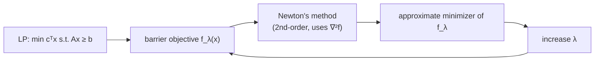

# 1. Recap: Interior Point and Second-Order Methods

## Where we left off

- The previous lecture gave the **outline of the interior point method (IPM)** and introduced **gradient descent**, a *first-order* method: it has oracle access to `f` and `∇f` at any query point, and minimizes `f` [`0:01`](https://www.youtube.com/watch?v=kqt1YV9dEoE&t=1).
- Today's subject is a **second-order** method — **Newton's method** — where the oracle additionally returns the **Hessian** `∇²f` [`0:34`](https://www.youtube.com/watch?v=kqt1YV9dEoE&t=34).
- The analysis of Newton's method is presented specifically because it is the engine inside interior point [`0:51`](https://www.youtube.com/watch?v=kqt1YV9dEoE&t=51).

## The IPM setup being recalled

- Goal: minimize `cᵀx` subject to `Ax ≥ b`; **any LP can be written in this form** [`0:51`](https://www.youtube.com/watch?v=kqt1YV9dEoE&t=51), [`1:18`](https://www.youtube.com/watch?v=kqt1YV9dEoE&t=78).
- The method repeatedly, approximately minimizes the barrier-penalized objective [`1:18`](https://www.youtube.com/watch?v=kqt1YV9dEoE&t=78):

  `f_λ(x) = λ·cᵀx − Σᵢ₌₁ᵐ ln(slack(x)ᵢ)`

- The **slack vector** is `s(x) = Ax − b` [`1:54`](https://www.youtube.com/watch?v=kqt1YV9dEoE&t=114).
- Newton's method is what produces "better and better solutions to `f_λ`" as `λ` is ratcheted up [`1:54`](https://www.youtube.com/watch?v=kqt1YV9dEoE&t=114).

## Second-order method, formally

- Minimize `f : ℝⁿ → ℝ` given oracle access to `f(x)`, `∇f(x)`, and `∇²f(x)` at any queried point `x` [`2:28`](https://www.youtube.com/watch?v=kqt1YV9dEoE&t=148).
- Start from some `x_init ∈ ℝⁿ` and repeatedly apply an update rule; the question to answer is **how fast the error decreases per update** [`3:07`](https://www.youtube.com/watch?v=kqt1YV9dEoE&t=187).

