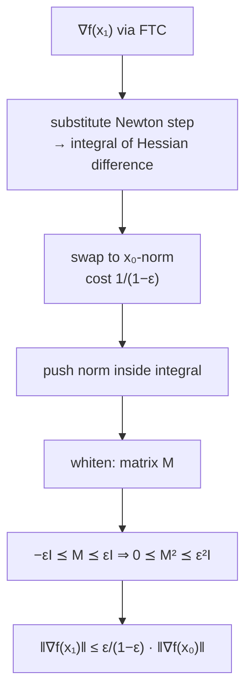

# 5. Proof of the Newton Progress Theorem

The lecturer's own summary: "conceptually there's not really a whole lot going on here, but it's just a lot of symbols" [`25:32`](https://www.youtube.com/watch?v=kqt1YV9dEoE&t=1532).

## Step 1 — express the new gradient exactly

- By the fundamental theorem of calculus (equivalently, a zeroth-order Taylor expansion with explicit error) [`18:11`](https://www.youtube.com/watch?v=kqt1YV9dEoE&t=1091), [`18:46`](https://www.youtube.com/watch?v=kqt1YV9dEoE&t=1126):

  `∇f(x₁) = ∇f(x₀) + ∫₀¹ ∇²f(x_t)(x₁ − x₀) dt`

- Substituting the Newton step `x₁ − x₀ = −(∇²f(x₀))⁻¹∇f(x₀)`, the leading `∇f(x₀)` cancels and one is left with an integral of the **Hessian difference** [`19:03`](https://www.youtube.com/watch?v=kqt1YV9dEoE&t=1143), [`20:06`](https://www.youtube.com/watch?v=kqt1YV9dEoE&t=1206):

  `∇f(x₁) = ∫₀¹ [∇²f(x₀) − ∇²f(x_t)] (∇²f(x₀))⁻¹ ∇f(x₀) dt`

- A student catches a sign error in the expansion; the lecturer confirms the middle term is subtracted and that the remaining piece is by definition `x₁ − x₀` [`22:41`](https://www.youtube.com/watch?v=kqt1YV9dEoE&t=1361), [`23:12`](https://www.youtube.com/watch?v=kqt1YV9dEoE&t=1392), [`23:51`](https://www.youtube.com/watch?v=kqt1YV9dEoE&t=1431).

## Step 2 — swap the norm to the `x₀` norm, at cost `1/(1−ε)`

- Because the Hessians are spectrally similar along the whole segment, the `∇²f(x₁)⁻¹`-norm can be replaced by the `∇²f(x₀)⁻¹`-norm **at a factor of at most `1/(1−ε)`** [`21:04`](https://www.youtube.com/watch?v=kqt1YV9dEoE&t=1264), [`22:24`](https://www.youtube.com/watch?v=kqt1YV9dEoE&t=1344).
- Reason: inverting the sandwich flips the constants — the inverses satisfy the same inequality with `1/(1+ε)` on one side and `1/(1−ε)` on the other [`22:41`](https://www.youtube.com/watch?v=kqt1YV9dEoE&t=1361).
- Justification given when questioned: apply the spectral theorem, `(UΛUᵀ)⁻¹ = UΛ⁻¹Uᵀ`, and the eigenvalues agree up to `1 ± ε`. Worst case the exponent is off by a square root, which only **changes `ε` by a constant factor** [`30:25`](https://www.youtube.com/watch?v=kqt1YV9dEoE&t=1825), [`30:42`](https://www.youtube.com/watch?v=kqt1YV9dEoE&t=1842), [`31:38`](https://www.youtube.com/watch?v=kqt1YV9dEoE&t=1898), [`31:51`](https://www.youtube.com/watch?v=kqt1YV9dEoE&t=1911).
- Pulling the norm **inside the integral** only increases the bound (triangle inequality for integrals) [`24:27`](https://www.youtube.com/watch?v=kqt1YV9dEoE&t=1467), [`24:51`](https://www.youtube.com/watch?v=kqt1YV9dEoE&t=1491).

## Step 3 — rewrite as a whitened quadratic form

- Expanding both sides using `‖x‖_A = √(xᵀAx)` shows the integrand equals a norm of `∇²f(x₀)^{−1/2}∇f(x₀)` conjugated by the matrix

  `M := ∇²f(x₀)^{−1/2}[∇²f(x₀) − ∇²f(x_t)]∇²f(x₀)^{−1/2}`

  [`25:55`](https://www.youtube.com/watch?v=kqt1YV9dEoE&t=1555), [`26:57`](https://www.youtube.com/watch?v=kqt1YV9dEoE&t=1617).
- This identity is pure symbol-pushing; it is left to the notes and to the reader to verify, and is "not something deep" [`27:25`](https://www.youtube.com/watch?v=kqt1YV9dEoE&t=1645), [`27:56`](https://www.youtube.com/watch?v=kqt1YV9dEoE&t=1676).

## Step 4 — bound `M²`

- By the whitened sandwich from topic 4: `−εI ⪯ M ⪯ εI` [`27:56`](https://www.youtube.com/watch?v=kqt1YV9dEoE&t=1676), [`28:34`](https://www.youtube.com/watch?v=kqt1YV9dEoE&t=1714).
- The quadratic form involves `M²`, and `M²` is PSD, so [`28:34`](https://www.youtube.com/watch?v=kqt1YV9dEoE&t=1714), [`29:22`](https://www.youtube.com/watch?v=kqt1YV9dEoE&t=1762):

  `0 ⪯ M² ⪯ ε²·I`

## Step 5 — collapse to the conclusion

- With `ε²I` in the middle, the quantity becomes a **scaled L2 norm**: the plain L2 norm scaled by `ε` (from the square root) [`32:10`](https://www.youtube.com/watch?v=kqt1YV9dEoE&t=1930), [`32:50`](https://www.youtube.com/watch?v=kqt1YV9dEoE&t=1970).
- Computing `zᵀz` on `z = ∇²f(x₀)^{−1/2}∇f(x₀)` turns the two `−1/2` powers into `∇²f(x₀)⁻¹`, recovering exactly the original centrality-style norm [`32:50`](https://www.youtube.com/watch?v=kqt1YV9dEoE&t=1970), [`33:20`](https://www.youtube.com/watch?v=kqt1YV9dEoE&t=2000).
- **Final factor: `ε/(1−ε)`**, the extra `1/(1−ε)` coming from the norm swap in step 2 [`33:20`](https://www.youtube.com/watch?v=kqt1YV9dEoE&t=2000).

