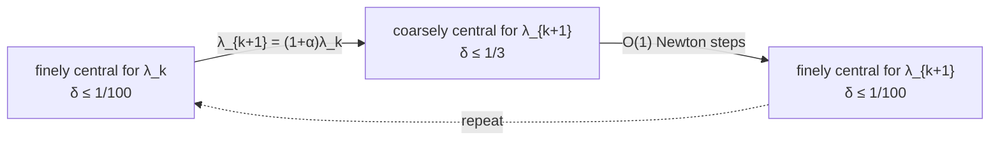

# 6. Back to Interior Point: Centrality, Fine and Coarse

## Gradient and Hessian of the barrier objective

With `f_λ(x) = λcᵀx − Σᵢ₌₁ᵐ log(s(x)ᵢ)` [`33:39`](https://www.youtube.com/watch?v=kqt1YV9dEoE&t=2019):

- **Gradient** [`34:33`](https://www.youtube.com/watch?v=kqt1YV9dEoE&t=2073):
  `∇f_λ(x) = λc − Aᵀ S(x)⁻¹ 𝟙`
  where `S(x)` is the **diagonal matrix** holding the slack vector on its diagonal, and `𝟙` is the all-ones vector [`34:33`](https://www.youtube.com/watch?v=kqt1YV9dEoE&t=2073), [`34:59`](https://www.youtube.com/watch?v=kqt1YV9dEoE&t=2099).
- **Hessian** [`34:59`](https://www.youtube.com/watch?v=kqt1YV9dEoE&t=2099):
  `∇²f_λ(x) = Aᵀ S(x)⁻² A`
- Crucially, **the Hessian does not depend on `c` or on `λ` at all** — only on the slacks [`34:59`](https://www.youtube.com/watch?v=kqt1YV9dEoE&t=2099), [`43:37`](https://www.youtube.com/watch?v=kqt1YV9dEoE&t=2617).

## Centrality

- **Definition.** The centrality of `x` for `f_{λ_k}` is [`37:12`](https://www.youtube.com/watch?v=kqt1YV9dEoE&t=2232):

  `δ_k(x) = ‖∇f_{λ_k}(x)‖_{(∇²f_{λ_k}(x))⁻¹}`

- If `x` is the exact minimizer of `f_λ`, then `δ_k(x) = 0`, because the gradient vanishes — so centrality measures **how close you are to the minimizer, in a funny norm** [`37:12`](https://www.youtube.com/watch?v=kqt1YV9dEoE&t=2232), [`38:07`](https://www.youtube.com/watch?v=kqt1YV9dEoE&t=2287).
- This is exactly the quantity Newton's progress theorem shrinks, which is why it is chosen as the IPM progress measure [`35:56`](https://www.youtube.com/watch?v=kqt1YV9dEoE&t=2156), [`36:51`](https://www.youtube.com/watch?v=kqt1YV9dEoE&t=2211).

## Two thresholds

| Term | Condition | Timestamp |
|---|---|---|
| **Finely central** for `f_{λ_k}` | `δ_k(x) ≤ 1/100` | [`38:35`](https://www.youtube.com/watch?v=kqt1YV9dEoE&t=2315) |
| **Coarsely central** for `f_{λ_k}` | `δ_k(x) ≤ 1/3` | [`38:35`](https://www.youtube.com/watch?v=kqt1YV9dEoE&t=2315) |

## The IPM invariant

- Start with an approximate optimum for `λ₀`, bump to a slightly larger `λ₁`, warm-start Newton's method there, run a few steps, then bump to `λ₂`, and so on [`36:25`](https://www.youtube.com/watch?v=kqt1YV9dEoE&t=2185), [`36:51`](https://www.youtube.com/watch?v=kqt1YV9dEoE&t=2211).
- The loop invariant: hold a **finely central** point for `λ_k`; if `λ_{k+1}` is not too much bigger, that point is still **coarsely central** for `λ_{k+1}` [`39:24`](https://www.youtube.com/watch?v=kqt1YV9dEoE&t=2364).
- Going from `1/3` back down to `1/100` costs only a **constant number of Newton steps**, since each step (or each constant number of steps) roughly halves the error while the Hessians behave [`39:47`](https://www.youtube.com/watch?v=kqt1YV9dEoE&t=2387), [`40:05`](https://www.youtube.com/watch?v=kqt1YV9dEoE&t=2405), [`40:18`](https://www.youtube.com/watch?v=kqt1YV9dEoE&t=2418).
- The famous **`1 + 1/√m` growth rate for `λ`** is precisely the largest increment that preserves coarse centrality [`40:40`](https://www.youtube.com/watch?v=kqt1YV9dEoE&t=2440), [`40:55`](https://www.youtube.com/watch?v=kqt1YV9dEoE&t=2455).
- On quantifiers: `ε` need not be uniform across `λ`'s. Newton's method is re-instantiated for each `f_{λ_k}` separately, so it suffices that `ε` be a fixed small constant **within each instantiation** [`40:55`](https://www.youtube.com/watch?v=kqt1YV9dEoE&t=2455), [`41:21`](https://www.youtube.com/watch?v=kqt1YV9dEoE&t=2481).

