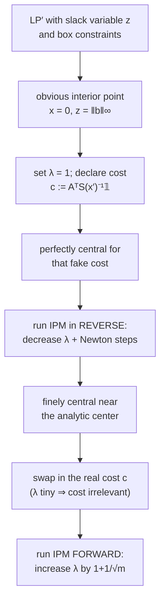

# 10. Initialization: Getting the First Central Point

The whole method assumes a coarsely (or finely) central `x̃(λ₀)` to start from. This closing section sketches how to manufacture one — precision calculations are deliberately omitted and deferred to the notes [`1:13:18`](https://www.youtube.com/watch?v=kqt1YV9dEoE&t=4398), [`1:17:13`](https://www.youtube.com/watch?v=kqt1YV9dEoE&t=4633).

## Step 1 — Modify the LP so an interior point is obvious

- Build **LP′** [`1:17:42`](https://www.youtube.com/watch?v=kqt1YV9dEoE&t=4662), [`1:18:03`](https://www.youtube.com/watch?v=kqt1YV9dEoE&t=4683):

  ```
  minimize   cᵀx + N·z
  subject to Ax + 𝟙·z ≥ b
             0 ≤ z ≤ 2^{L+1}
             −2^{L+1}·𝟙 ≤ x ≤ 2^{L+1}·𝟙
  ```

- **Claim.** If `N` is exponential in the precision (e.g. `10^L` or `100^L`), then whenever the original LP is **bounded and feasible**, every optimum of LP′ has **`z = 0`** — so solving LP′ solves the original LP [`1:18:40`](https://www.youtube.com/watch?v=kqt1YV9dEoE&t=4720), [`1:19:20`](https://www.youtube.com/watch?v=kqt1YV9dEoE&t=4760).
- Proved via precision arguments; a reference is promised in the notes. Separately, any solution of the original LP has **bounded precision** anyway [`1:19:20`](https://www.youtube.com/watch?v=kqt1YV9dEoE&t=4760), [`1:19:36`](https://www.youtube.com/watch?v=kqt1YV9dEoE&t=4776).
- LP′ has an **obvious interior point**: `x = 0`, `z = ‖b‖_∞` [`1:19:36`](https://www.youtube.com/watch?v=kqt1YV9dEoE&t=4776), [`1:20:02`](https://www.youtube.com/watch?v=kqt1YV9dEoE&t=4802).
- But an interior point is **not enough** — it must be central for some known `λ`, and this one isn't known to be [`1:20:02`](https://www.youtube.com/watch?v=kqt1YV9dEoE&t=4802), [`1:20:35`](https://www.youtube.com/watch?v=kqt1YV9dEoE&t=4835).

## Step 2 — The trick: change the cost function instead

- Set **`λ = 1`** and look at `∇f_λ(x′) = λc − AᵀS(x′)⁻¹𝟙`. Optimality means zero gradient [`1:20:35`](https://www.youtube.com/watch?v=kqt1YV9dEoE&t=4835), [`1:21:25`](https://www.youtube.com/watch?v=kqt1YV9dEoE&t=4885), [`1:21:55`](https://www.youtube.com/watch?v=kqt1YV9dEoE&t=4915).
- The trick: `x′` is **perfectly central for a *different* cost function**, namely `c := AᵀS(x′)⁻¹𝟙`, which makes the gradient identically zero [`1:21:55`](https://www.youtube.com/watch?v=kqt1YV9dEoE&t=4915), [`1:22:23`](https://www.youtube.com/watch?v=kqt1YV9dEoE&t=4943).

## Step 3 — Run the algorithm backwards, then swap the cost

- With a perfectly central point for *some* cost function in hand, **run all the update steps in reverse**: decrement `λ` a little at a time and run Newton's method, until `λ` is exponentially small in the precision [`1:22:23`](https://www.youtube.com/watch?v=kqt1YV9dEoE&t=4943), [`1:22:48`](https://www.youtube.com/watch?v=kqt1YV9dEoE&t=4968).
- The result is a point that is **finely central near the analytic center** [`1:23:04`](https://www.youtube.com/watch?v=kqt1YV9dEoE&t=4984).
- Key property: once `λ` is that tiny, **the cost function barely matters** — so you can swap in the real cost `c` and remain finely central for it (for any cost function of bounded precision) [`1:23:04`](https://www.youtube.com/watch?v=kqt1YV9dEoE&t=4984), [`1:23:27`](https://www.youtube.com/watch?v=kqt1YV9dEoE&t=5007).
- Then run everything **forward** with the true cost function [`1:23:27`](https://www.youtube.com/watch?v=kqt1YV9dEoE&t=5007), [`1:24:18`](https://www.youtube.com/watch?v=kqt1YV9dEoE&t=5058).


