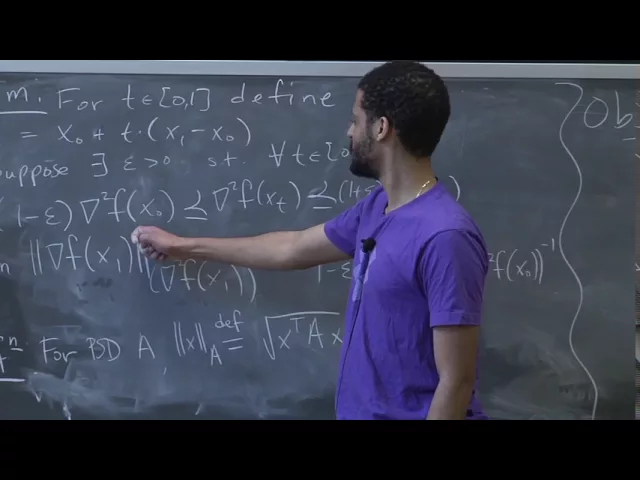
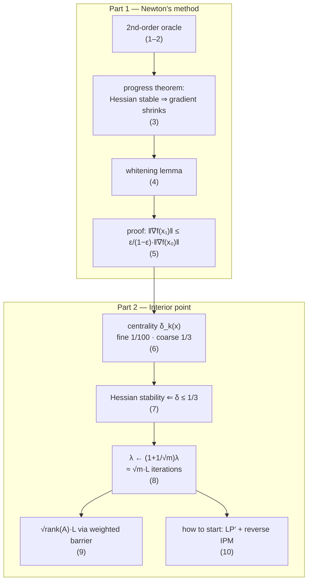

# Advanced Algorithms (COMPSCI 224), Lecture 18

*Harvard University · 1:24:42 · [Watch on YouTube](https://www.youtube.com/watch?v=kqt1YV9dEoE)*

## Summary

This lecture completes the analysis of the **interior point method (IPM)** for linear programming by supplying its missing engine: **Newton's method**, a second-order optimization method with oracle access to `f`, `∇f`, and `∇²f`. The first half states and proves a progress theorem — if the Hessian is spectrally stable along the segment between consecutive iterates (within a factor `1 ± ε`), one Newton step shrinks the gradient's Hessian-norm by a factor `ε/(1−ε)`. The second half plugs that theorem into IPM: it defines **centrality** as the progress measure, proves that the Hessian of the log-barrier objective is stable precisely because the centrality is small, and derives the classic **`λ ← (1 + 1/√m)·λ`** step size, giving `≈ √m·L` outer iterations. The lecture closes with the current best bound (`√rank(A)·L`, via Lee–Sidford's weighted barrier) and a sketch of how to construct the initial central point.

Classification: **educational video** — a university lecture in a theory course, structured as theorem → proof → application.

## Topic breakdown

1. [Recap: Interior Point and Second-Order Methods](01-recap-and-second-order-methods.md) — the LP setup, the barrier objective `f_λ`, and what a second-order oracle is.
2. [Newton's Method: the Update Rule and Where It Comes From](02-newtons-method-update-rule.md) — `x₁ = x₀ − (∇²f)⁻¹∇f` as the minimizer of the second-order Taylor model.
3. [The Progress Theorem and the Hessian Promise](03-progress-theorem-and-the-hessian-promise.md) — the `1 ± ε` Loewner sandwich along the segment, and the `‖·‖_A` norm.
4. [Preliminary: Rewriting the Spectral Sandwich](04-spectral-sandwiching-lemma.md) — whitening `(1−ε)A ⪯ B ⪯ (1+ε)A` into `−εI ⪯ A^{−1/2}(B−A)A^{−1/2} ⪯ εI`.
5. [Proof of the Newton Progress Theorem](05-proof-of-the-newton-progress-theorem.md) — FTC, norm swap, whitening, and the `M² ⪯ ε²I` bound.
6. [Back to Interior Point: Centrality, Fine and Coarse](06-centrality-fine-and-coarse.md) — `∇f_λ`, `∇²f_λ`, and the `1/100` vs `1/3` thresholds.
7. [Verifying Newton's Hypothesis: How Much the Hessian Moves](07-hessian-stability-along-the-newton-step.md) — reducing Hessian stability to slack stability, and showing `ε = δ(x₀)`.
8. [How Fast Can `λ` Grow? The `1 + 1/√m` Bound](08-how-fast-lambda-can-grow.md) — the add-and-subtract trick, the projection-matrix bound `√m`, and the iteration count.
9. [State of the Art: Lee–Sidford's Weighted Barrier](09-lee-sidford-weighted-barrier.md) — why the unweighted barrier double-counts constraints, and the `√rank(A)` improvement.
10. [Initialization: Getting the First Central Point](10-initializing-the-ipm.md) — the augmented LP′, the fake-cost trick, and running the IPM in reverse.

## Key takeaways

- **One Newton step contracts the gradient by `ε/(1−ε)`** in the Hessian-inverse norm, provided the Hessian stays within `(1±ε)·∇²f(x₀)` everywhere on the segment from `x₀` to `x₁` [`8:13`](https://www.youtube.com/watch?v=kqt1YV9dEoE&t=493), [`11:22`](https://www.youtube.com/watch?v=kqt1YV9dEoE&t=682), [`33:20`](https://www.youtube.com/watch?v=kqt1YV9dEoE&t=2000).
- **The Hessian of the log-barrier objective `∇²f_λ(x) = AᵀS(x)⁻²A` does not depend on `c` or `λ`** — only on the slacks — so Hessian stability reduces entirely to slack-matrix stability [`34:59`](https://www.youtube.com/watch?v=kqt1YV9dEoE&t=2099), [`44:01`](https://www.youtube.com/watch?v=kqt1YV9dEoE&t=2641), [`58:06`](https://www.youtube.com/watch?v=kqt1YV9dEoE&t=3486).
- **The `ε` in Newton's hypothesis equals the centrality of the starting point**: along the Newton segment the relative slack change is at most `t·δ(x₀) ≤ δ(x₀)`. Starting coarsely central (`δ ≤ 1/3`) gives `ε = 1/3 < 1/2`, hence a contraction factor of `1/2` per step and `O(1)` steps to return from `1/3` to `1/100` [`40:05`](https://www.youtube.com/watch?v=kqt1YV9dEoE&t=2405), [`51:44`](https://www.youtube.com/watch?v=kqt1YV9dEoE&t=3104), [`52:16`](https://www.youtube.com/watch?v=kqt1YV9dEoE&t=3136), [`53:45`](https://www.youtube.com/watch?v=kqt1YV9dEoE&t=3225).
- **`λ` can be multiplied by `1 + Θ(1/√m)` per outer step.** The bound `δ_{k+1} ≤ (1+α)·δ_k + α√m` comes from an orthogonal-projection argument (`‖𝟙‖₂ = √m`); requiring `δ_{k+1} ≤ 1/3` from `δ_k ≤ 1/100` forces `α ≈ 1/(10√m)` [`1:10:58`](https://www.youtube.com/watch?v=kqt1YV9dEoE&t=4258), [`1:11:33`](https://www.youtube.com/watch?v=kqt1YV9dEoE&t=4293), [`1:12:05`](https://www.youtube.com/watch?v=kqt1YV9dEoE&t=4325).
- **Total outer-loop cost is `≈ √m·L` iterations**, driving `λ` from roughly `exp(−L)` up to `m·exp(L)` for precision `L`; the best known bound improves this to **`√rank(A)·L`** (Lee–Sidford), by replacing the barrier with a weighted one so that duplicated constraints are not over-counted — making algorithmic an earlier non-constructive existence result of Nesterov (and Nemirovski) [`1:12:30`](https://www.youtube.com/watch?v=kqt1YV9dEoE&t=4350), [`1:12:52`](https://www.youtube.com/watch?v=kqt1YV9dEoE&t=4372), [`1:13:18`](https://www.youtube.com/watch?v=kqt1YV9dEoE&t=4398), [`1:14:26`](https://www.youtube.com/watch?v=kqt1YV9dEoE&t=4466), [`1:16:25`](https://www.youtube.com/watch?v=kqt1YV9dEoE&t=4585).
- **Initialization is solved by running the method in reverse.** Augment the LP with a slack variable `z` penalized by `N ≈ 10^L` (bounded + feasible original LP ⇒ optimum has `z = 0`), take the obvious interior point `x = 0, z = ‖b‖_∞`, declare a *fake* cost `c = AᵀS(x′)⁻¹𝟙` for which that point is perfectly central at `λ = 1`, decrease `λ` to exponentially small while running Newton — then swap in the real cost, which no longer matters at tiny `λ`, and run forward [`1:18:40`](https://www.youtube.com/watch?v=kqt1YV9dEoE&t=4720), [`1:20:02`](https://www.youtube.com/watch?v=kqt1YV9dEoE&t=4802), [`1:22:23`](https://www.youtube.com/watch?v=kqt1YV9dEoE&t=4943), [`1:22:48`](https://www.youtube.com/watch?v=kqt1YV9dEoE&t=4968), [`1:23:27`](https://www.youtube.com/watch?v=kqt1YV9dEoE&t=5007).
