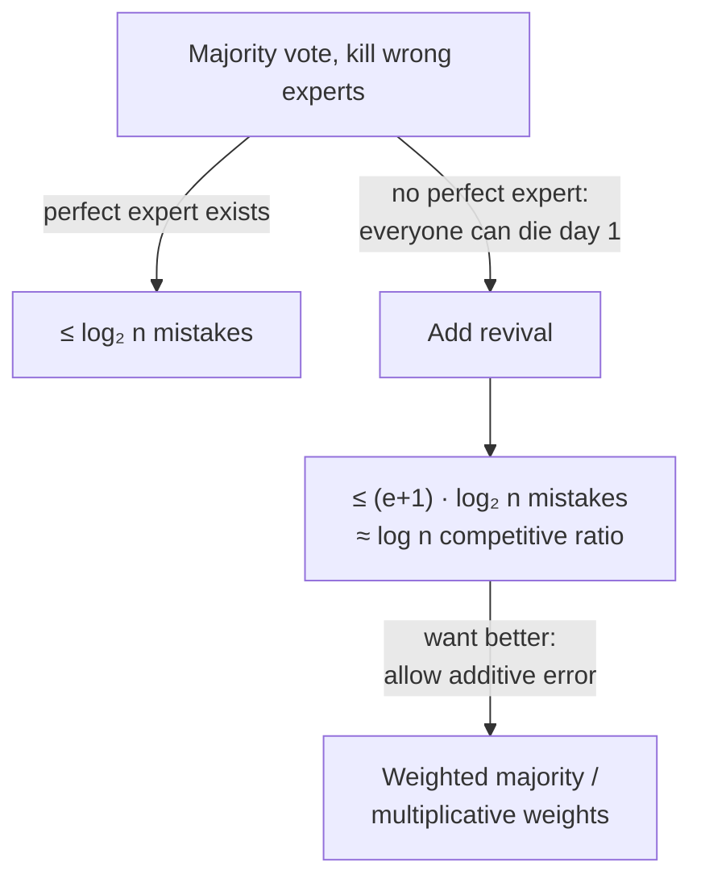

# 2. Majority vote, elimination, and revival

The lecture builds up to multiplicative weights through two warm-up algorithms, each analyzed exactly.

## Algorithm A — majority vote + kill the wrong

- **Rule:** take a plain (unweighted) majority vote of all living experts; at the end of the day, "kill" (permanently ignore) every expert who was wrong [`6:36`](https://www.youtube.com/watch?v=R9mT5CtdHLg&t=396) [`7:17`](https://www.youtube.com/watch?v=R9mT5CtdHLg&t=437) [`7:29`](https://www.youtube.com/watch?v=R9mT5CtdHLg&t=449).
- **Claim:** if some expert is *perfect* (never wrong), the algorithm makes at most `log₂ n` mistakes [`7:29`](https://www.youtube.com/watch?v=R9mT5CtdHLg&t=449) [`8:19`](https://www.youtube.com/watch?v=R9mT5CtdHLg&t=499).
- **Proof idea:** every day we are wrong, the majority of the (weighted-by-count) population was wrong, so at least half the surviving experts get killed. The perfect expert is never killed, so the population never empties — hence at most `log₂ n` halvings [`8:19`](https://www.youtube.com/watch?v=R9mT5CtdHLg&t=499) [`8:55`](https://www.youtube.com/watch?v=R9mT5CtdHLg&t=535) [`9:26`](https://www.youtube.com/watch?v=R9mT5CtdHLg&t=566).

**Failure mode:** without a perfect expert, everyone can be wrong on day 1, killing the entire population and leaving nobody to listen to [`9:50`](https://www.youtube.com/watch?v=R9mT5CtdHLg&t=590) [`10:13`](https://www.youtube.com/watch?v=R9mT5CtdHLg&t=613).

## Algorithm B — same, but revive everyone when all are dead

- **Rule:** as above, but whenever every expert is dead, revive all of them and start a new phase [`10:59`](https://www.youtube.com/watch?v=R9mT5CtdHLg&t=659) [`11:14`](https://www.youtube.com/watch?v=R9mT5CtdHLg&t=674).
- **Claim:** if the best expert makes `e` errors, we make at most `e + 1` phases' worth of errors, i.e. at most `(e + 1) · log₂ n` mistakes [`11:46`](https://www.youtube.com/watch?v=R9mT5CtdHLg&t=706).
- **Proof structure** [`12:47`](https://www.youtube.com/watch?v=R9mT5CtdHLg&t=767) [`13:11`](https://www.youtube.com/watch?v=R9mT5CtdHLg&t=791) [`13:33`](https://www.youtube.com/watch?v=R9mT5CtdHLg&t=813):
  1. A phase can only end by killing the best expert, and the best expert dies at most `e` times → at most `e + 1` phases (counting the initial one).
  2. Within a phase, at most `log₂ n` of our mistakes can occur before everyone is dead.

## Verdict

- This is roughly a **logarithmic competitive ratio** (`log n · e`, plus an additive term) — real, but unsatisfying [`13:33`](https://www.youtube.com/watch?v=R9mT5CtdHLg&t=813) [`14:43`](https://www.youtube.com/watch?v=R9mT5CtdHLg&t=883).
- To do better, we must **allow additive error** in the competitive guarantee, not just a multiplicative one [`14:43`](https://www.youtube.com/watch?v=R9mT5CtdHLg&t=883).

