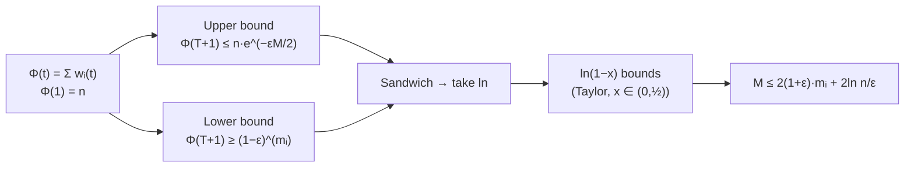

# 4. Potential-function analysis of weighted majority

The whole proof is the **sandwich pattern**: upper-bound a potential, lower-bound the same potential, compare.

## The potential

- `w(t)` = weight vector at the beginning of day `t` [`22:10`](https://www.youtube.com/watch?v=R9mT5CtdHLg&t=1330).
- `Φ(t) = Σᵢ₌₁ⁿ wᵢ(t)` — the total weight [`22:36`](https://www.youtube.com/watch?v=R9mT5CtdHLg&t=1356).
- Base case: `Φ(1) = n`, since all weights start at 1 [`22:36`](https://www.youtube.com/watch?v=R9mT5CtdHLg&t=1356).

## Upper bound (shrinkage on mistake days)

- If **we** are wrong on day `t`, then by definition of a weighted majority at least **half the total weight** sat on the wrong answer [`24:05`](https://www.youtube.com/watch?v=R9mT5CtdHLg&t=1445) [`24:37`](https://www.youtube.com/watch?v=R9mT5CtdHLg&t=1477).
- That half shrinks by `(1 − ε)`; the other half certainly does not grow, so bound it pessimistically as unchanged [`24:57`](https://www.youtube.com/watch?v=R9mT5CtdHLg&t=1497) [`25:18`](https://www.youtube.com/watch?v=R9mT5CtdHLg&t=1518).
- Result: `Φ(t+1) ≤ (1 − ε/2)·Φ(t)` on any day we make a mistake [`25:18`](https://www.youtube.com/watch?v=R9mT5CtdHLg&t=1518).
- By induction over the `M(T)` mistake days: `Φ(T+1) ≤ n·(1 − ε/2)^{M(T)}` [`26:05`](https://www.youtube.com/watch?v=R9mT5CtdHLg&t=1565) [`26:56`](https://www.youtube.com/watch?v=R9mT5CtdHLg&t=1616).
- Applying the standing trick `1 − x ≤ e^{−x}` (and `1 + x ≤ e^{x}`): **`Φ(T+1) ≤ n · e^{−ε·M(T)/2}`** [`26:56`](https://www.youtube.com/watch?v=R9mT5CtdHLg&t=1616).

## Lower bound (the weakest one imaginable)

- All weights are non-negative, so the total is at least any single weight: `Φ(T+1) ≥ wᵢ(T)` for any expert `i`, in particular the best one [`28:00`](https://www.youtube.com/watch?v=R9mT5CtdHLg&t=1680) [`28:28`](https://www.youtube.com/watch?v=R9mT5CtdHLg&t=1708).
- And `wᵢ(T) = (1 − ε)^{mᵢ(T)}` — one factor per mistake expert `i` made [`28:28`](https://www.youtube.com/watch?v=R9mT5CtdHLg&t=1708).

## Combining

Sandwiching gives [`29:32`](https://www.youtube.com/watch?v=R9mT5CtdHLg&t=1772):

```
(1 − ε)^{mᵢ(T)}  ≤  n · (1 − ε/2)^{M(T)}
```

Take natural logs [`29:59`](https://www.youtube.com/watch?v=R9mT5CtdHLg&t=1799):

```
mᵢ(T)·ln(1 − ε)  ≤  M(T)·ln(1 − ε/2) + ln n
```

## The calculus ingredient

- Taylor's theorem with remainder: expanding `f` around `a` to the linear term leaves error `f''(z)/2 · x²` for some `z` between `a` and `x` [`30:33`](https://www.youtube.com/watch?v=R9mT5CtdHLg&t=1833) [`31:14`](https://www.youtube.com/watch?v=R9mT5CtdHLg&t=1874).
- Expanding `ln(1 − x)` about 0 and bounding the derivative on the relevant range yields, **for `x ∈ (0, ½)`** [`31:53`](https://www.youtube.com/watch?v=R9mT5CtdHLg&t=1913) [`32:30`](https://www.youtube.com/watch?v=R9mT5CtdHLg&t=1950) [`33:34`](https://www.youtube.com/watch?v=R9mT5CtdHLg&t=2014):

  ```
  −x − x²  ≤  ln(1 − x)  ≤  −x
  ```
  This two-sided bound is exactly why the theorem requires `ε ∈ (0, ½)`.

## Finishing

- Right-hand side: `ln(1 − ε/2) ≤ −ε/2` [`34:09`](https://www.youtube.com/watch?v=R9mT5CtdHLg&t=2049).
- Left-hand side: `mᵢ(T)·ln(1 − ε) ≥ mᵢ(T)·(−ε − ε²/2)` [`34:51`](https://www.youtube.com/watch?v=R9mT5CtdHLg&t=2091) [`35:13`](https://www.youtube.com/watch?v=R9mT5CtdHLg&t=2113).
- Multiply through by `−1`, rearrange, and the theorem of the previous topic falls out [`35:13`](https://www.youtube.com/watch?v=R9mT5CtdHLg&t=2113).


