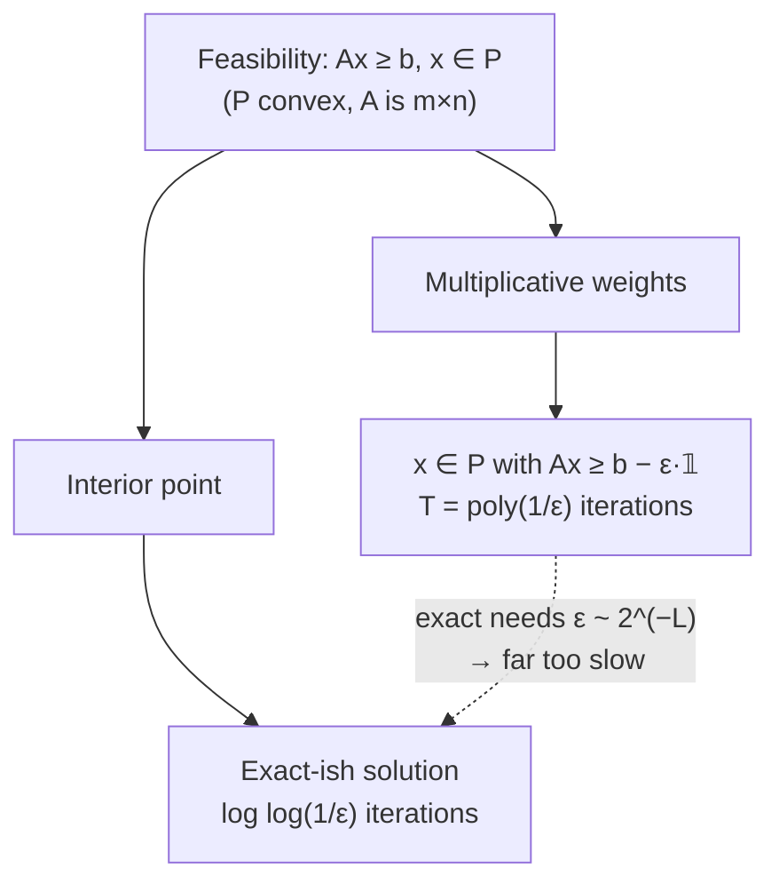

# 7. Using MW to approximately solve linear programs

## The application

- MW is not just about stocks and weather — it can **approximately solve linear programs** [`1:02:49`](https://www.youtube.com/watch?v=R9mT5CtdHLg&t=3769) [`1:03:12`](https://www.youtube.com/watch?v=R9mT5CtdHLg&t=3792).
- Historical result cited: **Plotkin, Shmoys and Tardos** (*Mathematics of Operations Research*) used multiplicative weights to approximately solve **packing and covering LPs** [`1:03:12`](https://www.youtube.com/watch?v=R9mT5CtdHLg&t=3792).
- The lecture instead presents the **general LP** version, assuming access to a certain oracle; this treatment is in the Arora–Hazan–Kale monograph [`1:04:07`](https://www.youtube.com/watch?v=R9mT5CtdHLg&t=3847) [`1:04:37`](https://www.youtube.com/watch?v=R9mT5CtdHLg&t=3877).

## The problem: approximate feasibility

Decide whether `{ Ax ≥ b, x ∈ P }` is feasible, where [`1:04:37`](https://www.youtube.com/watch?v=R9mT5CtdHLg&t=3877) [`1:05:36`](https://www.youtube.com/watch?v=R9mT5CtdHLg&t=3936):

- `P ⊆ ℝⁿ` is **convex** (closed under convex combinations of its points),
- `A` is an `m × n` matrix.

Required output [`1:06:08`](https://www.youtube.com/watch?v=R9mT5CtdHLg&t=3968):

- If infeasible → report infeasible.
- Otherwise → return `x ∈ P` with `Ax ≥ b − ε·𝟙`, i.e. `aᵢ·x ≥ bᵢ − ε` for every constraint `i`.

Note this is a **feasibility** formulation — there is no linear objective to minimize [`1:10:49`](https://www.youtube.com/watch?v=R9mT5CtdHLg&t=4249).

## Speed vs. precision: the crucial trade-off

- Given the right efficiency assumptions on `P`, MW finds such an `x` in few "days" (iterations) [`1:07:14`](https://www.youtube.com/watch?v=R9mT5CtdHLg&t=4034) [`1:07:33`](https://www.youtube.com/watch?v=R9mT5CtdHLg&t=4053).
- **But** the iteration count `T` is **polynomial in `1/ε`**, whereas interior point needed only `log log(1/ε)` [`1:07:59`](https://www.youtube.com/watch?v=R9mT5CtdHLg&t=4079) [`1:08:14`](https://www.youtube.com/watch?v=R9mT5CtdHLg&t=4094).
- Getting an *exact* LP solution requires `ε` **exponentially small in the bit-length parameter `L`**, so using MW to solve LPs exactly would be extremely slow [`1:07:33`](https://www.youtube.com/watch?v=R9mT5CtdHLg&t=4053) [`1:08:14`](https://www.youtube.com/watch?v=R9mT5CtdHLg&t=4094).

**Conclusion:** MW is the right tool when a `(1 ± ε)` answer with modest `ε` suffices — and the wrong tool for high-precision exact LP solving.

