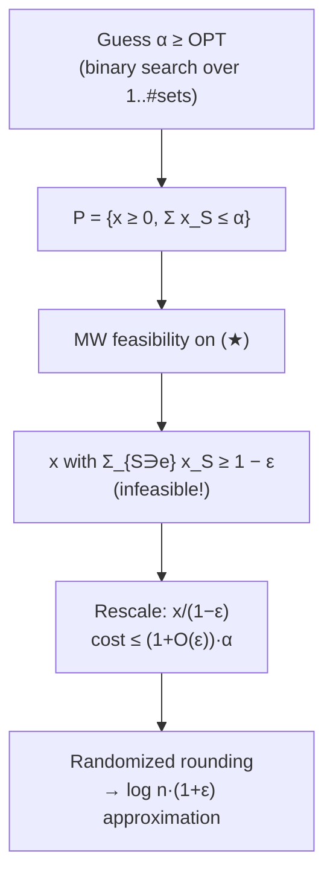

# 8. Worked example: fractional set cover

A concrete instantiation of the feasibility framework [`1:08:48`](https://www.youtube.com/watch?v=R9mT5CtdHLg&t=4128).

## The LP relaxation

```
minimize   Σ_S x_S
s.t.       Σ_{S ∋ e} x_S ≥ 1     for every element e     (★)
           x_S ≥ 0               for every set S
```
[`1:10:07`](https://www.youtube.com/watch?v=R9mT5CtdHLg&t=4207)

- In the integer program, `x_S ∈ {0, 1}` marks whether set `S` is taken; the LP relaxes this to a linear constraint [`1:10:32`](https://www.youtube.com/watch?v=R9mT5CtdHLg&t=4232).

## Turning optimization into feasibility

- Guess `α ∈ ℝ` with `α ≥ OPT` [`1:09:30`](https://www.youtube.com/watch?v=R9mT5CtdHLg&t=4170) [`1:10:49`](https://www.youtube.com/watch?v=R9mT5CtdHLg&t=4249).
- Set the convex body `P = { x : x ≥ 0, Σ_S x_S ≤ α }` — the objective becomes a **constraint inside `P`** [`1:11:08`](https://www.youtube.com/watch?v=R9mT5CtdHLg&t=4268).
- Ask MW whether the `(★)` constraints are feasible over `P` [`1:11:42`](https://www.youtube.com/watch?v=R9mT5CtdHLg&t=4302).

## Recovering the optimum without knowing it

- **Binary search on `α`**, over the range `1` to the number of sets in the collection [`1:12:18`](https://www.youtube.com/watch?v=R9mT5CtdHLg&t=4338) [`1:12:39`](https://www.youtube.com/watch?v=R9mT5CtdHLg&t=4359).

## Fixing the `ε`-violation by rescaling

- MW returns an `x` that only guarantees `Σ_{S ∋ e} x_S ≥ 1 − ε` — **not feasible** for the relaxation [`1:13:08`](https://www.youtube.com/watch?v=R9mT5CtdHLg&t=4388) [`1:13:44`](https://www.youtube.com/watch?v=R9mT5CtdHLg&t=4424).
- **Fix:** rescale to `x / (1 − ε)`, which *is* feasible [`1:14:17`](https://www.youtube.com/watch?v=R9mT5CtdHLg&t=4457).
- Its cost: since `x ∈ P` gave `Σ x_S ≤ α`, the rescaled cost is at most `α/(1 − ε) = (1 + O(ε))·α` [`1:14:17`](https://www.youtube.com/watch?v=R9mT5CtdHLg&t=4457) [`1:15:08`](https://www.youtube.com/watch?v=R9mT5CtdHLg&t=4508).

## Why solve this LP at all

- The standard set-cover approximation solves the LP relaxation, then does **randomized rounding**, picking each set with probability `x_S` — yielding a `log n` approximation [`1:13:44`](https://www.youtube.com/watch?v=R9mT5CtdHLg&t=4424) [`1:15:29`](https://www.youtube.com/watch?v=R9mT5CtdHLg&t=4529).
- Feeding the MW solution into that pipeline gives a **`log n · (1 + ε)` approximation**, but with a *fast* algorithm instead of ellipsoid or interior point [`1:15:29`](https://www.youtube.com/watch?v=R9mT5CtdHLg&t=4529) [`1:15:42`](https://www.youtube.com/watch?v=R9mT5CtdHLg&t=4542).


