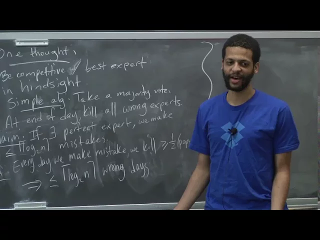
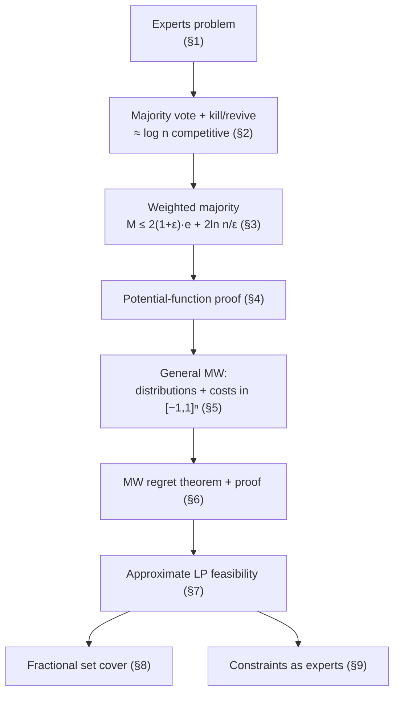

# Advanced Algorithms (COMPSCI 224), Lecture 19

*Harvard University · 1:21:33 · [Watch on YouTube](https://www.youtube.com/watch?v=R9mT5CtdHLg)*

## Summary

This lecture introduces the **multiplicative weights (MW)** method, starting from the "listening to expert advice" problem: `n` experts give daily yes/no predictions and you must decide, aiming to make nearly as few mistakes as the best expert in hindsight. The lecture builds up through two warm-up algorithms (majority-vote-with-elimination, then with revival, giving a `log n` competitive ratio), then derives the weighted majority algorithm and its potential-function analysis, and finally generalizes to arbitrary cost vectors in `[−1, 1]ⁿ` with a probability distribution as output — yielding the standard MW regret bound. The last third pivots to applications: using MW to approximately solve linear programs, worked through on fractional set cover, with the key analogy that **each LP constraint plays the role of an expert**.

**Type:** university lecture (educational). **Prerequisites referenced:** competitive analysis, LP duality/relaxations, ellipsoid and interior point methods, randomized rounding for set cover.

## Topics

1. [Introduction and the "listening to expert advice" problem](./01-introduction-and-the-experts-problem.md)
2. [Majority vote, elimination, and revival](./02-majority-vote-and-the-halving-algorithm.md)
3. [The weighted majority algorithm](./03-weighted-majority-algorithm.md)
4. [Potential-function analysis of weighted majority](./04-potential-function-analysis.md)
5. [Generalizing the model: distributions and real-valued costs](./05-generalized-multiplicative-weights.md)
6. [Proof of the general MW theorem](./06-proof-of-the-mw-theorem.md)
7. [Using MW to approximately solve linear programs](./07-mw-for-approximate-lp-feasibility.md)
8. [Worked example: fractional set cover](./08-example-fractional-set-cover.md)
9. [The analogy: LP constraints as experts](./09-constraints-as-experts-and-next-steps.md)

## Key takeaways

- **A perfect expert makes plain majority-vote-with-elimination cheap:** if some expert never errs, halving the population on every mistake bounds our mistakes by `log₂ n` [`8:19`](https://www.youtube.com/watch?v=R9mT5CtdHLg&t=499) [`8:55`](https://www.youtube.com/watch?v=R9mT5CtdHLg&t=535).
- **Adding revival removes the perfection assumption at a log-factor cost:** if the best expert makes `e` errors, the algorithm makes at most `(e + 1)·log₂ n` mistakes — at most `e + 1` phases, each costing at most `log₂ n` [`11:46`](https://www.youtube.com/watch?v=R9mT5CtdHLg&t=706) [`13:33`](https://www.youtube.com/watch?v=R9mT5CtdHLg&t=813).
- **Weighted majority replaces the `log n` multiplicative factor with the constant 2:** `M(T) ≤ 2(1 + ε)·minᵢ mᵢ(T) + 2·ln n / ε` for any `ε ∈ (0, ½)` — trading a multiplicative log for an additive term that was essentially already there [`16:25`](https://www.youtube.com/watch?v=R9mT5CtdHLg&t=985) [`17:37`](https://www.youtube.com/watch?v=R9mT5CtdHLg&t=1057).
- **The general MW regret bound:** with `m(t) ∈ [−1, 1]ⁿ` and the update `pᵢ(t+1) ∝ (1 − ε)^{mᵢ(t)}·pᵢ(t)`, our expected cost satisfies `Σ_t ⟨m(t), p(t)⟩ ≤ Σ_t mᵢ(t) + ε·Σ_t |mᵢ(t)| + ln n / ε` for every expert `i` [`43:07`](https://www.youtube.com/watch?v=R9mT5CtdHLg&t=2587) [`49:23`](https://www.youtube.com/watch?v=R9mT5CtdHLg&t=2963).
- **Both proofs are the same two-sided potential argument:** upper-bound `Φ(t) = Σᵢ wᵢ(t)` by `n·e^{−ε·(our cost)}`, lower-bound it by a single expert's weight, take logs [`26:56`](https://www.youtube.com/watch?v=R9mT5CtdHLg&t=1616) [`54:06`](https://www.youtube.com/watch?v=R9mT5CtdHLg&t=3246) [`54:50`](https://www.youtube.com/watch?v=R9mT5CtdHLg&t=3290).
- **MW is fast but low-precision for LPs:** its iteration count is `poly(1/ε)` versus interior point's `log log(1/ε)`, and exact LP solving needs `ε` exponentially small in `L` — so MW is only worth it when a `(1 + ε)` answer suffices [`1:07:59`](https://www.youtube.com/watch?v=R9mT5CtdHLg&t=4079) [`1:08:14`](https://www.youtube.com/watch?v=R9mT5CtdHLg&t=4094).
- **On fractional set cover, MW yields a `log n · (1 + ε)` approximation quickly:** binary-search `α ≥ OPT`, run MW over `P = {x ≥ 0, Σ x_S ≤ α}`, rescale the `(1 − ε)`-violating output by `1/(1 − ε)` for cost `(1 + O(ε))·α`, then randomized-round [`1:14:17`](https://www.youtube.com/watch?v=R9mT5CtdHLg&t=4457) [`1:15:29`](https://www.youtube.com/watch?v=R9mT5CtdHLg&t=4529).
- **The LP-to-experts analogy hinges on an inverted sign:** with `mᵢ = aᵢ·x − bᵢ`, a large positive slack means the constraint is *easy*, so MW down-weights it and concentrates effort on the constraints still unsatisfied — exactly what approximate feasibility needs [`1:18:42`](https://www.youtube.com/watch?v=R9mT5CtdHLg&t=4722) [`1:19:53`](https://www.youtube.com/watch?v=R9mT5CtdHLg&t=4793).
