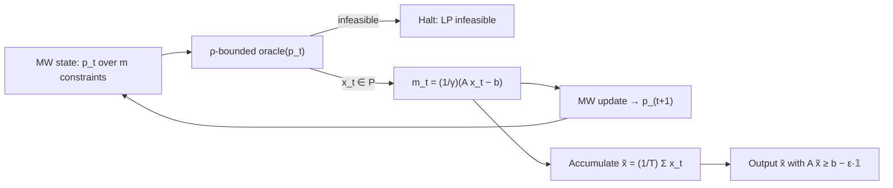

# 3. Multiplicative weights for LPs: theorem and proof

## The theorem

Given a ρ-bounded oracle with `ρ > ε/2`, multiplicative weights finds `x ∈ P` with

`Ax ≥ b − ε·𝟙`

in `O(ρ² log m / ε²)` iterations (days `T`) ([`14:52`](https://www.youtube.com/watch?v=TdTFYVjzs1I&t=892), [`15:41`](https://www.youtube.com/watch?v=TdTFYVjzs1I&t=941)).

## The reduction

- **Experts = the `m` constraints** of the LP ([`16:32`](https://www.youtube.com/watch?v=TdTFYVjzs1I&t=992), [`17:09`](https://www.youtube.com/watch?v=TdTFYVjzs1I&t=1029)).
- Day 1 starts from the uniform distribution over experts; `p_t` then evolves as usual ([`17:09`](https://www.youtube.com/watch?v=TdTFYVjzs1I&t=1029), [`17:38`](https://www.youtube.com/watch?v=TdTFYVjzs1I&t=1058)).
- **Cost vector**: `m_t = (1/γ)(A x_t − b)`, where `x_t` is the oracle's answer on input `p_t` and `γ = ρ` ([`18:16`](https://www.youtube.com/watch?v=TdTFYVjzs1I&t=1096), [`18:52`](https://www.youtube.com/watch?v=TdTFYVjzs1I&t=1132)).
- Legality: MW allows the cost vector to be chosen adversarially *after* `p_t` is committed, which is exactly the order here ([`17:38`](https://www.youtube.com/watch?v=TdTFYVjzs1I&t=1058), [`17:59`](https://www.youtube.com/watch?v=TdTFYVjzs1I&t=1079)).
- The `1/γ` normalization is precisely what forces `m_t ∈ [−1, 1]^m`, the hypothesis the MW theorem needs ([`21:32`](https://www.youtube.com/watch?v=TdTFYVjzs1I&t=1292)).
- If the oracle ever reports infeasible, halt and declare the LP infeasible ([`19:30`](https://www.youtube.com/watch?v=TdTFYVjzs1I&t=1170)).

## Proof sketch — the squeeze

1. **Lower bound.** `⟨m_t, p_t⟩ = (1/γ)(p_tᵀA x_t − p_tᵀb) ≥ 0`, because that is exactly the guarantee the oracle enforces on (⋆) ([`20:51`](https://www.youtube.com/watch?v=TdTFYVjzs1I&t=1251), [`21:32`](https://www.youtube.com/watch?v=TdTFYVjzs1I&t=1292), [`22:29`](https://www.youtube.com/watch?v=TdTFYVjzs1I&t=1349)).
2. Sum over all days — still non-negative term by term ([`23:23`](https://www.youtube.com/watch?v=TdTFYVjzs1I&t=1403)).
3. **Upper bound.** Apply the MW theorem with its own error parameter `η` (deliberately different from the final `ε`): `0 ≤ (1/γ)Σ_t(aᵢ·x_t − bᵢ) + ηT + log m / η`, for every `i` ([`23:57`](https://www.youtube.com/watch?v=TdTFYVjzs1I&t=1437), [`24:23`](https://www.youtube.com/watch?v=TdTFYVjzs1I&t=1463), [`24:58`](https://www.youtube.com/watch?v=TdTFYVjzs1I&t=1498)).
4. **Average the iterates.** Set `x̃ = (1/T) Σ_t x_t`. Each `x_t ∈ P` and `P` is convex, so `x̃ ∈ P` ([`25:59`](https://www.youtube.com/watch?v=TdTFYVjzs1I&t=1559)).
5. Multiply through by `γ/T`: `0 ≤ aᵢ·x̃ − bᵢ + γη + γ ln m / (ηT)` ([`25:24`](https://www.youtube.com/watch?v=TdTFYVjzs1I&t=1524), [`26:33`](https://www.youtube.com/watch?v=TdTFYVjzs1I&t=1593)).
6. **Tune both error terms to `ε/2`** ([`27:32`](https://www.youtube.com/watch?v=TdTFYVjzs1I&t=1652), [`28:35`](https://www.youtube.com/watch?v=TdTFYVjzs1I&t=1715)):
   - `η = ε / (2γ)` ([`27:32`](https://www.youtube.com/watch?v=TdTFYVjzs1I&t=1652))
   - `T = 4γ² ln m / ε²` ([`28:00`](https://www.youtube.com/watch?v=TdTFYVjzs1I&t=1680), [`28:35`](https://www.youtube.com/watch?v=TdTFYVjzs1I&t=1715))
7. Conclude `aᵢ·x̃ ≥ bᵢ − ε` for **all** `i` ([`29:00`](https://www.youtube.com/watch?v=TdTFYVjzs1I&t=1740)).

## The algorithm in one sentence

Run the oracle once per iteration to get `x_t`; the final almost-feasible output is the **average** of all the `x_t` produced ([`29:29`](https://www.youtube.com/watch?v=TdTFYVjzs1I&t=1769), [`29:49`](https://www.youtube.com/watch?v=TdTFYVjzs1I&t=1789)).
