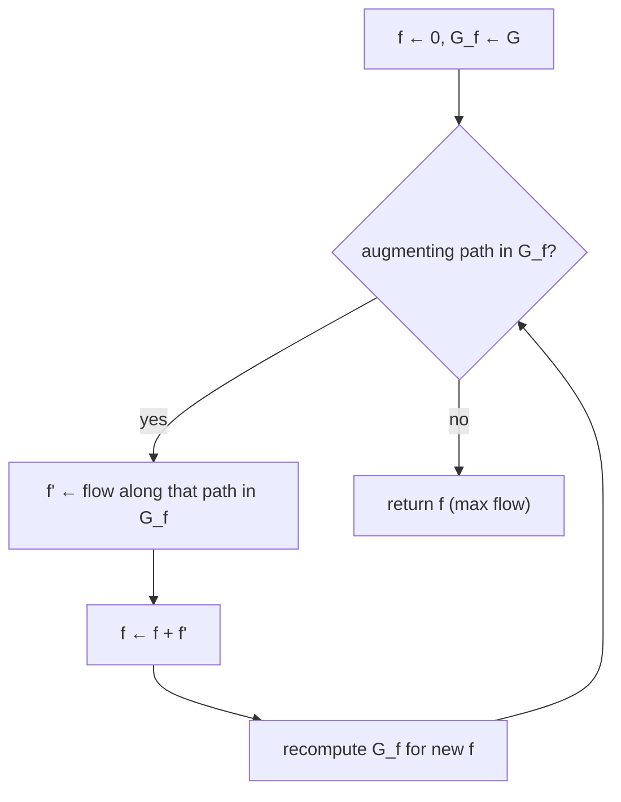

# 7. Ford–Fulkerson: augmenting paths and residual graphs

Dropping LP technology and thinking purely combinatorially ([`1:04:39`](https://www.youtube.com/watch?v=TdTFYVjzs1I&t=3879)).

## Running time and why it is bad

- Ford–Fulkerson (1950s) runs in `O(m · f*)`, where `f*` abbreviates `val(f*)`, the value of the max flow ([`1:05:32`](https://www.youtube.com/watch?v=TdTFYVjzs1I&t=3932)).
- The dependence is on the **value**, not the graph size: a tiny graph with a capacity of a billion admits a bound of a billion steps ([`1:06:07`](https://www.youtube.com/watch?v=TdTFYVjzs1I&t=3967)). On the trivial two-vertex graph it would not actually be slow, but a slight modification (adding a unit-capacity edge) can genuinely force ~a billion steps if augmenting paths are chosen carelessly ([`1:06:35`](https://www.youtube.com/watch?v=TdTFYVjzs1I&t=3995)).
- With all capacities equal to 1 the bound is not terrible ([`1:07:04`](https://www.youtube.com/watch?v=TdTFYVjzs1I&t=4024)).

## Finding a positive-value flow

- Run a **DFS** from `s` to `t`, considering only edges of positive capacity ([`1:08:22`](https://www.youtube.com/watch?v=TdTFYVjzs1I&t=4102), [`1:08:46`](https://www.youtube.com/watch?v=TdTFYVjzs1I&t=4126)).
- Take `λ` = the minimum capacity along the found path; set `f = λ` on that path and 0 elsewhere ([`1:08:46`](https://www.youtube.com/watch?v=TdTFYVjzs1I&t=4126), [`1:09:10`](https://www.youtube.com/watch?v=TdTFYVjzs1I&t=4150)).
- Board example: a path with capacities 7, 5, 2 ⇒ `λ = 2` ([`1:10:12`](https://www.youtube.com/watch?v=TdTFYVjzs1I&t=4212), [`1:10:44`](https://www.youtube.com/watch?v=TdTFYVjzs1I&t=4244), [`1:10:58`](https://www.youtube.com/watch?v=TdTFYVjzs1I&t=4258)).

## Residual graph

Assumption first: capacities are rationals, denominators cleared, so they are **integers in `[1, U]`** ([`1:11:36`](https://www.youtube.com/watch?v=TdTFYVjzs1I&t=4296)).

- Given a flow `f` in `G`, the residual graph `G_f` uses the same edge set with `c'(u,v) = c(u,v) − f(u,v) + f(v,u)` ([`1:12:02`](https://www.youtube.com/watch?v=TdTFYVjzs1I&t=4322), [`1:13:00`](https://www.youtube.com/watch?v=TdTFYVjzs1I&t=4380)).
- **Both directions exist**: for every edge, assume the reverse edge is present too, adding it with capacity 0 if it was not ([`1:13:51`](https://www.youtube.com/watch?v=TdTFYVjzs1I&t=4431), [`1:14:12`](https://www.youtube.com/watch?v=TdTFYVjzs1I&t=4452), [`1:14:31`](https://www.youtube.com/watch?v=TdTFYVjzs1I&t=4471)). This is preferred over "complete graph with zero capacities" so running times stay in terms of `m` ([`1:14:12`](https://www.youtube.com/watch?v=TdTFYVjzs1I&t=4452)). It at most doubles the edge count, a constant factor inside `O(m·)` bounds ([`1:19:15`](https://www.youtube.com/watch?v=TdTFYVjzs1I&t=4755)).

### Convention on opposite-direction flow

- Flow vectors stay **non-negative**: `f(u,v)` is *not* defined as `−f(v,u)` ([`1:15:41`](https://www.youtube.com/watch?v=TdTFYVjzs1I&t=4541), [`1:17:16`](https://www.youtube.com/watch?v=TdTFYVjzs1I&t=4636)).
- One may always assume **at most one of an edge and its reverse carries non-zero flow**: `(5, 1)` is equivalent to `(4, 0)`; cancelling preserves all constraints and the same value ([`1:16:21`](https://www.youtube.com/watch?v=TdTFYVjzs1I&t=4581), [`1:16:40`](https://www.youtube.com/watch?v=TdTFYVjzs1I&t=4600), [`1:18:31`](https://www.youtube.com/watch?v=TdTFYVjzs1I&t=4711)).
- Water analogy: 5 L/s forward is the same as 12 forward and 7 backward; the canonical representative is the cancelled one ([`1:17:44`](https://www.youtube.com/watch?v=TdTFYVjzs1I&t=4664), [`1:18:16`](https://www.youtube.com/watch?v=TdTFYVjzs1I&t=4696)).

## The algorithm

- Initialize `f = 0`, so `G_f = G` ([`1:19:33`](https://www.youtube.com/watch?v=TdTFYVjzs1I&t=4773)).
- While an augmenting path exists in `G_f`: let `f'` be a flow in `G_f`, set `f ← f + f'`, then rebuild `G_f` for the new `f` ([`1:19:33`](https://www.youtube.com/watch?v=TdTFYVjzs1I&t=4773), [`1:20:50`](https://www.youtube.com/watch?v=TdTFYVjzs1I&t=4850)).

## Correctness theorem (asserted, not proved)

> `f*` is a max flow **iff** `G_{f*}` has no augmenting path — i.e. `s` and `t` are disconnected in `G_{f*}` ([`1:21:21`](https://www.youtube.com/watch?v=TdTFYVjzs1I&t=4881), [`1:22:16`](https://www.youtube.com/watch?v=TdTFYVjzs1I&t=4936)).

- The proof is left to CS 124 / any intro algorithms textbook; it is stated here because it is the foundation for the faster flow algorithms coming next lecture ([`1:22:16`](https://www.youtube.com/watch?v=TdTFYVjzs1I&t=4936), [`1:22:59`](https://www.youtube.com/watch?v=TdTFYVjzs1I&t=4979)).
