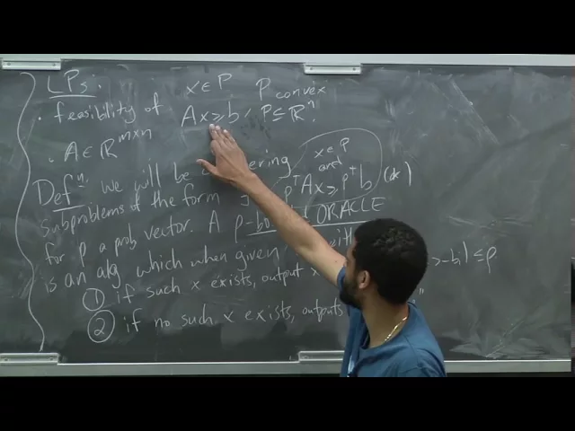
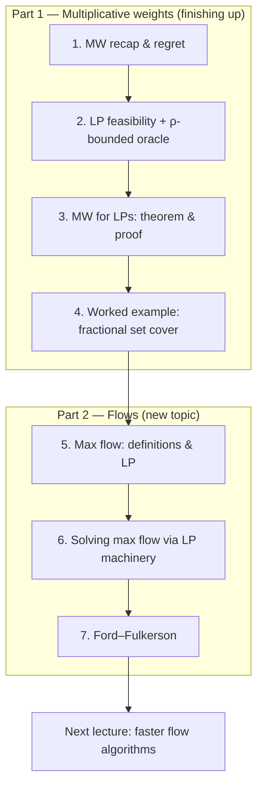

# Advanced Algorithms (COMPSCI 224), Lecture 20

*Harvard University · 1:23:37 · https://www.youtube.com/watch?v=TdTFYVjzs1I*

A two-part lecture. The first half closes out **multiplicative weights** by showing how it approximately solves linear programs: the `m` LP constraints become the "experts", a ρ-bounded oracle answers a one-constraint relaxation each day, and the average of the oracle's answers is an almost-feasible point. Fractional set cover is worked through end to end as a concrete instantiation. The second half opens a new topic, **max flow** — the definitions, the LP formulation and what interior point methods buy for it, and finally Ford–Fulkerson with residual graphs and augmenting paths.

## Topics

1. [Multiplicative weights recap and regret](./01-multiplicative-weights-recap-and-regret.md)
2. [LP feasibility and the ρ-bounded oracle](./02-lp-feasibility-and-the-rho-bounded-oracle.md)
3. [Multiplicative weights for LPs: theorem and proof](./03-mw-for-lps-theorem-and-proof.md)
4. [Worked example: fractional set cover](./04-worked-example-fractional-set-cover.md)
5. [Max flow: definitions and LP formulation](./05-max-flow-definitions-and-lp-formulation.md)
6. [Solving max flow with LP machinery](./06-solving-max-flow-with-lp-machinery.md)
7. [Ford–Fulkerson: augmenting paths and residual graphs](./07-ford-fulkerson-augmenting-paths-and-residual-graphs.md)

## Key takeaways

- Given a ρ-bounded oracle with `ρ > ε/2`, multiplicative weights returns `x ∈ P` with `Ax ≥ b − ε·𝟙` in `O(ρ² log m / ε²)` iterations — the LP's `m` constraints play the role of experts and the output is the **average** of the oracle's per-iteration answers ([`15:41`](https://www.youtube.com/watch?v=TdTFYVjzs1I&t=941), [`29:29`](https://www.youtube.com/watch?v=TdTFYVjzs1I&t=1769)).
- The proof is a squeeze: the oracle's guarantee forces `⟨m_t, p_t⟩ ≥ 0` while the MW regret bound caps it from above; choosing `η = ε/(2γ)` and `T = 4γ² ln m / ε²` makes both error terms `ε/2` ([`22:29`](https://www.youtube.com/watch?v=TdTFYVjzs1I&t=1349), [`27:32`](https://www.youtube.com/watch?v=TdTFYVjzs1I&t=1652), [`28:35`](https://www.youtube.com/watch?v=TdTFYVjzs1I&t=1715)).
- For fractional set cover the oracle is trivial — put all `β` mass on the set maximizing `p(S) = Σ_{e∈S} p_e` — which gives `ρ ≤ β ≤ m` and hence `O(m² log m / ε²)` MW iterations for a `(1+ε)`-approximate solution, with `β` found by binary search over `[1, m]` ([`37:03`](https://www.youtube.com/watch?v=TdTFYVjzs1I&t=2223), [`41:18`](https://www.youtube.com/watch?v=TdTFYVjzs1I&t=2478), [`41:38`](https://www.youtube.com/watch?v=TdTFYVjzs1I&t=2498), [`42:06`](https://www.youtube.com/watch?v=TdTFYVjzs1I&t=2526)).
- Max flow is exactly an LP, and a generic interior point method solves it in about `O(m^{3.5} L)` because each of the `√m` Newton steps is a linear system solve costing `m³` ([`53:21`](https://www.youtube.com/watch?v=TdTFYVjzs1I&t=3201), [`1:00:31`](https://www.youtube.com/watch?v=TdTFYVjzs1I&t=3631)).
- Exploiting flow structure beats the generic bound twice over: Daitch–Spielman (STOC 2008) solve the flow-induced (Laplacian-like) systems in `Õ(m)`, giving `m^{3/2} log² U`, and Lee–Sidford's weighted barrier turns the `√m` iteration count into `√n`, giving `m√n` ([`1:01:44`](https://www.youtube.com/watch?v=TdTFYVjzs1I&t=3704), [`1:02:43`](https://www.youtube.com/watch?v=TdTFYVjzs1I&t=3763), [`1:04:39`](https://www.youtube.com/watch?v=TdTFYVjzs1I&t=3879)).
- Ford–Fulkerson's `O(m · f*)` scales with the flow *value*, not the graph size — a small graph with billion-scale capacities can force ~a billion steps — and its correctness rests on: `f*` is maximum **iff** `s` and `t` are disconnected in the residual graph `G_{f*}` ([`1:05:32`](https://www.youtube.com/watch?v=TdTFYVjzs1I&t=3932), [`1:06:35`](https://www.youtube.com/watch?v=TdTFYVjzs1I&t=3995), [`1:21:21`](https://www.youtube.com/watch?v=TdTFYVjzs1I&t=4881)).
