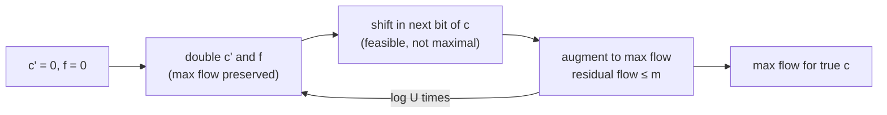

# 3. Capacity scaling

## The idea

- Scaling **reduces the general-capacity case toward the unit-capacity case**, feeding in capacities one bit at a time [`16:09`](https://www.youtube.com/watch?v=rfTt7k6Nv-I&t=969), [`16:53`](https://www.youtube.com/watch?v=rfTt7k6Nv-I&t=1013).
- Treat each capacity as a `log₂ U`-bit binary integer [`16:53`](https://www.youtube.com/watch?v=rfTt7k6Nv-I&t=1013).
- Work with **shadow capacities `c'(e)`**, starting at `0`, that grow toward the true `c(e)` bit by bit; e.g. an edge of capacity 6 (`0110`) is seen as capacity 0, then 1, then 3, then 6 [`19:17`](https://www.youtube.com/watch?v=rfTt7k6Nv-I&t=1157), [`19:51`](https://www.youtube.com/watch?v=rfTt7k6Nv-I&t=1191), [`20:19`](https://www.youtube.com/watch?v=rfTt7k6Nv-I&t=1219), [`20:46`](https://www.youtube.com/watch?v=rfTt7k6Nv-I&t=1246).

## Pseudocode

```
f ← 0;  c'(e) ← 0 for all e
for k = log₂U − 1 down to 0:
    for each edge e:  c'(e) ← 2·c'(e);  f(e) ← 2·f(e)     # shift left
    for each edge e:  c'(e) ← c'(e) + (k-th bit of c(e))  # shift the bit in
    augment f until it is a max flow for c'
```

[`17:33`](https://www.youtube.com/watch?v=rfTt7k6Nv-I&t=1053), [`18:26`](https://www.youtube.com/watch?v=rfTt7k6Nv-I&t=1106), [`21:22`](https://www.youtube.com/watch?v=rfTt7k6Nv-I&t=1282), [`21:36`](https://www.youtube.com/watch?v=rfTt7k6Nv-I&t=1296), [`22:05`](https://www.youtube.com/watch?v=rfTt7k6Nv-I&t=1325)

## Correctness — the loop invariant

- **Invariant**: at the start of every iteration, `f` is a max flow for the current `c'` capacities [`22:05`](https://www.youtube.com/watch?v=rfTt7k6Nv-I&t=1325), [`23:17`](https://www.youtube.com/watch?v=rfTt7k6Nv-I&t=1397).
- **Base case**: trivially true when all capacities are 0 [`23:17`](https://www.youtube.com/watch?v=rfTt7k6Nv-I&t=1397).
- **Doubling preserves maximality**: max flow = min cut, and a max flow saturates some `s`–`t` cut with zero residual capacity. Doubling doubles both that cut's capacity and the flow across it, so it stays saturated [`23:17`](https://www.youtube.com/watch?v=rfTt7k6Nv-I&t=1397), [`24:17`](https://www.youtube.com/watch?v=rfTt7k6Nv-I&t=1457).
- **Shifting in a bit** keeps `f` feasible but possibly non-maximum; augmenting paths restore maximality [`24:44`](https://www.youtube.com/watch?v=rfTt7k6Nv-I&t=1484).

## Running time

- **Iterations**: exactly `log U` [`25:30`](https://www.youtube.com/watch?v=rfTt7k6Nv-I&t=1530).
- Caution: after doubling, unsaturated edges are *not* unit-capacity, so this is **not** literally the unit-capacity case — the lecturer retracts that phrasing [`25:58`](https://www.youtube.com/watch?v=rfTt7k6Nv-I&t=1558), [`26:33`](https://www.youtube.com/watch?v=rfTt7k6Nv-I&t=1593).
- The real argument is that the **residual max flow per iteration is small** [`26:56`](https://www.youtube.com/watch?v=rfTt7k6Nv-I&t=1616):
  1. Before shifting in the new bit, some cut `C` is saturated by `f` and has residual capacity 0 [`27:18`](https://www.youtube.com/watch?v=rfTt7k6Nv-I&t=1638), [`28:06`](https://www.youtube.com/watch?v=rfTt7k6Nv-I&t=1686).
  2. `C` has at most `m` edges, and the shift adds at most **1** capacity per edge [`27:35`](https://www.youtube.com/watch?v=rfTt7k6Nv-I&t=1655), [`28:53`](https://www.youtube.com/watch?v=rfTt7k6Nv-I&t=1733).
  3. So `C`'s residual capacity is at most `m`, hence the min cut — and therefore the residual max flow — is at most `m` [`27:35`](https://www.youtube.com/watch?v=rfTt7k6Nv-I&t=1655), [`29:33`](https://www.youtube.com/watch?v=rfTt7k6Nv-I&t=1773).
- Per iteration Ford–Fulkerson costs `O(m · f*) = O(m²)`, giving **`O(m² log U)`** overall — weakly polynomial [`28:06`](https://www.youtube.com/watch?v=rfTt7k6Nv-I&t=1686), [`29:33`](https://www.youtube.com/watch?v=rfTt7k6Nv-I&t=1773).

## Why scaling matters beyond this bound

- Scaling is a **wrapper**: the inner "augment to max flow" step can be any max-flow routine, so it composes with blocking flows and other algorithms [`29:33`](https://www.youtube.com/watch?v=rfTt7k6Nv-I&t=1773), [`30:23`](https://www.youtube.com/watch?v=rfTt7k6Nv-I&t=1823).


