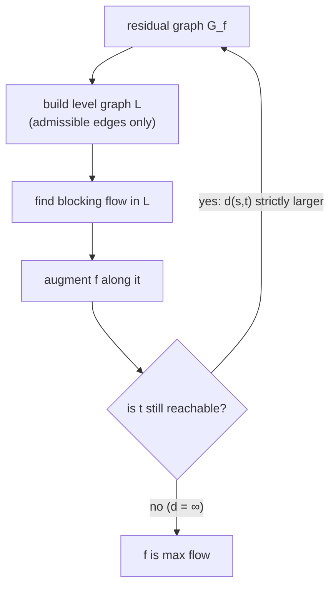

# 5. The key claim: distances strictly increase

## Statement

> **Claim.** After augmenting along a blocking flow, the shortest-path distance `d(s, t)` in the new level graph — the graph of admissible edges with positive residual capacity — **strictly increases** [`42:44`](https://www.youtube.com/watch?v=rfTt7k6Nv-I&t=2564), [`43:19`](https://www.youtube.com/watch?v=rfTt7k6Nv-I&t=2599), [`44:06`](https://www.youtube.com/watch?v=rfTt7k6Nv-I&t=2646).

This is *the* reason blocking flows are worth computing [`42:44`](https://www.youtube.com/watch?v=rfTt7k6Nv-I&t=2564).

## The algorithm it licenses

- Repeat: find a blocking flow in the residual graph, augment along it, rebuild the residual graph [`45:22`](https://www.youtube.com/watch?v=rfTt7k6Nv-I&t=2722).
- Distance grows by **at least 1** each round; in an unweighted graph it can never exceed `n` without becoming infinite, and infinite means no augmenting path — done [`44:38`](https://www.youtube.com/watch?v=rfTt7k6Nv-I&t=2678).
- Therefore **at most `n` iterations**, and total time = `O(n × time to find one blocking flow)` [`49:09`](https://www.youtube.com/watch?v=rfTt7k6Nv-I&t=2949), [`49:39`](https://www.youtube.com/watch?v=rfTt7k6Nv-I&t=2979).

## Proof

Let `L` be the level graph before augmentation and `L'` the one after [`51:19`](https://www.youtube.com/watch?v=rfTt7k6Nv-I&t=3079).

1. **Which edges can appear in `L'`?** Only edges of `L`, reverses of `L` edges (created by augmenting), or "yellow" edges of `G_f` that skip/go backward across levels [`54:34`](https://www.youtube.com/watch?v=rfTt7k6Nv-I&t=3274), [`55:13`](https://www.youtube.com/watch?v=rfTt7k6Nv-I&t=3313), [`55:54`](https://www.youtube.com/watch?v=rfTt7k6Nv-I&t=3354).
2. **`d_{L'}(s,t) ≥ d_L(s,t)`**: taking a yellow edge or a reversed edge never gets you to `t` faster, since neither advances a level [`56:12`](https://www.youtube.com/watch?v=rfTt7k6Nv-I&t=3372), [`58:44`](https://www.youtube.com/watch?v=rfTt7k6Nv-I&t=3524).
3. **Equality is impossible**: a path in `L'` of length exactly `d_L(s,t)` must consist entirely of `L` edges. But by definition of a blocking flow, **at least one edge on every admissible `s`–`t` path is saturated**, so that whole path cannot survive into the new residual graph — contradiction [`56:45`](https://www.youtube.com/watch?v=rfTt7k6Nv-I&t=3405), [`57:23`](https://www.youtube.com/watch?v=rfTt7k6Nv-I&t=3443), [`57:47`](https://www.youtube.com/watch?v=rfTt7k6Nv-I&t=3467).

Hence `d_{L'}(s,t) > d_L(s,t)`. ∎

## Target times per blocking flow (previewed here)

| Graph | Time per blocking flow | Resulting max flow |
| --- | --- | --- |
| Unit capacity | `O(m)`, via a modified DFS [`50:11`](https://www.youtube.com/watch?v=rfTt7k6Nv-I&t=3011) | `O(mn)` [`50:11`](https://www.youtube.com/watch?v=rfTt7k6Nv-I&t=3011) |
| General capacity, simple method | `O(mn)` [`50:11`](https://www.youtube.com/watch?v=rfTt7k6Nv-I&t=3011) | `O(mn²)` [`50:11`](https://www.youtube.com/watch?v=rfTt7k6Nv-I&t=3011) |
| General capacity + link-cut trees (Sleator–Tarjan) | `O(m log n)` [`50:40`](https://www.youtube.com/watch?v=rfTt7k6Nv-I&t=3040) | `O(mn log n)` — close to Orlin's `O(mn)` [`50:40`](https://www.youtube.com/watch?v=rfTt7k6Nv-I&t=3040) |

