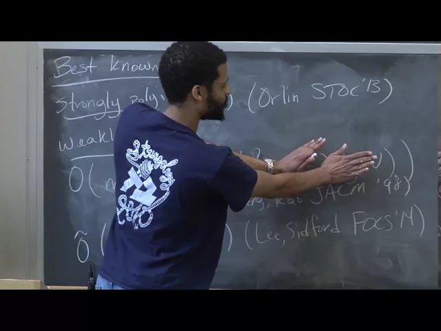
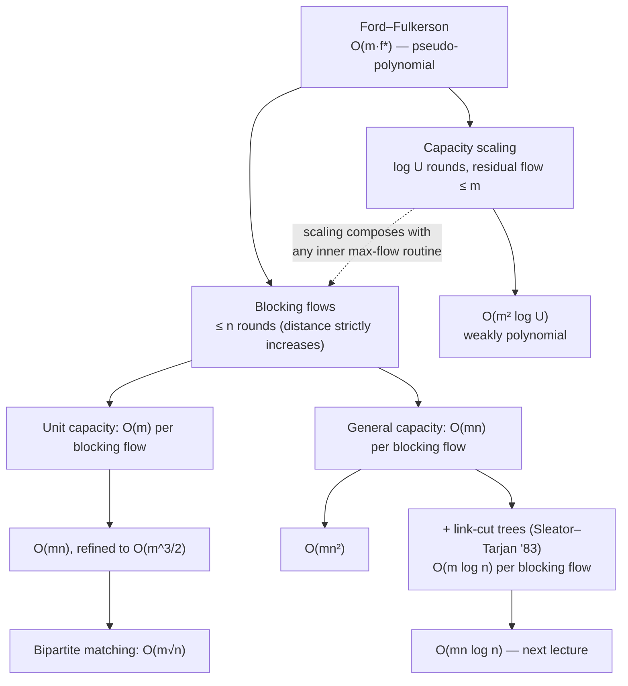

# Advanced Algorithms (COMPSCI 224), Lecture 21

*Harvard University · 1:27:09 · [Watch on YouTube](https://www.youtube.com/watch?v=rfTt7k6Nv-I)*

## Summary

A lecture on **faster maximum-flow algorithms**, picking up from a Ford–Fulkerson recap. Jelani Nelson first fixes the vocabulary — weakly polynomial, strongly polynomial, pseudo-polynomial — and surveys the best bounds known at the time (Orlin's `O(mn)`, Goldberg–Rao, the then-days-old Lee–Sidford interior-point result). He then develops two techniques in detail: **capacity scaling**, which feeds capacities in one bit at a time and yields `O(m² log U)`, and **blocking flows**, whose central claim is that each augmentation strictly increases the `s`–`t` distance, capping the number of rounds at `n`. The blocking-flow subroutine is an advance/retreat/augment DFS on the level graph, costing `O(m)` in unit-capacity graphs (`O(m^{3/2})` overall, `O(m√n)` for bipartite matching) and `O(mn)` in general (`O(mn²)` overall), with link-cut trees teased as the fix that brings it to `O(mn log n)`.

## Topics

1. [Max-flow recap and complexity terminology](01-max-flow-recap-and-complexity-terminology.md)
2. [State of the art for max flow](02-state-of-the-art-max-flow-bounds.md)
3. [Capacity scaling](03-capacity-scaling.md)
4. [Blocking flows: levels, admissibility, definition](04-blocking-flows-definitions.md)
5. [The key claim: distances strictly increase](05-distance-increase-claim-and-proof.md)
6. [Finding a blocking flow: advance / retreat / augment](06-finding-a-blocking-flow.md)
7. [Sharper iteration bounds and bipartite matching](07-sharper-iteration-bounds-and-bipartite-matching.md)
8. [General capacities and link-cut trees](08-general-capacities-and-link-cut-trees.md)

## Key takeaways

- **Ford–Fulkerson is pseudo-polynomial**: `O(m · f*)` with `f*` up to `n·U`, which is exponential in the `log U` bits used to write a capacity — motivating the whole lecture [`5:29`](https://www.youtube.com/watch?v=rfTt7k6Nv-I&t=329), [`5:59`](https://www.youtube.com/watch?v=rfTt7k6Nv-I&t=359).
- **Capacity scaling gives `O(m² log U)`**: `log U` iterations, and after shifting in one bit, a previously saturated cut of ≤ `m` edges gains at most `m` residual capacity, so the residual max flow per round is at most `m` [`27:35`](https://www.youtube.com/watch?v=rfTt7k6Nv-I&t=1655), [`29:33`](https://www.youtube.com/watch?v=rfTt7k6Nv-I&t=1773).
- **Augmenting along a blocking flow strictly increases `d(s,t)`** — an equal-length path would have to use only old level-graph edges, one of which the blocking flow saturated — capping the algorithm at `n` iterations [`42:44`](https://www.youtube.com/watch?v=rfTt7k6Nv-I&t=2564), [`57:23`](https://www.youtube.com/watch?v=rfTt7k6Nv-I&t=3443), [`49:39`](https://www.youtube.com/watch?v=rfTt7k6Nv-I&t=2979).
- **Unit-capacity graphs: `O(m)` per blocking flow** (each edge touched `O(1)` times by the advance/retreat/augment DFS) ⇒ `O(mn)`, sharpened to `O(m^{3/2})` by the `d + m/d` iteration bound minimized at `d ≈ √m` [`1:14:16`](https://www.youtube.com/watch?v=rfTt7k6Nv-I&t=4456), [`1:16:55`](https://www.youtube.com/watch?v=rfTt7k6Nv-I&t=4615), [`1:17:22`](https://www.youtube.com/watch?v=rfTt7k6Nv-I&t=4642).
- **Maximum bipartite matching in `O(m√n)`** via the layered unit-capacity flow reduction, beating Ford–Fulkerson's `O(mn)` on the same instance [`1:20:26`](https://www.youtube.com/watch?v=rfTt7k6Nv-I&t=4826).
- **General capacities: `O(mn)` per blocking flow** (≤ `m` augments × `O(n)`, ≤ `m` retreats, ≤ `mn` advances) ⇒ **`O(mn²)`**; link-cut trees reduce this to `O(m log n)` per blocking flow and `O(mn log n)` overall — the 1983 bound that stood until Orlin's `O(mn)` in 2013 [`1:24:43`](https://www.youtube.com/watch?v=rfTt7k6Nv-I&t=5083), [`1:25:32`](https://www.youtube.com/watch?v=rfTt7k6Nv-I&t=5132), [`1:26:22`](https://www.youtube.com/watch?v=rfTt7k6Nv-I&t=5182), [`9:21`](https://www.youtube.com/watch?v=rfTt7k6Nv-I&t=561).
- **The two weakly polynomial front-runners are incomparable**: Goldberg–Rao wins on sparse graphs (`m ≪ n^{3/2}`), Lee–Sidford's interior-point `Õ(m√n log² U)` wins on dense ones [`11:41`](https://www.youtube.com/watch?v=rfTt7k6Nv-I&t=701), [`12:33`](https://www.youtube.com/watch?v=rfTt7k6Nv-I&t=753).
