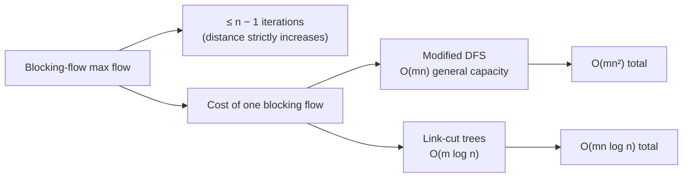

# 1. Blocking-flow recap and the goal for this lecture

## Where we left off

- **Blocking-flow max flow** (from the previous lecture): repeat { find a blocking flow `f` in the level graph, augment by `f` } until there is no `s`–`t` path left in the residual graph [`1:00`](https://www.youtube.com/watch?v=HFqO_8Eoc1U&t=60).
- Total cost = (number of iterations) × (cost of one blocking flow) + `O(m)` for the augmentation, and the blocking-flow term dominates the `m` [`1:50`](https://www.youtube.com/watch?v=HFqO_8Eoc1U&t=110).
- **At most `n − 1` iterations**, because augmenting by a blocking flow strictly increases the `s`–`t` distance by at least one [`2:18`](https://www.youtube.com/watch?v=HFqO_8Eoc1U&t=138).
- With the plain modified-DFS blocking-flow routine, one blocking flow costs `O(mn)` in the general-capacity case [`2:18`](https://www.youtube.com/watch?v=HFqO_8Eoc1U&t=138).

## The claim this lecture delivers

- **Link-cut trees** (Sleator–Tarjan, *JCSS* 1983) find a blocking flow in **`O(m log n)`** [`2:39`](https://www.youtube.com/watch?v=HFqO_8Eoc1U&t=159).
- They are a general-purpose data structure with other applications, some of which appear on the final problem set [`2:39`](https://www.youtube.com/watch?v=HFqO_8Eoc1U&t=159).
- Only the **general-capacity** case needs speeding up — unit-capacity blocking flow was already `O(m)` [`5:07`](https://www.youtube.com/watch?v=HFqO_8Eoc1U&t=307).
- Also on the syllabus for the following class: min-cost max flow [`0:14`](https://www.youtube.com/watch?v=HFqO_8Eoc1U&t=14).

