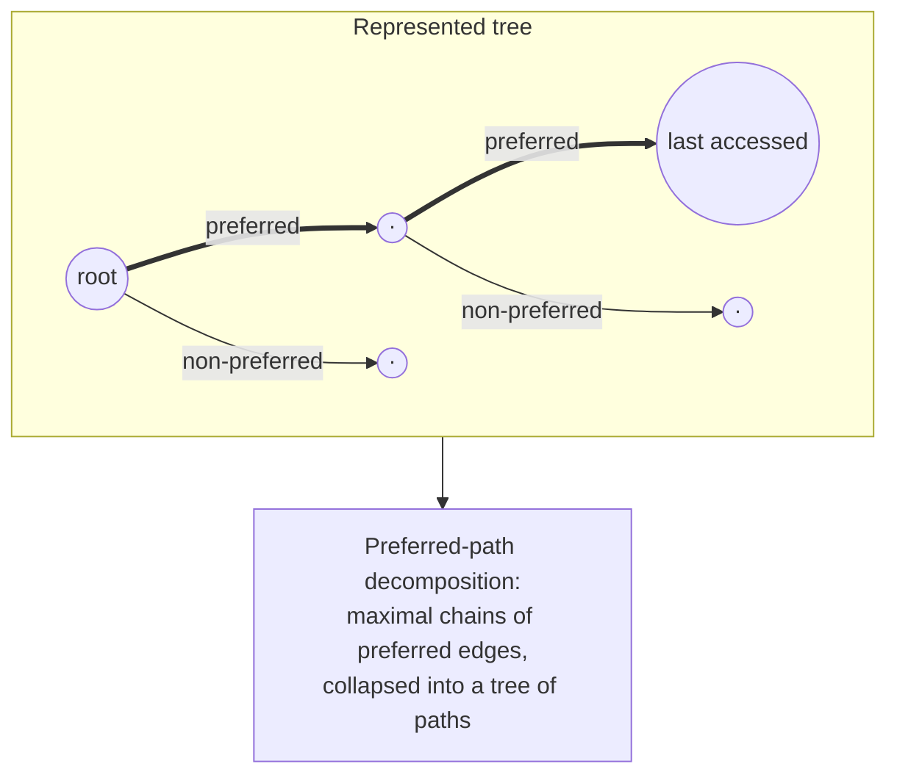

# 6. Preferred-path decomposition

Each represented tree is carved into paths driven by **which node was accessed most recently** [`42:15`](https://www.youtube.com/watch?v=HFqO_8Eoc1U&t=2535).

## Definitions

- **Preferred child of `v`**:
  - `none` — if `v` itself was the **last node accessed** in `v`'s subtree [`43:11`](https://www.youtube.com/watch?v=HFqO_8Eoc1U&t=2591), [`44:58`](https://www.youtube.com/watch?v=HFqO_8Eoc1U&t=2698);
  - otherwise, the child whose subtree **contains** the last accessed node in `v`'s subtree [`43:11`](https://www.youtube.com/watch?v=HFqO_8Eoc1U&t=2591), [`43:54`](https://www.youtube.com/watch?v=HFqO_8Eoc1U&t=2634).
- Every vertex except a leaf has a preferred child, unless the "none" rule applies [`42:15`](https://www.youtube.com/watch?v=HFqO_8Eoc1U&t=2535), [`46:23`](https://www.youtube.com/watch?v=HFqO_8Eoc1U&t=2783).
- **Preferred edge** = an edge leading to a preferred child [`46:49`](https://www.youtube.com/watch?v=HFqO_8Eoc1U&t=2809).
- **Preferred path** = a **maximal chain** of preferred edges [`47:32`](https://www.youtube.com/watch?v=HFqO_8Eoc1U&t=2852).
- **Preferred-path decomposition** = collapse each preferred path to a single node; what remains is a **tree on the preferred paths**, joined by the non-preferred edges [`47:32`](https://www.youtube.com/watch?v=HFqO_8Eoc1U&t=2852), [`48:22`](https://www.youtube.com/watch?v=HFqO_8Eoc1U&t=2902), [`48:58`](https://www.youtube.com/watch?v=HFqO_8Eoc1U&t=2938).

## The rule, applied

- Walk from the root to the last-accessed node: at each vertex, the preferred child is the one that is an **ancestor of (or is) the last accessed node** [`44:27`](https://www.youtube.com/watch?v=HFqO_8Eoc1U&t=2667).
- The last-accessed node itself terminates its path — it has no preferred child [`44:58`](https://www.youtube.com/watch?v=HFqO_8Eoc1U&t=2698).
- The rule is **local to each subtree**, so many nodes may simultaneously have no preferred child [`46:23`](https://www.youtube.com/watch?v=HFqO_8Eoc1U&t=2783).

- The link-cut tree **explicitly maintains** this decomposition [`48:58`](https://www.youtube.com/watch?v=HFqO_8Eoc1U&t=2938).
