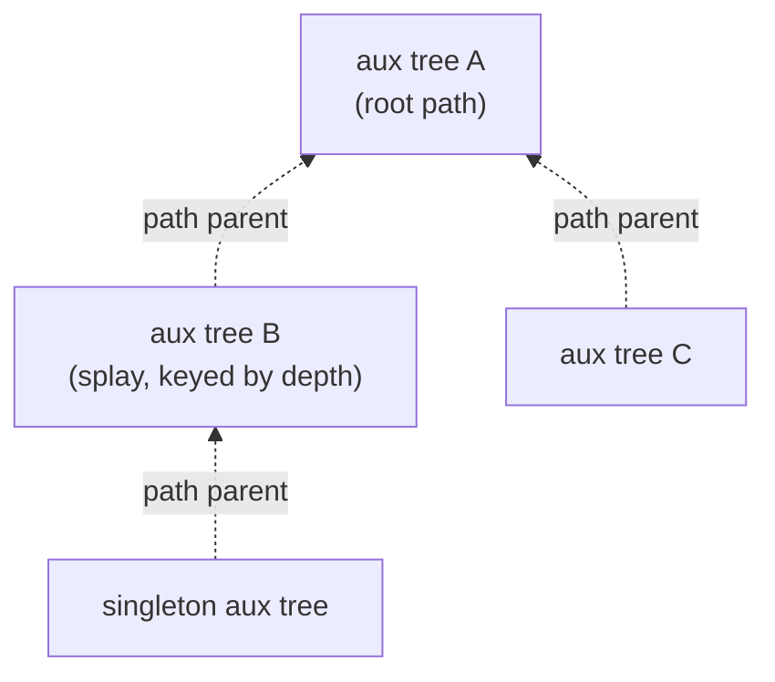

# 7. The representation: auxiliary splay trees and path-parent pointers

## Vocabulary

| Term | Meaning |
| --- | --- |
| **Represented tree** `T` | The actual tree the link-cut tree is maintaining (a fragment of the level graph) [`53:00`](https://www.youtube.com/watch?v=HFqO_8Eoc1U&t=3180), [`53:45`](https://www.youtube.com/watch?v=HFqO_8Eoc1U&t=3225) |
| **Auxiliary tree** (aux tree) | The splay tree storing **one preferred path** [`53:00`](https://www.youtube.com/watch?v=HFqO_8Eoc1U&t=3180) |
| **Path-parent pointer** | Stored at the **root of each aux tree**; points at the represented-tree parent of the **top node of that path** [`51:56`](https://www.youtube.com/watch?v=HFqO_8Eoc1U&t=3116), [`53:45`](https://www.youtube.com/watch?v=HFqO_8Eoc1U&t=3225), [`55:15`](https://www.youtube.com/watch?v=HFqO_8Eoc1U&t=3315) |

## How the paths are stored

- Each preferred path lives in a **splay tree keyed by depth**: a node higher in the represented tree has a **smaller key** [`50:43`](https://www.youtube.com/watch?v=HFqO_8Eoc1U&t=3043), [`51:11`](https://www.youtube.com/watch?v=HFqO_8Eoc1U&t=3071).
  - Consequence used everywhere: within an aux tree, the **left subtree = ancestors**, the **right subtree = descendants** [`1:03:08`](https://www.youtube.com/watch?v=HFqO_8Eoc1U&t=3788), [`1:03:29`](https://www.youtube.com/watch?v=HFqO_8Eoc1U&t=3809).
- A balanced BST would work and give `O(log² n)`; splay trees are used to reach `O(log n)` [`50:07`](https://www.youtube.com/watch?v=HFqO_8Eoc1U&t=3007), [`50:18`](https://www.youtube.com/watch?v=HFqO_8Eoc1U&t=3018).
- The result is a **tree of trees**: aux trees linked upward by path-parent pointers, which encode the non-preferred edges [`52:38`](https://www.youtube.com/watch?v=HFqO_8Eoc1U&t=3158), [`53:00`](https://www.youtube.com/watch?v=HFqO_8Eoc1U&t=3180), [`55:15`](https://www.youtube.com/watch?v=HFqO_8Eoc1U&t=3315).
- Even a single vertex forms its **own singleton aux tree** with its own path-parent pointer [`52:38`](https://www.youtube.com/watch?v=HFqO_8Eoc1U&t=3158), [`56:12`](https://www.youtube.com/watch?v=HFqO_8Eoc1U&t=3372).

## Pointers go **up only**

- The child aux tree remembers its parent in the represented tree; the parent aux tree **does not** remember what hangs off it — and never needs to [`56:12`](https://www.youtube.com/watch?v=HFqO_8Eoc1U&t=3372), [`56:45`](https://www.youtube.com/watch?v=HFqO_8Eoc1U&t=3405).

- **Aux trees are keyed by depth, not by capacity**; capacities are carried as augmented values (see topic 9) [`50:43`](https://www.youtube.com/watch?v=HFqO_8Eoc1U&t=3043).
