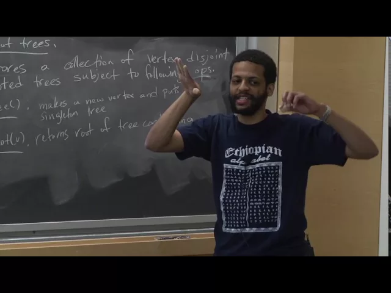
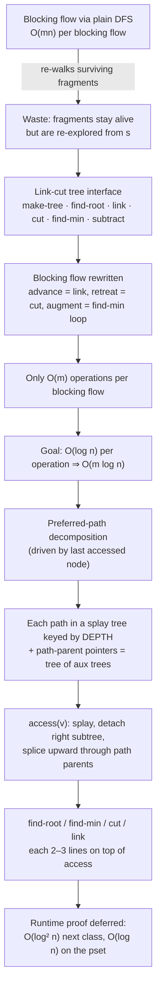

# Advanced Algorithms (COMPSCI 224), Lecture 22

*Harvard University · 1:20:15 · [Watch on YouTube](https://www.youtube.com/watch?v=HFqO_8Eoc1U)*

## Summary

A lecture devoted almost entirely to **link-cut trees** (Sleator–Tarjan, *JCSS* 1983) and their use as the accelerator inside the blocking-flow max-flow algorithm. Jelani Nelson starts from the waste in the previous lecture's routine — after each augment, the plain DFS re-walks surviving path fragments from `s` — and derives the data-structure interface that fixes it: a forest of vertex-disjoint rooted trees supporting `make-tree`, `find-root`, `link`, `cut`, `find-min`, and `subtract`. He rewrites blocking flow on top of that interface (finding and patching a live bug along the way), counts the calls to show only `O(m)` operations are needed per blocking flow, and then builds the structure itself: a **preferred-path decomposition** of each represented tree, each path stored in a **splay tree keyed by depth**, joined by **path-parent pointers**. The bulk of the second half is the `access(v)` helper — splay, detach the right subtree, then walk up splicing aux trees — from which `find-root`, `find-min`, `cut`, and `link` each follow in two or three lines; the running-time proof is deferred.

## Topics

1. [Blocking-flow recap and the goal for this lecture](01-blocking-flow-recap-and-the-goal.md)
2. [Why the plain DFS is wasteful: surviving fragments](02-why-the-plain-dfs-is-wasteful.md)
3. [The link-cut tree interface](03-the-link-cut-tree-interface.md)
4. [Blocking flow written on top of link-cut trees](04-blocking-flow-on-top-of-link-cut-trees.md)
5. [Counting the operations: why `O(m log n)` is the target](05-counting-operations-and-the-target-bound.md)
6. [Preferred-path decomposition](06-preferred-path-decomposition.md)
7. [The representation: auxiliary splay trees and path-parent pointers](07-auxiliary-splay-trees-and-path-parent-pointers.md)
8. [`access(v)` — the one helper every operation is built on](08-the-access-operation.md)
9. [Implementing every operation via `access`](09-implementing-the-operations-via-access.md)

## Key takeaways

- **Link-cut trees find a blocking flow in `O(m log n)`**, down from `O(mn)` for the plain modified-DFS routine in the general-capacity case; with at most `n − 1` blocking-flow iterations this is the `O(mn log n)` max-flow bound [`2:39`](https://www.youtube.com/watch?v=HFqO_8Eoc1U&t=159), [`2:18`](https://www.youtube.com/watch?v=HFqO_8Eoc1U&t=138).
- **Only `O(m)` link-cut operations are needed per blocking flow**, because the loop's three cases are each charged to an edge: links explore an edge for the first time (≤ `m`), cuts delete an edge (≤ `m`), and every `find-min` in an augment's cleanup except possibly the last deletes an edge (≤ `m` in aggregate) — so `O(log n)` per operation is exactly what suffices [`39:39`](https://www.youtube.com/watch?v=HFqO_8Eoc1U&t=2379), [`39:53`](https://www.youtube.com/watch?v=HFqO_8Eoc1U&t=2393), [`40:12`](https://www.youtube.com/watch?v=HFqO_8Eoc1U&t=2412), [`40:31`](https://www.youtube.com/watch?v=HFqO_8Eoc1U&t=2431).
- **The leftover fragments are trees, not paths** — once a middle edge saturates the survivor branches — which is why the structure maintains a forest of vertex-disjoint rooted trees rather than a set of paths [`8:40`](https://www.youtube.com/watch?v=HFqO_8Eoc1U&t=520), [`9:14`](https://www.youtube.com/watch?v=HFqO_8Eoc1U&t=554), [`9:47`](https://www.youtube.com/watch?v=HFqO_8Eoc1U&t=587).
- **The forest never becomes a DAG** because the algorithm always calls `find-root(s)` first and follows an existing path to its end before exploring a new one — and the underlying level graph is a DAG anyway [`12:16`](https://www.youtube.com/watch?v=HFqO_8Eoc1U&t=736), [`14:38`](https://www.youtube.com/watch?v=HFqO_8Eoc1U&t=878), [`15:18`](https://www.youtube.com/watch?v=HFqO_8Eoc1U&t=918).
- **The design trick: store unbalanced represented trees inside balanced BSTs** — decompose each tree into preferred paths and keep each path in a splay tree **keyed by depth**, connected by path-parent pointers. Plain balanced BSTs give `O(log² n)`; splay trees are what buy `O(log n)` [`37:49`](https://www.youtube.com/watch?v=HFqO_8Eoc1U&t=2269), [`50:07`](https://www.youtube.com/watch?v=HFqO_8Eoc1U&t=3007), [`50:43`](https://www.youtube.com/watch?v=HFqO_8Eoc1U&t=3043).
- **`access(v)` is the whole data structure**: it makes the root-to-`v` path preferred by splaying `v`, converting its right subtree into a separately-rooted aux tree, then repeatedly splaying the path-parent `w` and swapping `w`'s old right subtree for `v`'s path. Its cost is the **number of preferred-child changes** on the way up — the quantity the amortized analysis must bound [`1:02:18`](https://www.youtube.com/watch?v=HFqO_8Eoc1U&t=3738), [`1:03:29`](https://www.youtube.com/watch?v=HFqO_8Eoc1U&t=3809), [`1:05:43`](https://www.youtube.com/watch?v=HFqO_8Eoc1U&t=3943), [`1:11:59`](https://www.youtube.com/watch?v=HFqO_8Eoc1U&t=4319).
- **Two interface details do real work**: `find-min` breaking ties **toward the root** is what makes the augment cleanup loop correct, and the `add-flow` operation is **redundant** — flows are recoverable at the end from capacity deltas [`17:14`](https://www.youtube.com/watch?v=HFqO_8Eoc1U&t=1034), [`31:39`](https://www.youtube.com/watch?v=HFqO_8Eoc1U&t=1899), [`20:40`](https://www.youtube.com/watch?v=HFqO_8Eoc1U&t=1240).
- **Runtime proof is deferred**: `O(log² n)` amortized next class, `O(log n)` assigned with a hint on the final problem set, and a worst-case (non-amortized) `O(log n)` variant exists in the original paper at the cost of a more complicated structure [`41:07`](https://www.youtube.com/watch?v=HFqO_8Eoc1U&t=2467), [`1:18:59`](https://www.youtube.com/watch?v=HFqO_8Eoc1U&t=4739).
