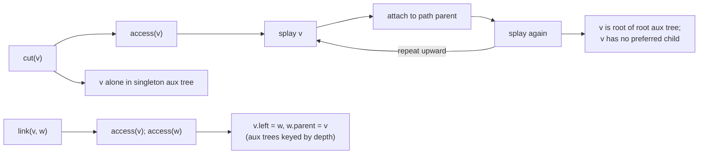

# 2. Link-cut tree operations: recap of `access`, `cut`, `link`

The data structure keeps a **represented tree** decomposed into **preferred paths**, each stored in an **auxiliary (aux) tree** — a BST keyed by depth [`3:03`](https://www.youtube.com/watch?v=nDLe6_sPSfs&t=183), [`6:18`](https://www.youtube.com/watch?v=nDLe6_sPSfs&t=378).

## `access(v)`

- Makes `v` the root of the **root aux tree** of the tree of aux trees [`3:03`](https://www.youtube.com/watch?v=nDLe6_sPSfs&t=183).
- Implementation: repeatedly **splay `v`**, connect it to its **path parent**, splay again to make it the root of that aux tree, and walk upward [`3:41`](https://www.youtube.com/watch?v=nDLe6_sPSfs&t=221).
- After an access, **`v` has no preferred child** — it was the last vertex touched in its subtree — so in its aux tree it has **no right children** [`4:12`](https://www.youtube.com/watch?v=nDLe6_sPSfs&t=252), [`4:32`](https://www.youtube.com/watch?v=nDLe6_sPSfs&t=272).

## `cut(v)`

- Starts with `access(v)` [`3:41`](https://www.youtube.com/watch?v=nDLe6_sPSfs&t=221).
- Detaches `v` from its parent; afterwards **`v` sits alone in a singleton aux tree**, with `v.parent = none` and its left pointer cleared [`4:55`](https://www.youtube.com/watch?v=nDLe6_sPSfs&t=295).

## `link(v, w)`

- Precondition: `v` is the **root of its represented tree**, `w` lives in a **different** represented tree; afterwards `w` is `v`'s parent [`5:27`](https://www.youtube.com/watch?v=nDLe6_sPSfs&t=327).
- Implementation: `access(v)`, `access(w)` — both become roots of their respective trees of aux trees — then **splice `w` in as `v`'s left child** (`v.left = w`, `w.parent = v`) [`5:27`](https://www.youtube.com/watch?v=nDLe6_sPSfs&t=327), [`5:48`](https://www.youtube.com/watch?v=nDLe6_sPSfs&t=348).
- **Why left?** Aux trees are keyed by depth; `w` is `v`'s parent in the represented tree, so `w`'s depth is one less and it belongs in the left subtree [`6:18`](https://www.youtube.com/watch?v=nDLe6_sPSfs&t=378).

## Scope of the analysis

- Only `access`, `link`, `cut` are analyzed. The other operations (`find root`, `find min`, …) "require the least work" and are left to the reader [`4:55`](https://www.youtube.com/watch?v=nDLe6_sPSfs&t=295), [`41:03`](https://www.youtube.com/watch?v=nDLe6_sPSfs&t=2463).

