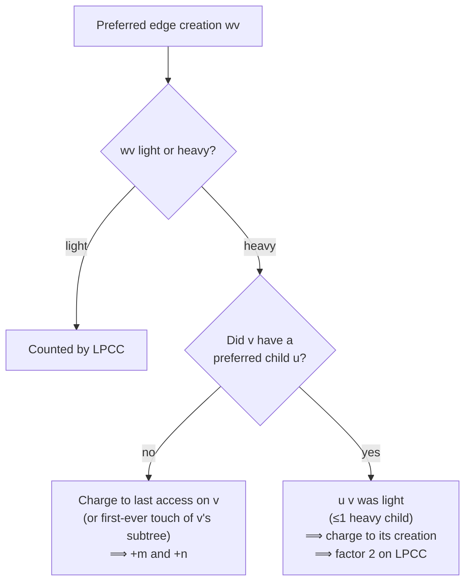

# 5. Bounding `PCC` by light preferred child creations

## The claim

> `PCC ≤ 2 · LPCC + m + n`

where **`LPCC`** = number of **light preferred (child) edge creations**. The name uses "child" only so the acronym lines up [`16:15`](https://www.youtube.com/watch?v=nDLe6_sPSfs&t=975), [`16:52`](https://www.youtube.com/watch?v=nDLe6_sPSfs&t=1012).

## Setup

Every preferred-edge creation is either a **light creation** or a **heavy creation** [`16:52`](https://www.youtube.com/watch?v=nDLe6_sPSfs&t=1012). Scenario: `v` had preferred child `u`; an access happens somewhere in `w`'s subtree, so `uv` is destroyed and `wv` is created [`17:41`](https://www.youtube.com/watch?v=nDLe6_sPSfs&t=1061), [`18:07`](https://www.youtube.com/watch?v=nDLe6_sPSfs&t=1087).

## Case A — `wv` is light

- Counted directly by the `LPCC` term. Done [`19:02`](https://www.youtube.com/watch?v=nDLe6_sPSfs&t=1142).

## Case B1 — `wv` is heavy, and `v` had **no** preferred child before

Why can `v` have no preferred child? Either [`19:33`](https://www.youtube.com/watch?v=nDLe6_sPSfs&t=1173), [`20:05`](https://www.youtube.com/watch?v=nDLe6_sPSfs&t=1205), [`20:41`](https://www.youtube.com/watch?v=nDLe6_sPSfs&t=1241):

- this is the **first ever access in `v`'s subtree** — happens at most **`n`** times overall (the `+n` term); or
- the **last access in `v`'s subtree was to `v` itself**; or
- the previous preferred child was **cut off**. The lecturer then observes that after a `cut`, `v` is anyway the last access in its subtree, so this collapses into the previous case [`21:30`](https://www.youtube.com/watch?v=nDLe6_sPSfs&t=1290), [`23:38`](https://www.youtube.com/watch?v=nDLe6_sPSfs&t=1418).

**Charging argument** [`21:49`](https://www.youtube.com/watch?v=nDLe6_sPSfs&t=1309), [`22:11`](https://www.youtube.com/watch?v=nDLe6_sPSfs&t=1331), [`22:52`](https://www.youtube.com/watch?v=nDLe6_sPSfs&t=1372):

- Hand each access **one dollar** when it finishes.
- A heavy creation at `v` in this case is charged to **the last access on `v`**.
- Each access is charged **at most once**: the next time `v` is seen it already has a preferred child (namely `w`) — unless a new access intervened, and that access absorbs the charge instead [`23:14`](https://www.youtube.com/watch?v=nDLe6_sPSfs&t=1394), [`25:56`](https://www.youtube.com/watch?v=nDLe6_sPSfs&t=1556).
- With `m` operations, this contributes an additive **`+m`** [`27:04`](https://www.youtube.com/watch?v=nDLe6_sPSfs&t=1624).

## Case B2 — `wv` is heavy, and `v` **did** have a preferred child `u`

- Since a vertex has **at most one heavy child**, and `wv` is heavy, `uv` must have been **light** [`24:37`](https://www.youtube.com/watch?v=nDLe6_sPSfs&t=1477).
- So this heavy creation coincides with **destroying a preferred light edge**. A light preferred edge can only be destroyed once per creation, so **charge the destruction to its creation** — this is exactly the **factor of 2** in front of `LPCC` [`25:29`](https://www.youtube.com/watch?v=nDLe6_sPSfs&t=1529).

