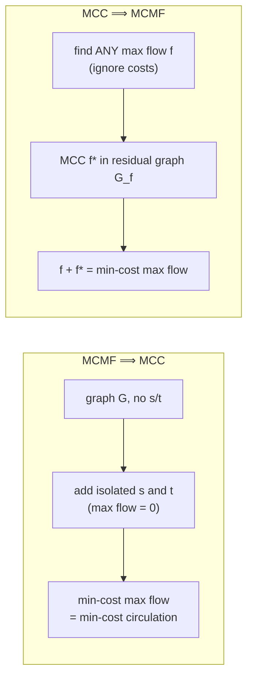

# 9. Min-cost circulation and its equivalence with min-cost max flow

## Definition

- A **circulation** is a flow `f` with `inflow(v) = outflow(v)` **for every** `v` — no source, no sink, flow just moves around in cycles [`52:34`](https://www.youtube.com/watch?v=nDLe6_sPSfs&t=3154).
- Even with negative-cost cycles the problem is **not unbounded**, because capacities cap how much flow a cycle can carry [`55:25`](https://www.youtube.com/watch?v=nDLe6_sPSfs&t=3325).

## Claim

> **Min-cost max flow (MCMF)** and **min-cost circulation (MCC)** efficiently reduce to each other — so it suffices to solve one [`53:29`](https://www.youtube.com/watch?v=nDLe6_sPSfs&t=3209).

## MCMF ⟹ MCC (the easy direction)

- MCC has no source/sink, but MCMF's interface demands them. **Add an isolated `s` and an isolated `t`, connected to nothing** [`55:59`](https://www.youtube.com/watch?v=nDLe6_sPSfs&t=3359), [`56:18`](https://www.youtube.com/watch?v=nDLe6_sPSfs&t=3378).
- Then the max flow value is **0**, every `s`–`t` flow in that graph *is* a circulation, and the min-cost max flow is exactly the min-cost circulation [`56:18`](https://www.youtube.com/watch?v=nDLe6_sPSfs&t=3378).

## MCC ⟹ MCMF (the harder direction)

**Naive attempt**, from a student: add a `t → s` edge, and repeatedly increase its capacity as long as it stays saturated. Works, but costs a number of MCC calls proportional to the **max flow value** [`56:53`](https://www.youtube.com/watch?v=nDLe6_sPSfs&t=3413), [`57:42`](https://www.youtube.com/watch?v=nDLe6_sPSfs&t=3462).

**Why it needs care** — the lecturer retracts his own endorsement: the MCC subroutine **has no incentive to use the `t → s` edge at all**; it will happily pick some cheaper cycle elsewhere and produce no max flow [`58:22`](https://www.youtube.com/watch?v=nDLe6_sPSfs&t=3502), [`58:58`](https://www.youtube.com/watch?v=nDLe6_sPSfs&t=3538).

**Two working fixes** [`59:27`](https://www.youtube.com/watch?v=nDLe6_sPSfs&t=3567), [`59:50`](https://www.youtube.com/watch?v=nDLe6_sPSfs&t=3590), [`1:00:24`](https://www.youtube.com/watch?v=nDLe6_sPSfs&t=3624):

1. Add a `t → s` edge with **very negative cost and infinite capacity**, so the algorithm is forced to use it.
2. **Max flow + MCC** — one MCC call:
   - find **any** max flow `f`, ignoring costs entirely;
   - find the **min-cost circulation `f*` in the residual graph** of `f`;
   - **add it back** to `f`.

**Why fix 2 is correct**: the **difference of any two `s`–`t` flows of the same value is a circulation** [`1:00:24`](https://www.youtube.com/watch?v=nDLe6_sPSfs&t=3624). So if `f★` is the true min-cost max flow, `f★ − f` is a valid circulation in the residual graph; finding it and adding it back recovers `f★` [`1:01:10`](https://www.youtube.com/watch?v=nDLe6_sPSfs&t=3670).

