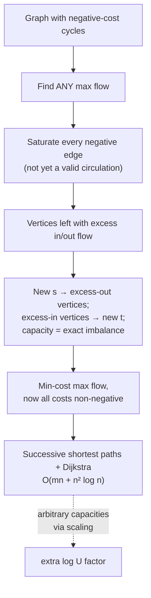

# 12. Faster min-cost max flow: successive shortest paths (unit capacities)

## The simplified setting

- **No negative-cost cycles**, **all capacities equal 1**, and — simplifying further — **no negative-cost edges at all** [`1:16:49`](https://www.youtube.com/watch?v=nDLe6_sPSfs&t=4609).

## The algorithm

> Repeatedly **find the shortest `s`–`t` path in the residual graph, using costs as edge lengths, and augment along it** [`1:17:52`](https://www.youtube.com/watch?v=nDLe6_sPSfs&t=4672).

## Runtime

- **At most `n` iterations** [`1:19:13`](https://www.youtube.com/watch?v=nDLe6_sPSfs&t=4753).
- **Dijkstra** is usable in each iteration — `O(m log n)`, or with **Fibonacci heaps** `O(m + n log n)` [`1:19:13`](https://www.youtube.com/watch?v=nDLe6_sPSfs&t=4753), [`1:19:43`](https://www.youtube.com/watch?v=nDLe6_sPSfs&t=4783).
- ⇒ **Total: `O(mn + n² log n)`** [`1:19:43`](https://www.youtube.com/watch?v=nDLe6_sPSfs&t=4783).
- **Strongly polynomial** in the unit-capacity case — no `mUC` dependence [`1:26:08`](https://www.youtube.com/watch?v=nDLe6_sPSfs&t=5168).

## The catch, and the proof that fixes it

Dijkstra needs non-negative edges. Residual graphs **negate costs on reverse edges**, so non-negativity is **not a priori preserved** [`1:19:13`](https://www.youtube.com/watch?v=nDLe6_sPSfs&t=4753), [`1:19:43`](https://www.youtube.com/watch?v=nDLe6_sPSfs&t=4783).

**Claim**: no **negative reduced cost** ever appears in the residual graph — this, not raw cost, is the right invariant [`1:23:14`](https://www.youtube.com/watch?v=nDLe6_sPSfs&t=4994).

**Proof** [`1:20:38`](https://www.youtube.com/watch?v=nDLe6_sPSfs&t=4838), [`1:22:12`](https://www.youtube.com/watch?v=nDLe6_sPSfs&t=4932), [`1:22:52`](https://www.youtube.com/watch?v=nDLe6_sPSfs&t=4972), [`1:23:41`](https://www.youtube.com/watch?v=nDLe6_sPSfs&t=5021):

1. Set `p(v)` = shortest-path distance from `s` to `v` in the residual graph.
2. We only ever augment along **shortest paths**. If `uv` lies on a shortest path, then `d(v) = d(u) + c(uv)`.
3. Substituting into `c_p(uv) = c(uv) + p(u) − p(v)` gives **reduced cost exactly 0**.
4. Capacities are 1, so augmenting **saturates** `uv`, and the **reverse edge** enters the residual graph with reduced cost `−0 = 0`.
5. ⇒ Every newly added residual edge is the reverse of a saturated edge, hence has **reduced cost 0** — never negative.

## Loose ends (deferred to the scribe notes)

The lecturer runs out of time and promises to finish the argument in the notes [`1:23:41`](https://www.youtube.com/watch?v=nDLe6_sPSfs&t=5021), [`1:26:36`](https://www.youtube.com/watch?v=nDLe6_sPSfs&t=5196).

**Arbitrary capacities** — handled by **scaling**, a pset problem; costs a **`log U` dependence** [`1:24:26`](https://www.youtube.com/watch?v=nDLe6_sPSfs&t=5066), [`1:26:08`](https://www.youtube.com/watch?v=nDLe6_sPSfs&t=5168).

**Graphs that do have negative cycles** — reduce to the non-negative case [`1:24:26`](https://www.youtube.com/watch?v=nDLe6_sPSfs&t=5066), [`1:24:57`](https://www.youtube.com/watch?v=nDLe6_sPSfs&t=5097), [`1:25:19`](https://www.youtube.com/watch?v=nDLe6_sPSfs&t=5119), [`1:25:45`](https://www.youtube.com/watch?v=nDLe6_sPSfs&t=5145):

1. Find any max flow; the remaining task is a min-cost circulation.
2. **Forget cycles** — take **any negative edge and fully saturate it** with flow.
3. That breaks conservation: some vertices now have excess inflow, others excess outflow.
4. Repair it by adding a **new source and sink**: connect `s` to every vertex that must push flow out, connect every vertex that must absorb flow to `t`, with **capacities equal to exactly the required imbalance**.
5. Solve **min-cost max flow on that graph** — which now has **only non-negative costs**, so the shortest-path algorithm above applies.

